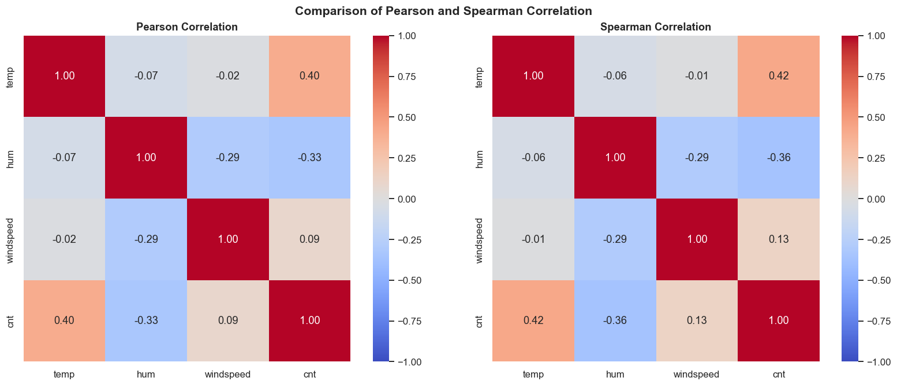
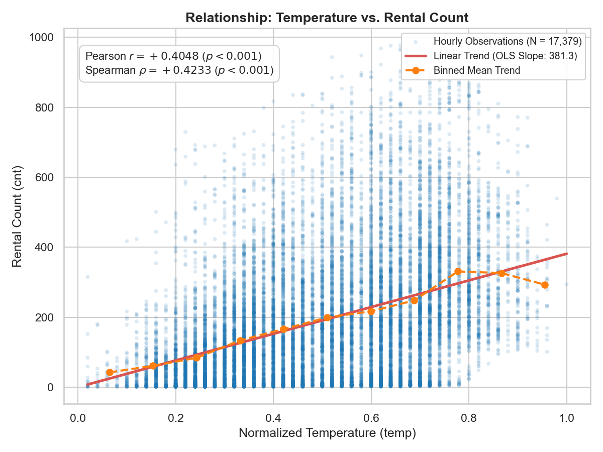
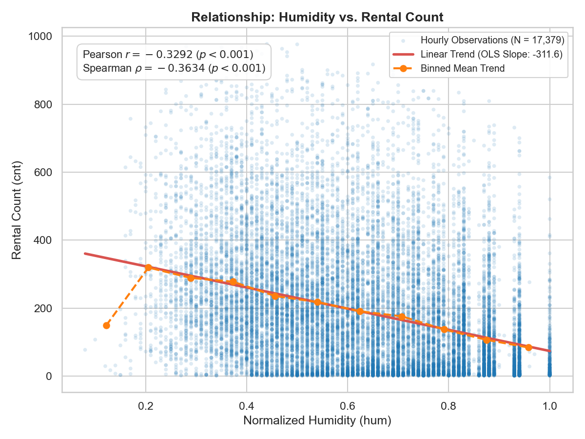
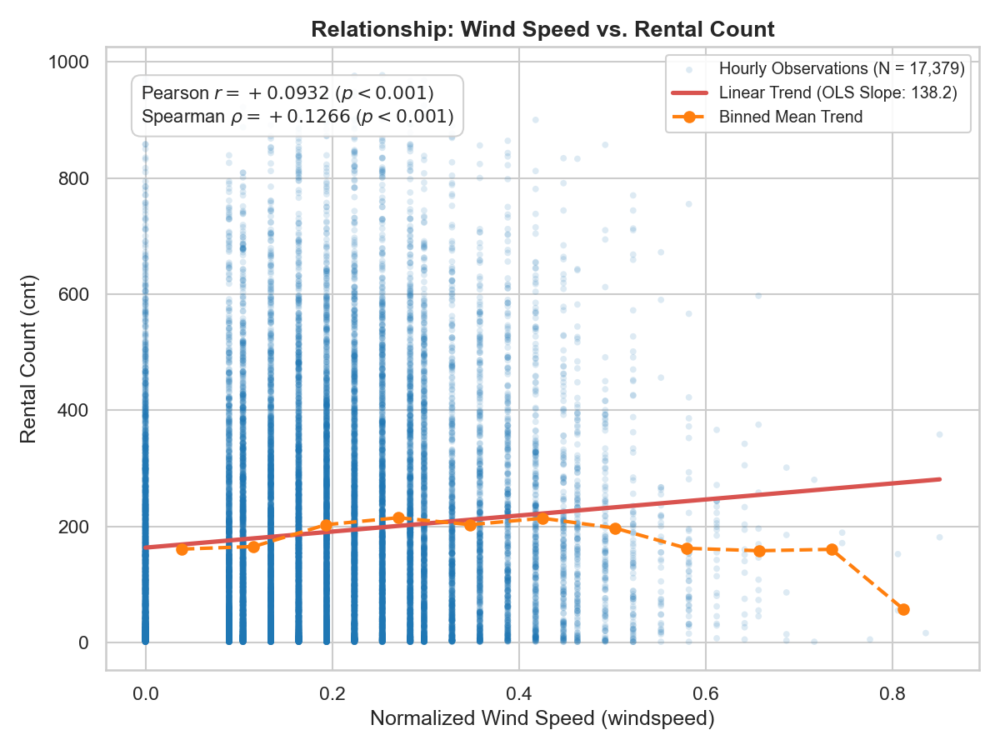
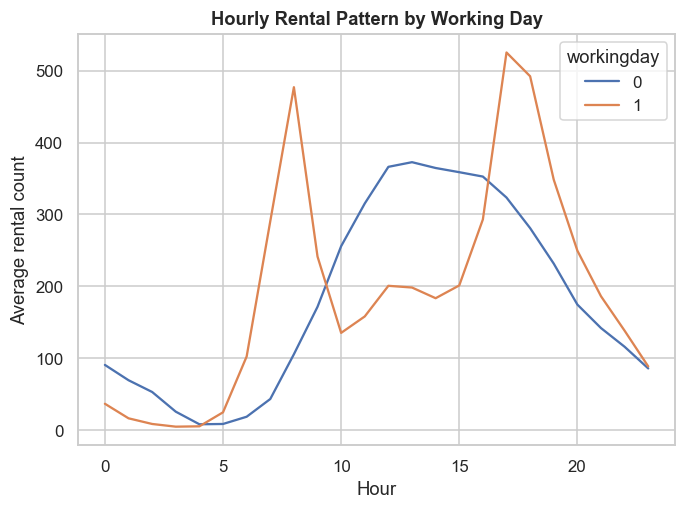

# CHƯƠNG 4. Phân tích tương quan giữa các biến

## 4.1. Lý thuyết 

### 4.1.1. Phân tích tương quan Pearson ($r$) - Quan hệ tuyến tính

**Định nghĩa:**

Hệ số tương quan Pearson được dùng để đo lường mức độ và chiều hướng của mối quan hệ **tương quan tuyến tính** (linear relationship) giữa hai biến định lượng.
Hệ số Pearson được tính bằng cách chia **hiệp phương sai** (covariance) của hai biến định lượng cho tích **độ lệch chuẩn** (standard deviation) của từng biến.

**Ý nghĩa:**

Hệ số tương quan Pearson nằm trong khoảng: $$-1 \leq r \leq 1$$

Với:

- $r < 0$: quan hệ tương quan tuyến tính **âm**
- $r > 0$: quan hệ tương quan tuyến tính **dương**
- $r \approx 0$: **Không có hoặc rất ít** tương quan tuyến tính
- $|r|$ càng **gần 1** -> Mối quan hệ càng **mạnh**
- $|r|$ càng **gần 0** -> Mối quan hệ càng **yếu**

**Công thức tính:**
$$r = \frac{\sum(x_i - \bar{x})(y_i - \bar{y})}{\sqrt{\sum(x_i - \bar{x})^2 \sum(y_i - \bar{y})^2}}$$

Với:

- $x_i, y_i$ là giá trị quan sát thứ i của X và Y.
- $\bar{x}, \bar{y}$ lần lượt là giá trị trung bình của biến X và biến Y.

**Điều kiện áp dụng:**
- Biến định lượng: Pearson phù hợp để đánh giá mối quan hệ giữa hai biến định lượng.
- Quan hệ tuyến tính: Pearson đo lường mối quan hệ tuyến tính, do đó nên kiểm tra scatter plot trước khi sử dụng.
- Không có outlier nghiêm trọng: Pearson khá nhạy cảm với các giá trị ngoại lệ (outliers), vì vậy outlier có thể làm thay đổi đáng kể hệ số $r$.
- Phân phối dữ liệu: Phân phối chuẩn không phải điều kiện bắt buộc để tính $r$, nhưng thường được xem xét khi thực hiện các kiểm định suy luận dựa trên Pearson.

### 4.1.2. Phân tích tương quan Spearman ($\rho$ hoặc $r_s$) - Quan hệ đơn điệu & thứ bậc

**Định nghĩa:**
Hệ số tương quan Spearman ($\rho$ hoặc $r_s$) là một phương pháp tương quan phi tham số (non-parametric), dùng để đo lường mức độ và chiều hướng của mối quan hệ đơn điệu (monotonic relationship) giữa hai biến.

Thay vì sử dụng giá trị thực tế của dữ liệu như Pearson, Spearman chuyển đổi các giá trị quan sát thành thứ hạng (rank), sau đó đánh giá mức độ và chiều hướng tương quan giữa các thứ hạng.

**Ý nghĩa:**

Giống như Pearson, hệ số tương quan Spearman cũng nằm trong khoảng: $$-1 \leq \rho \leq 1$$

Với:
- $\rho < 0$: quan hệ tương quan đơn điệu **âm**
- $\rho > 0$: quan hệ tương quan đơn điệu **dương**
- $\rho \approx 0$: **Không có hoặc rất ít** tương quan đơn điệu
- $|\rho|$ càng **gần 1** -> Mối quan hệ càng **mạnh**
- $|\rho|$ càng **gần 0** -> Mối quan hệ càng **yếu**

**Công thức tính:**

Khi không có tied ranks, có thể sử dụng công thức dựa trên sự chênh lệch thứ hạng $d_i$.

$$\rho = 1 - \frac{6\sum{d_i^2}}{n(n^2 - 1)}$$

Với:
- $d_i = \text{rg}(x_i) - \text{rg}(y_i)$ là sự chênh lệch giữa thứ hạng của $x_i$ và $y_i$
- $n$ là tổng số lượng quan sát.

Khi dữ liệu có tied ranks, hệ số Spearman có thể được tính bằng cách áp dụng công thức tương quan Pearson trên các thứ hạng của dữ liệu.

$$\rho = \frac{\sum_{i=1}^{n} (R(x_i) - \bar{R}_x)(R(y_i) - \bar{R}_y)}{\sqrt{\sum_{i=1}^{n} (R(x_i) - \bar{R}_x)^2 \sum_{i=1}^{n} (R(y_i) - \bar{R}_y)^2}}$$

Với:
- $R(x_i), R(y_i)$ là thứ hạng (rank) của các quan sát $x_i$ và $y_i$.
- $\bar{R}_x, \bar{R}_y$ là thứ hạng trung bình của tập $X$ và $Y$.

**Điều kiện áp dụng:**
- Loại dữ liệu linh hoạt: Thích hợp cho cả biến định lượng liên tục và biến thứ bậc (ordinal variables)
- Mối quan hệ đơn điệu: Mối quan hệ giữa hai biến không bắt buộc phải là đường thẳng, chỉ cần tăng hoặc giảm đồng điệu.
- Không yêu cầu phân phối chuẩn: Phù hợp với dữ liệu bị lệch (skewed) hoặc không tuân theo phân phối chuẩn.
- Ít bị ảnh hưởng bởi ngoại lai (Outliers): Nhờ cơ chế chuyển sang thứ hạng (rank), Spearman thường ít nhạy cảm với ngoại lai hơn Pearson.

### 4.1.3. So sánh Pearson và Spearman

| Đặc điểm | Pearson | Spearman |
| --- | --- | --- |
| Đo lường | Tuyến tính | Đơn điệu |
| Dữ liệu sử dụng | Giá trị gốc | Thứ hạng |
| Nhạy với ngoại lai | Cao hơn | Thường thấp hơn |
| Bắt quan hệ phi tuyến đơn điệu | Không tốt | Tốt hơn |
| Phù hợp khi | Quan hệ gần tuyến tính | Quan hệ đơn điệu nhưng có thể phi tuyến |

### 4.1.4. Trường hợp mà kết quả Pearson và Spearman khác nhau:
1. **Ngoại lai:** Một vài điểm cực đoan có thể kéo Pearson lên/xuống mạnh hơn Spearman.

2. **Quan hệ phi tuyến nhưng đơn điệu:** Spearman vẫn có thể cao trong khi Pearson không nhất thiết cao tương ứng. VD: 
$$Y = X^2, X > 0$$

3. **Quan hệ không đơn điệu:** Ở đây cả Pearson và Spearman đều có thể không phản ánh tốt cấu trúc quan hệ. VD: 
$$Y=X^2,\quad X\in[-1,1]$$

---

## 4.2. Áp dụng tính toán trên bộ dữ liệu Bike Sharing

### 4.2.1. Lựa chọn tập biến phân tích

Dựa trên kết quả khám phá dữ liệu (EDA), phân tích tương quan chính được thực hiện trên 4 biến định lượng cốt lõi:
- `temp`: Nhiệt độ môi trường (đã chuẩn hóa về đoạn $[0, 1]$).
- `hum`: Độ ẩm không khí (đã chuẩn hóa về đoạn $[0, 1]$).
- `windspeed`: Tốc độ gió (đã chuẩn hóa về đoạn $[0, 1]$).
- `cnt`: Tổng số lượt thuê xe đạp theo giờ (biến mục tiêu chính).

**Các biến bị loại khỏi ma trận tương quan chính và cơ sở lý luận:**
1. **Biến `atemp` (Nhiệt độ cảm nhận):** Có hệ số tương quan tuyến tính Pearson cực kỳ cao với `temp` ($r = 0.9877$, xấp xỉ 1). Điều này cho thấy hai biến mang thông tin gần như trùng lặp hoàn toàn. Việc giữ lại cả hai sẽ gây ra hiện tượng đa cộng tuyến (multicollinearity) nghiêm trọng cho các mô hình hồi quy phía sau. Do đó, loại bỏ `atemp` là bắt buộc.
2. **Biến `casual` và `registered`:** Là hai thành phần cộng gộp cấu thành trực tiếp nên biến mục tiêu ($\text{cnt} = \text{casual} + \text{registered}$). Đưa hai biến này vào phân tích giải thích cho `cnt` sẽ gây ra hiện tượng rò rỉ dữ liệu (data leakage) nghiêm trọng.
3. **Biến thời gian `hr` (Giờ trong ngày):** Do quan hệ giữa `hr` và `cnt` có tính chu kỳ 24 giờ và phi tuyến mạnh, hệ số tương quan đơn lẻ Pearson không thể phản ánh đầy đủ bản chất. Biến `hr` sẽ được phân tích trực quan hóa riêng biệt bằng biểu đồ chuỗi thời gian phân nhóm ở mục 4.3.

---

### 4.2.2. Kết quả tính toán hệ số tương quan

#### Bảng 4.1. Ma trận tương quan Pearson ($r$ - Tuyến tính)
| Biến | temp | hum | windspeed | cnt |
|---|---|---|---|---|
| **temp** | 1.0000 | -0.0730 | -0.0231 | 0.4048 |
| **hum** | -0.0730 | 1.0000 | -0.2893 | -0.3292 |
| **windspeed** | -0.0231 | -0.2893 | 1.0000 | 0.0932 |
| **cnt** | 0.4048 | -0.3292 | 0.0932 | 1.0000 |

*Nhận xét:*
- Cặp có tương quan tuyến tính dương mạnh nhất là `temp – cnt` ($r = 0.4048$): Nhiệt độ tăng đi kèm xu hướng tăng số lượng thuê xe ở mức độ trung bình.
- Cặp có tương quan tuyến tính âm rõ nét nhất là `hum – cnt` ($r = -0.3292$): Độ ẩm không khí tăng có mối liên hệ nghịch biến với nhu cầu thuê xe.
- `windspeed – cnt` có tương quan tuyến tính rất yếu ($r = 0.0932$).
- Giữa các biến độc lập thời tiết, `hum – windspeed` có tương quan âm nhẹ ($r = -0.2893$), các cặp còn lại có hệ số gần bằng 0 ($|r| < 0.08$), cho thấy nguy cơ cộng tuyến giữa các biến thời tiết là rất thấp.

#### Bảng 4.2. Ma trận tương quan Spearman ($\rho$ - Thứ hạng đơn điệu)
| Biến | temp | hum | windspeed | cnt |
|---|---|---|---|---|
| **temp** | 1.0000 | -0.0571 | -0.0097 | 0.4233 |
| **hum** | -0.0571 | 1.0000 | -0.2926 | -0.3634 |
| **windspeed** | -0.0097 | -0.2926 | 1.0000 | 0.1266 |
| **cnt** | 0.4233 | -0.3634 | 0.1266 | 1.0000 |

#### Bảng 4.3. So sánh chênh lệch giữa hệ số Pearson và Spearman
| Cặp biến | Pearson ($r$) | Spearman ($\rho$) | Chênh lệch ($\rho - r$) | $\vert\text{Chênh lệch}\vert$ | Đánh giá tính chất quan hệ |
|---|---|---|---|---|---|
| **hum – cnt** | -0.3292 | -0.3634 | -0.0341 | 0.0341 | Tương quan âm mức yếu đến trung bình; $\vert\rho\vert > \vert r\vert$ do phân phối $cnt$ lệch phải |
| **windspeed – cnt** | 0.0932 | 0.1266 | +0.0334 | 0.0334 | Tương quan dương rất yếu; quan hệ tuyến tính tổng thể không đáng kể |
| **temp – cnt** | 0.4048 | 0.4233 | +0.0186 | 0.0186 | Tương quan dương mức trung bình; hai hệ số đồng thuận cao |
| **temp – hum** | -0.0730 | -0.0571 | +0.0159 | 0.0159 | Tương quan âm rất yếu; gần như độc lập tuyến tính |
| **temp – windspeed** | -0.0231 | -0.0097 | +0.0134 | 0.0134 | Gần như không có quan hệ tương quan |
| **hum – windspeed** | -0.2893 | -0.2926 | -0.0033 | 0.0033 | Tương quan âm mức yếu; hai hệ số gần như trùng khớp hoàn toàn |

*Nhận xét tổng quát:*
Mức chênh lệch tuyệt đối giữa Pearson và Spearman trên toàn bộ các cặp biến đều rất nhỏ ($|\rho - r| \le 0.0341$). Điều này chỉ ra rằng mối quan hệ giữa các biến thời tiết và nhu cầu thuê xe về cơ bản tuân theo dạng đơn điệu tương đối nhất quán, không xuất hiện các điểm ngoại lai cục bộ quá nghiêm trọng làm sai lệch cục diện tương quan tuyến tính.

---

## 4.3. Trực quan hóa mối quan hệ giữa các biến

Nhằm đáp ứng yêu cầu trực quan hóa trực diện mối quan hệ giữa biến mục tiêu (`cnt`) và các biến độc lập, nghiên cứu sử dụng hệ thống biểu đồ chuẩn mực gồm: **Ma trận nhiệt kép (Dual Heatmap)** để quan sát tổng thể mạng lưới tương quan đa biến, **Biểu đồ phân tán kết hợp đường xu hướng hồi quy (Scatter Plot with OLS Trendline & Binned Mean Trend)** cho từng cặp biến thời tiết liên tục (`temp`, `hum`, `windspeed`), và **Biểu đồ đường chuỗi thời gian phân nhóm** cho biến chu kỳ (`hr` × `workingday`). 

Phương pháp này thay thế hoàn toàn dạng biểu đồ Hexbin (vốn có nhược điểm khó đọc giá trị mật độ, che khuất độ dốc tuyến tính và kém thẩm mỹ), mang lại góc nhìn định lượng trực quan, rõ ràng và giàu hàm lượng thông tin thống kê.

---

### 4.3.1. Ma trận nhiệt tương quan kép (Dual Heatmap: Pearson vs Spearman)

> **Hình 4.1. So sánh ma trận nhiệt tương quan Pearson và Spearman**  
> *Mục đích:* Trực quan hóa toàn diện và so sánh đồng thời mối tương quan tuyến tính (Pearson) và tương quan thứ hạng đơn điệu (Spearman) giữa tất cả các cặp biến định lượng (`temp`, `hum`, `windspeed`, `cnt`).  
> *Lý do lựa chọn loại biểu đồ (Dual Heatmap):*  
> 1. **Khả năng tổng hợp đa biến:** Ma trận kích thước $4 \times 4$ chứa 16 giá trị tương quan. Heatmap là công cụ tối ưu nhất trong trực quan hóa dữ liệu để trình bày toàn bộ mạng lưới tương quan đa chiều trong một không gian duy nhất mà không gây rối mắt.  
> 2. **Trực giác hóa cường độ và chiều hướng qua màu sắc:** Việc sử dụng bảng màu phân kỳ đối xứng (`diverging colormap` từ -1.0 đến +1.0 với tâm trung hòa tại 0.0) giúp mắt người đọc lập tức nhận biết được mức độ tác động: sắc đỏ cam thể hiện đồng biến, sắc xanh lam thể hiện nghịch biến, sắc xám nhạt thể hiện quan hệ yếu hoặc không tương quan.  
> 3. **Đối chiếu song song trực tiếp (Side-by-side Subplots):** Đặt hai ma trận cạnh nhau trên cùng một tỉ lệ màu cho phép kiểm tra ngay tính ổn định của mối quan hệ; sự tương đồng về sắc độ màu giữa hai nửa khẳng định tính vững của tương quan trước các giá trị biên.  
> *Nhận xét:* Biểu đồ nhiệt khẳng định `temp` có mối liên hệ dương rõ nét nhất với `cnt` ($r = 0.40, \rho = 0.42$), trong khi `hum` là rào cản nghịch biến lớn nhất ($r = -0.33, \rho = -0.36$). Tốc độ gió `windspeed` giữ sắc độ trung tính nhạt ($r = 0.09, \rho = 0.13$), cho thấy tác động tuyến tính đơn biến không đáng kể.

---

### 4.3.2. Mối quan hệ giữa Nhiệt độ (`temp`) và Nhu cầu thuê xe (`cnt`)

> **Hình 4.2. Phân tán dữ liệu và đường xu hướng giữa Nhiệt độ và Lượt thuê xe**  
> *Mục đích:* Trực quan hóa chi tiết mối quan hệ thực nghiệm giữa nhiệt độ chuẩn hóa (`temp`) và số lượt thuê xe theo giờ (`cnt`), đánh giá mức độ phù hợp của giả định tuyến tính.  
> *Lý do lựa chọn loại biểu đồ (Scatter Plot kết hợp Đường hồi quy OLS và Đường trung bình phân khoảng):*  
> 1. **Khắc phục hiện tượng chồng lấn điểm (Overplotting):** Bộ dữ liệu có quy mô lớn ($N = 17,379$ quan sát). Việc sử dụng biểu đồ phân tán với độ trong suốt cao ($\alpha = 0.15$) và kích thước điểm nhỏ giúp người đọc quan sát rõ vùng tập trung mật độ cao (phía dưới) đồng thời nhận diện được các giá trị cực đại phân tán ở phía trên.  
> 2. **Định lượng trực quan độ dốc tuyến tính (OLS Trendline):** Đường thẳng hồi quy màu đỏ thể hiện trực quan hệ số góc OLS ($\text{Slope} = +381.3$), phản ánh trực tiếp hệ số tương quan Pearson dương mức trung bình ($r = +0.4048, p < 0.001$).  
> 3. **Phát hiện tính chất phi tuyến cục bộ (Binned Mean Trend):** Đường nét đứt màu cam nối các giá trị trung bình theo 11 khoảng nhiệt độ giúp kiểm tra xem xu hướng có thực sự thẳng hay không.  
> *Nhận xét:*  
> - Đường xu hướng trung bình cho thấy nhu cầu thuê xe tăng liên tục và mạnh mẽ từ mức nhiệt độ thấp ($temp \approx 0.1$, trung bình $\approx 50$ lượt/giờ) lên đến mức nhiệt độ lý tưởng ($temp \approx 0.8$, tương đương $\approx 33^\circ\text{C}$, trung bình đạt trên $330$ lượt/giờ).  
> - Đáng chú ý, ở khoảng nhiệt độ cực kỳ cao ($temp > 0.85$, tương đương $> 35^\circ\text{C}$), đường trung bình có xu hướng bão hòa và hơi uốn xuống ($290$ lượt/giờ), phản ánh hiện tượng nắng nóng gay gắt làm hạn chế vận động thể chất ngoài trời.

---

### 4.3.3. Mối quan hệ giữa Độ ẩm (`hum`) và Nhu cầu thuê xe (`cnt`)

> **Hình 4.3. Phân tán dữ liệu và đường xu hướng giữa Độ ẩm và Lượt thuê xe**  
> *Mục đích:* Trực quan hóa tác động cản trở của độ ẩm không khí chuẩn hóa (`hum`) lên tổng số lượt thuê xe (`cnt`).  
> *Lý do lựa chọn loại biểu đồ (Scatter Plot kết hợp Đường hồi quy OLS và Đường trung bình phân khoảng):*  
> 1. **Hiển thị độ dốc nghịch biến rõ ràng:** Đường hồi quy OLS dốc xuống với hệ số góc âm ($\text{Slope} = -311.6$), minh họa trực quan cho hệ số tương quan âm $r = -0.3292$ ($p < 0.001$) và $\rho = -0.3634$.  
> 2. **Quan sát độ phân tán theo từng mức độ ẩm:** Biểu đồ cho thấy khi độ ẩm tiến dần về mức bão hòa ($hum \to 1.0$), mật độ các điểm có $cnt$ cao giảm hẳn, các quan sát co cụm sát trục hoành.  
> *Nhận xét:*  
> - Nhu cầu thuê xe cao nhất ghi nhận ở ngưỡng độ ẩm thấp đến trung bình ($0.2 \le hum \le 0.4$, đạt trung bình khoảng $300$ lượt/giờ).  
> - Khi độ ẩm vượt quá $0.7$ (thường kèm cảm giác oi ả, sương mù hoặc mưa ẩm), lượng thuê xe giảm dốc đều đặn xuống dưới $100$ lượt/giờ ở mức độ ẩm cực đại ($hum \approx 0.95 - 1.0$). Điều này chứng minh độ ẩm là một trong những rào cản thời tiết bất lợi nhất đối với dịch vụ chia sẻ xe đạp.

---

### 4.3.4. Mối quan hệ giữa Tốc độ gió (`windspeed`) và Nhu cầu thuê xe (`cnt`)

> **Hình 4.4. Phân tán dữ liệu và đường xu hướng giữa Tốc độ gió và Lượt thuê xe**  
> *Mục đích:* Đánh giá mối quan hệ thực tế giữa tốc độ gió chuẩn hóa (`windspeed`) và lượt thuê xe (`cnt`), làm rõ nguyên nhân hệ số tương quan tuyến tính tổng thể rất thấp ($r = 0.0932$).  
> *Lý do lựa chọn loại biểu đồ (Scatter Plot kết hợp Đường hồi quy OLS và Đường trung bình phân khoảng):*  
> 1. **Bộc lộ đặc điểm rời rạc của phép đo:** Biểu đồ phân tán vạch trần cấu trúc dữ liệu `windspeed` thực chất được ghi nhận theo từng bậc vận tốc gió nhất định (các cột điểm thẳng đứng song song) thay vì dải biến thiên liên tục tuyệt đối.  
> 2. **Vạch rõ nghịch lý giữa tương quan tuyến tính và tác động phi tuyến:** Đường hồi quy OLS màu đỏ có độ dốc dương rất nhẹ ($\text{Slope} = +138.2$), nhưng đường trung bình phân khoảng màu cam lại cho thấy bản chất phi tuyến hình vòm (inverted U-shape).  
> *Nhận xét:*  
> - Ở dải gió nhẹ và trung bình ($0.1 \le windspeed \le 0.45$), nhu cầu thuê xe duy trì ổn định quanh mức $200$ lượt/giờ (gió nhẹ tạo cảm giác thoáng mát).  
> - Tuy nhiên, khi tốc độ gió tăng mạnh ($windspeed > 0.5$, và đặc biệt ở mức gió giật bão $windspeed > 0.7$), đường trung bình giảm dốc đứng xuống chỉ còn dưới $60$ lượt/giờ. Sự sụt giảm ở đuôi phân phối bị áp đảo bởi số lượng quan sát khổng lồ ở dải gió nhẹ, giải thích vì sao hệ số tương quan tuyến tính Pearson toàn cục chỉ ở mức $0.0932$ nhưng không đồng nghĩa với việc gió mạnh không ảnh hưởng đến người đi xe.

---

### 4.3.5. Nhịp sinh hoạt thuê xe theo giờ phân nhóm ngày làm việc (`hr` × `workingday`)

> **Hình 4.5. Nhịp sinh hoạt thuê xe theo giờ phân nhóm theo ngày làm việc**  
> *Mục đích:* Trực quan hóa trường hợp quan hệ phi tuyến tính và tính chu kỳ mạnh mẽ giữa biến thời gian (`hr`) và nhu cầu thuê xe (`cnt`), lý giải nghịch lý vì sao hệ số tương quan tuyến tính đơn lẻ không thể nắm bắt được quy luật thực tế.  
> *Lý do lựa chọn loại biểu đồ (Line Plot theo chuỗi giờ):*  
> 1. **Bản chất chu kỳ thời gian 24 giờ:** Khung giờ trong ngày có tính thứ tự liên tục và chu kỳ khép kín (23:00 liền kề 00:00). Biểu đồ đường (Line Plot) là lựa chọn chuẩn mực nhất để thể hiện tính liên tục của nhịp biến thiên trong ngày.  
> 2. **Vạch trần hiệu ứng tương tác đa đỉnh (Interaction Effect):** Việc vẽ 2 đường phân tách theo `workingday` (0: Ngày nghỉ/cuối tuần, 1: Ngày làm việc) bộc lộ sự đối lập hoàn toàn về hình thái nhu cầu:  
>    - Ngày làm việc (`workingday = 1`): Xuất hiện **hai đỉnh nhọn** rất sắc nét vào giờ cao điểm đi làm và tan tầm: **8:00 sáng** ($cnt \approx 478$) và **17:00 chiều** ($cnt \approx 524$), trong khi giảm sâu vào giữa trưa.  
>    - Ngày nghỉ (`workingday = 0`): Đường biểu diễn chỉ có **một đỉnh vòm đơn** trải rộng vào đầu giờ chiều (**12:00 – 14:00**, $cnt \approx 372$), phục vụ mục đích giải trí và dạo chơi.  
> 3. **Ý nghĩa phương pháp luận:** Mối quan hệ giữa `hr` và `cnt` rõ ràng là phi tuyến tính nghiêm trọng và phụ thuộc chặt chẽ vào loại ngày. Nếu chỉ tính hệ số Pearson đơn biến giữa `hr` và `cnt`, giá trị thu được sẽ bị triệt tiêu do hai đỉnh đối xứng. Biểu đồ đường này là bằng chứng thực nghiệm quan trọng giải thích tại sao cần đưa chuỗi điều hòa Fourier và biến tương tác `hr * workingday` vào mô hình hồi quy ở Phần 5 và Phần 6.

---

## 4.4. Ý nghĩa thực tiễn và hạn chế

### 4.4.1. Diễn giải ý nghĩa thực tiễn của các mối tương quan
1. **Nhiệt độ môi trường (`temp – cnt`, $r = 0.4048$):**
   - Nhiệt độ ấm áp là động lực tự nhiên thúc đẩy nhu cầu di chuyển bằng xe đạp công cộng ngoài trời. Ngược lại, điều kiện giá lạnh vào mùa đông làm giảm đáng kể lượng người sử dụng xe đạp.
   - Tuy nhiên, mối tương quan ở mức trung bình ($0.40$) nhắc nhở rằng nhiệt độ thuận lợi là điều kiện cần nhưng chưa đủ; hành vi thuê xe còn bị chi phối mạnh bởi nhịp sinh hoạt theo giờ và lịch làm việc.
2. **Độ ẩm không khí (`hum – cnt`, $r = -0.3292$):**
   - Độ ẩm cao thường đi kèm với cảm giác oi bức khó chịu hoặc xuất hiện mưa phùn/sương mù, tạo ra sự bất tiện và giảm mức độ an toàn khi điều khiển xe hai bánh, dẫn đến lượng khách sụt giảm.
3. **Tốc độ gió (`windspeed – cnt`, $r = 0.0932$):**
   - Hệ số tương quan gần bằng 0 cho thấy trong điều kiện thời tiết thông thường ở Washington D.C., gió nhẹ không gây trở ngại lớn cho người đi xe đạp. Mặc dù gió bão cực đoan chắc chắn sẽ ngăn cản người đi xe, nhưng các sự kiện cực đoan này chiếm tỷ lệ mẫu rất nhỏ, khiến cho tương quan tuyến tính tổng thể trên toàn bộ tập dữ liệu biểu hiện ở mức rất yếu.

### 4.4.2. Hạn chế và lưu ý phương pháp luận
1. **Tương quan không đồng nghĩa với quan hệ nhân quả (Correlation $\neq$ Causation):**
   - Một hệ số tương quan dương giữa nhiệt độ và lượt thuê xe không thể tự chứng minh nhiệt độ là nguyên nhân duy nhất làm tăng nhu cầu. Các yếu tố nhiễu đồng biến như mùa trong năm (`season`) hay giờ trong ngày (`hr`) có thể cùng tác động đồng thời.
2. **Hiện tượng tự tương quan chuỗi thời gian (Serial Autocorrelation):**
   - Dữ liệu `hour.csv` được thu thập tuần tự theo từng giờ liên tiếp, dẫn đến hiện tượng các quan sát liền kề có sự phụ thuộc mạnh mẽ vào nhau ($r_1 = 0.8431$).
   - Kích thước mẫu hiệu dụng thực tế chỉ đạt xấp xỉ $N_{\text{eff}} \approx 1,479$, thấp hơn rất nhiều so với kích thước danh nghĩa $N = 17,379$. Do đó, các kiểm định ý nghĩa thống kê ($p\text{-value}$) OLS thông thường sẽ bị thu hẹp nhân tạo (lạc quan hóa) nếu không áp dụng các phương pháp hiệu chỉnh sai số chuẩn vững (HAC Newey-West).
3. **Giới hạn của thước đo tương quan tuyến tính đối với biến chu kỳ:**
   - Các biến chu kỳ như giờ trong ngày (`hr`) hoặc tháng trong năm (`mnth`) không thể đánh giá chính xác bằng một hệ số Pearson duy nhất, đòi hỏi phải sử dụng các kỹ thuật biến đổi không gian đặc trưng thích hợp (như hàm lượng giác sin/cos) trong các phân tích nâng cao tiếp theo.
