# BÁO CÁO NGHIÊN CỨU PHÂN TÍCH VÀ MÔ HÌNH HÓA DỮ LIỆU
## ĐỀ TÀI: DỰ BÁO NHU CẦU THUÊ XE HỆ THỐNG CAPITAL BIKESHARE (WASHINGTON D.C.)

---

### THÔNG TIN CHUNG
- **Cơ sở đào tạo:** Trường Đại học Tôn Đức Thắng (TDTU) — Khoa Công nghệ Thông tin
- **Môn học:** Trực quan hóa và Phân tích Dữ liệu (Data Analysis and Visualization)
- **Tập dữ liệu nghiên cứu:** hour.csv — Bike Sharing Dataset (UCI Machine Learning Repository / Kaggle)
- **Quy mô tập dữ liệu:** ,379$ dòng quan sát theo giờ × 17 biến số (Thời gian: 2011–2012)
- **Phương pháp tiếp cận:** Tiếp cận theo quy trình khoa học dữ liệu chuẩn mực: EDA → Phân tích phân phối xác suất → Kiểm định giả thuyết thống kê → Phân tích tương quan → Hồi quy tuyến tính đa biến (MLR).

---

### BẢNG PHÂN CÔNG NHIỆM VỤ THỰC HIỆN

| Thành viên | Phần phụ trách theo Đề cương (Outline) | Phạm vi và Đóng góp chính | Trạng thái hoàn thành |
| :---: | :--- | :--- | :---: |
| **TV1** | **Phần 1: Khám phá Dữ liệu (EDA)** | Rà soát chất lượng dữ liệu, kiểm tra độ nhạy, tiền xử lý, trực quan hóa 10 biểu đồ nhịp giờ & khí hậu, phát hiện ngoại lai, định lượng cỡ mẫu hiệu dụng {\text{eff}} \approx 1,479$. | **100% (Hoàn thành)** |
| **TV2** | **Phần 2: Phân tích Phân phối Xác suất** | Khảo sát phân phối thực nghiệm của cnt, so sánh 4 mô hình MLE (Negative Binomial, Poisson, Log-normal, Normal), kiểm định GOF & Q-Q plots, phân tích đa chế độ Multi-regime, mô hình Beta & hiệu ứng 4 mùa của 	emp. | **100% (Hoàn thành)** |
| **TV3** | **Phần 3: Kiểm định Giả thuyết Thống kê & Tổng hợp Báo cáo** | Thực thi quy trình 5 bước Neave-Kanji, Welch's t-test ( = 0.0651$, hiệu chỉnh {\text{eff}}$ và cấp ngày), Welch's ANOVA 4 mùa ($\eta^2 = 6.60\%$), hậu nghiệm Games-Howell & Dunn-Bonferroni, phát hiện phản trực giác Hè $\approx$ Đông, tổng hợp báo cáo. | **100% (Hoàn thành)** |
| **TV4** | **Phần 4 & 5: Tương quan & Lý thuyết Bài toán Hồi quy** | Phân tích tương quan Pearson vs Spearman, lý thuyết hồi quy đa biến MLR, lập bài toán hồi quy và Feature Candidate Sheet chuyển giao cho TV5. | *Đang rà soát & hoàn thiện* |
| **TV5** | **Phần 6: Xây dựng và Đánh giá Mô hình Hồi quy Thực chiến** | Feature Engineering (hài Fourier của giờ × workingday), Chronological Split (cắt 31/03/2012), huấn luyện OLS, kiểm tra các giả định OLS & Durbin-Watson, đánh giá MAE/RMSE trên thang gốc. | *Đang rà soát & hoàn thiện* |

---

## MỤC LỤC

- [PHẦN 1. KHÁM PHÁ DỮ LIỆU (EDA)](#phần-1-khám-phá-dữ-liệu-eda)
  - [1.1. Giới thiệu](#11-giới-thiệu)
    - [1.1.1. Bối cảnh và mục tiêu](#111-bối-cảnh-và-mục-tiêu)
    - [1.1.2. Nguồn dữ liệu](#112-nguồn-dữ-liệu)
    - [1.1.3. Biến mục tiêu và phân loại biến](#113-biến-mục-tiêu-và-phân-loại-biến)
  - [1.2. Kiểm định chất lượng dữ liệu và tiền xử lý](#12-kiểm-định-chất-lượng-dữ-liệu-và-tiền-xử-lý)
    - [1.2.1. Rà soát chất lượng dữ liệu](#121-rà-soát-chất-lượng-dữ-liệu)
    - [1.2.2. Kiểm tra độ nhạy và quyết định tiền xử lý](#122-kiểm-tra-độ-nhạy-và-quyết-định-tiền-xử-lý)
  - [1.3. Thống kê mô tả và trực quan hóa dữ liệu](#13-thống-kê-mô-tả-và-trực-quan-hóa-dữ-liệu)
    - [1.3.1. Thống kê mô tả tổng thể](#131-thống-kê-mô-tả-tổng-thể)
    - [1.3.2. Phân tích phân phối biến mục tiêu và các biến số](#132-phân-tích-phân-phối-biến-mục-tiêu-và-các-biến-số)
    - [1.3.3. Phân tích xu hướng thời gian và chu kỳ mùa](#133-phân-tích-xu-hướng-thời-gian-và-chu-kỳ-mùa)
    - [1.3.4. Phân tích nhịp giờ theo loại ngày](#134-phân-tích-nhịp-giờ-theo-loại-ngày)
    - [1.3.5. Tác động của các yếu tố khí tượng](#135-tác-động-của-các-yếu-tố-khí-tượng)
  - [1.4. Phát hiện và xử lý giá trị ngoại lai (Outliers)](#14-phát-hiện-và-xử-lý-giá-trị-ngoại-lai-outliers)
    - [1.4.1. Phương pháp phát hiện ngoại lai](#141-phương-pháp-phát-hiện-ngoại-lai)
    - [1.4.2. Đánh giá và quyết định xử lý ngoại lai](#142-đánh-giá-và-quyết-định-xử-lý-ngoại-lai)
  - [1.6. Kết luận và Hạn chế của Phần 1](#16-kết-luận-và-hạn-chế-của-phần-1)
    - [1.6.1. Tóm tắt các phát hiện cốt lõi](#161-tóm-tắt-các-phát-hiện-cốt-lõi)
    - [1.6.2. Hạn chế của phương pháp và dữ liệu](#162-hạn-chế-của-phương-pháp-và-dữ-liệu)
- [PHẦN 2. PHÂN TÍCH PHÂN PHỐI XÁC SUẤT](#phần-2-phân-tích-phân-phối-xác-suất)
  - [2.1. Giới thiệu và Kiểm tra Dữ liệu Đầu vào](#21-giới-thiệu-và-kiểm-tra-dữ-liệu-đầu-vào)
    - [2.1.1. Bối cảnh và Mục tiêu Nghiên cứu](#211-bối-cảnh-và-mục-tiêu-nghiên-cứu)
    - [2.1.2. Dữ liệu và Biến Phân tích](#212-dữ-liệu-và-biến-phân-tích)
    - [2.1.3. Kiểm tra Tính Toàn vẹn Dữ liệu Đầu vào (Sanity Checks)](#213-kiểm-tra-tính-toàn-vẹn-dữ-liệu-đầu-vào-sanity-checks)
  - [2.2. Thống kê Mô tả Tổng thể](#22-thống-kê-mô-tả-tổng-thể)
  - [2.3. Phân phối Thực nghiệm của Biến Mục tiêu (cnt)](#23-phân-phối-thực-nghiệm-của-biến-mục-tiêu-cnt)
    - [2.3.1. Trực quan hóa Đa góc nhìn](#231-trực-quan-hóa-đa-góc-nhìn)
    - [2.3.2. Nhận xét Chi tiết Phân phối Thực nghiệm](#232-nhận-xét-chi-tiết-phân-phối-thực-nghiệm)
    - [2.3.3. Đánh giá Phép Biến đổi Target (log1p và sqrt)](#233-đánh-giá-phép-biến-đổi-target-log1p-và-sqrt)
  - [2.4. Khớp và So sánh các Mô hình Phân phối Lý thuyết cho cnt](#24-khớp-và-so-sánh-các-mô-hình-phân-phối-lý-thuyết-cho-cnt)
    - [2.4.1. Cơ sở Lý thuyết Lựa chọn Mô hình](#241-cơ-sở-lý-thuyết-lựa-chọn-mô-hình)
    - [2.4.2. Kết quả Khớp Tham số và Tiêu chí Thông tin](#242-kết-quả-khớp-tham-số-và-tiêu-chí-thông-tin)
  - [2.5. Kiểm định Độ phù hợp (Goodness-of-Fit) và Biểu đồ Q-Q Plot](#25-kiểm-định-độ-phù-hợp-goodness-of-fit-và-biểu-đồ-q-q-plot)
    - [2.5.1. Trực quan hóa Biểu đồ Phân vị (Q-Q Plot)](#251-trực-quan-hóa-biểu-đồ-phân-vị-q-q-plot)
    - [2.5.2. Kết quả Kiểm định Định lượng (KS-test và Chi-square GOF)](#252-kết-quả-kiểm-định-định-lượng-ks-test-và-chi-square-gof)
  - [2.6. Cấu trúc Đa Chế độ (Multi-regime) và Phân tích Nhịp giờ](#26-cấu-trúc-đa-chế-độ-multi-regime-và-phân-tích-nhịp-giờ)
    - [2.6.1. Nguyên lý Phân phối Hỗn hợp Thực nghiệm (Empirical Mixture Concept)](#261-nguyên-lý-phân-phối-hỗn-hợp-thực-nghiệm-empirical-mixture-concept)
    - [2.6.2. Phân tách Định lượng theo Khung giờ và Loại ngày](#262-phân-tách-định-lượng-theo-khung-giờ-và-loại-ngày)
  - [2.7. Phân tích Biến Giải thích: Nhiệt độ (temp) và Hiệu ứng Mùa vụ](#27-phân-tích-biến-giải-thích-nhiệt-độ-temp-và-hiệu-ứng-mùa-vụ)
    - [2.7.1. Mô hình Phân phối Normal so với Beta cho temp](#271-mô-hình-phân-phối-normal-so-với-beta-cho-temp)
    - [2.7.2. Hiệu ứng Chu kỳ 4 Mùa Giải mã Dạng Đa Đỉnh (Multimodal) của temp](#272-hiệu-ứng-chu-kỳ-4-mùa-giải-mã-dạng-đa-đỉnh-multimodal-của-temp)
  - [2.8. Kết luận và Hạn chế của Phần 2](#28-kết-luận-và-hạn-chế-của-phần-2)
    - [2.8.1. Tóm tắt Kết luận Khoa học](#281-tóm-tắt-kết-luận-khoa-học)
    - [2.8.2. Hạn chế Phương pháp luận](#282-hạn-chế-phương-pháp-luận)
- [PHẦN 3. KIỂM ĐỊNH GIẢ THUYẾT (HYPOTHESIS TESTING)](#phần-3-kiểm-định-giả-thuyết-hypothesis-testing)
  - [3.1. Cơ sở Lý thuyết và Khung Phương pháp luận](#31-cơ-sở-lý-thuyết-và-khung-phương-pháp-luận)
    - [3.1.1. Động cơ Thực tiễn và Nhu cầu Suy diễn Thống kê](#311-động-cơ-thực-tiễn-và-nhu-cầu-suy-diễn-thống-kê)
    - [3.1.2. Quy trình Thực thi Kiểm định 5 Bước Chuẩn tắc Neave-Kanji](#312-quy-trình-thực-thi-kiểm-định-5-bước-chuẩn-tắc-neave-kanji)
    - [3.1.3. Bốn Đặc trưng Định danh Phương pháp luận Bắt buộc](#313-bốn-đặc-trưng-định-danh-phương-pháp-luận-bắt-buộc)
    - [3.1.4. Ba Họ Phép thử Tham số và Nguyên lý Phi tham số Đối chứng](#314-ba-họ-phép-thử-tham-số-và-nguyên-lý-phi-tham-số-đối-chứng)
  - [3.2. Thực thi Kiểm định Chi tiết theo Hai Câu hỏi Nghiên cứu](#32-thực-thi-kiểm-định-chi-tiết-theo-hai-câu-hỏi-nghiên-cứu)
    - [3.2.1. Câu hỏi Nghiên cứu 1 (RQ1) — Ngày làm việc so với Ngày nghỉ](#321-câu-hỏi-nghiên-cứu-1-rq1--ngày-làm-việc-so-với-ngày-nghỉ)
    - [3.2.2. Câu hỏi Nghiên cứu 2 (RQ2) — So sánh Nhu cầu Thuê xe giữa 4 Mùa](#322-câu-hỏi-nghiên-cứu-2-rq2--so-sánh-nhu-cầu-thuê-xe-giữa-4-mùa)
  - [3.3. Kiểm tra Độ bền vững Thống kê và Xử lý Vi phạm Giả định Chuỗi thời gian](#33-kiểm-tra-độ-bền-vững-thống-kê-và-xử-lý-vi-phạm-giả-định-chuỗi-thời-gian)
    - [3.3.1. Vấn đề Tự tương quan Chuỗi và Sự suy giảm Cỡ mẫu Hiệu dụng](#331-vấn-đề-tự-tương-quan-chuỗi-và-sự-suy-giảm-cỡ-mẫu-hiệu-dụng)
    - [3.3.2. Kiểm tra Độ bền vững qua Hiệu chỉnh Thống kê theo Neff](#332-kiểm-tra-độ-bền-vững-qua-hiệu-chỉnh-thống-kê-theo-neff)
    - [3.3.3. Đối chứng Thực nghiệm trên Chuỗi Thời gian Tổng hợp Cấp độ Ngày](#333-đối-chứng-thực-nghiệm-trên-chuỗi-thời-gian-tổng-hợp-cấp-độ-ngày)
  - [3.4. Kết luận và Hạn chế của Phần 3](#34-kết-luận-và-hạn-chế-của-phần-3)
    - [3.4.1. Tóm tắt các Kết luận Kiểm định Chính](#341-tóm-tắt-các-kết-luận-kiểm-định-chính)
    - [3.4.2. Hạn chế về Phương pháp luận và Dữ liệu](#342-hạn-chế-về-phương-pháp-luận-và-dữ-liệu)
- [TÀI LIỆU THAM KHẢO CHUNG](#tài-liệu-tham-khảo-chung)

---

### DANH MỤC BẢNG

| Số hiệu Bảng | Tên Bảng |
| :--- | :--- |
| **Bảng 1.1** | Mô tả chi tiết và phân loại các biến trong hour.csv |
| **Bảng 1.2** | Tổng hợp kết quả rà soát chất lượng dữ liệu |
| **Bảng 1.3** | Tổng hợp các quyết định tiền xử lý dữ liệu chính thức |
| **Bảng 1.4** | Bảng thống kê mô tả toàn diện các biến số lượng ( = 17,379$) |
| **Bảng 1.5** | Thống kê số lượng thuê xe cnt phân rã theo các nhóm yếu tố chính |
| **Bảng 1.6** | Đối chiếu đặc trưng nhu cầu theo giờ giữa hai loại ngày |
| **Bảng 1.8** | Kết quả phát hiện giá trị ngoại lai theo các tiêu chí thống kê |
| **Bảng 1.9** | Tổng kết đánh giá và quyết định xử lý ngoại lai |
| **Bảng 2.1** | Kết quả kiểm tra dữ liệu đầu vào đối chiếu với baseline EDA |
| **Bảng 2.2** | Thống kê mô tả của các biến nghiên cứu chính ( = 17,379$) |
| **Bảng 2.3** | Kết quả ước lượng tham số MLE và tiêu chí thông tin các mô hình phân phối cho cnt ( = 17,379$) |
| **Bảng 2.5** | Đánh giá độ phù hợp Goodness-of-Fit cho phân phối cnt ( = 17,379$) |
| **Bảng 2.6** | Thống kê mô tả các chế độ nhu cầu thuê xe theo khung giờ và loại ngày |
| **Bảng 2.7** | So sánh kết quả ước lượng phân phối cho biến nhiệt độ (	emp) ( = 17,379$) |
| **Bảng 2.7b**| Phân tích độ nhạy biên (Boundary Clipping Sensitivity) của mô hình Beta |
| **Bảng 2.8** | Thống kê mô tả nhiệt độ chuẩn hóa (	emp) phân tầng theo 4 mùa |
| **Bảng 3.1** | Tổng hợp các phép kiểm định thống kê sử dụng trong Chương 3 theo quy chiếu Gopal K. Kanji |
| **Bảng 3.2** | Thống kê mô tả số lượng thuê xe mỗi giờ (cnt) theo loại ngày |
| **Bảng 3.3** | Bảng tổng hợp kết quả các phép kiểm định thống kê cho RQ1 |
| **Bảng 3.4** | Thống kê mô tả số lượng thuê xe mỗi giờ (cnt) phân theo 4 mùa |
| **Bảng 3.5** | Kết quả các phép kiểm định tổng quát (Omnibus Tests) cho RQ2 |
| **Bảng 3.6** | Bảng tổng hợp đối chiếu hai phương pháp kiểm định hậu nghiệm (Post-hoc) cho 6 cặp mùa |
| **Bảng 3.7** | Bảng đối chiếu kiểm định RQ1 giữa cấp độ Giờ gốc và cấp độ Ngày tổng hợp |

---

### DANH MỤC HÌNH

| Số hiệu Hình | Tên Hình |
| :--- | :--- |
| **Hình 1.1** | Phân phối các giá trị bất thường của biến độ ẩm và tốc độ gió |
| **Hình 1.2** | Phân bố số giờ bị thiếu theo khung giờ trong ngày và theo ngày quan sát |
| **Hình 1.3** | Phân phối thực nghiệm của cnt và so sánh các phép biến đổi toán học |
| **Hình 1.4** | Phân phối thực nghiệm của 4 biến khí tượng trên thang chuẩn hóa $[0, 1]$ |
| **Hình 1.5** | Chuỗi thời gian nhu cầu thuê xe theo ngày và biến động trung bình theo tháng |
| **Hình 1.6** | So sánh nhu cầu thuê xe theo giờ giữa ngày làm việc và ngày nghỉ |
| **Hình 1.7** | Phân phối cnt theo các mùa trong năm và các điều kiện thời tiết |
| **Hình 1.8** | Quan hệ giữa nhiệt độ, độ ẩm, tốc độ gió và lượng thuê xe |
| **Hình 1.9** | Phân bố lượng thuê trung bình theo Thứ trong tuần × Khung giờ |
| **Hình 1.10**| Phát hiện ngoại lai của cnt theo ngưỡng toàn cục và theo khung giờ |
| **Hình 2.1** | Phân phối thực nghiệm, tỷ lệ tích lũy ECDF và độ phân tán của tổng lượt thuê theo giờ (cnt) |
| **Hình 2.2** | So sánh đường cong phân phối lý thuyết với histogram thực nghiệm của cnt |
| **Hình 2.3** | Biểu đồ Quantile-Quantile (Q-Q Plot) đối chiếu 4 mô hình phân phối với dữ liệu thực nghiệm cnt |
| **Hình 2.4** | Phân phối thực nghiệm, Q-Q Plot và hàm phân phối tích lũy ECDF của 	emp và hum |
| **Hình 2.6** | Số lượt thuê xe trung bình theo giờ trong ngày phân tách theo loại ngày (workingday) |
| **Hình 2.7** | Phân bố nhiệt độ chuẩn hóa (	emp) bóc tách theo 4 mùa trong năm |
| **Hình 3.1** | Kiểm tra các giả định phân phối cho RQ1 (KDE, Q-Q Plots, Boxplot-Violin) |
| **Hình 3.2** | Biểu đồ Forest plot thể hiện kết quả kiểm định hậu nghiệm Games-Howell cho 6 cặp mùa |

---

# CHƯƠNG 1. KHÁM PHÁ DỮ LIỆU (EDA)

## 1.1. Giới thiệu

### 1.1.1. Bối cảnh và mục tiêu

Hệ thống chia sẻ xe đạp (Bike Sharing System) cho phép người dùng thuê xe tại một trạm và trả tại một trạm bất kỳ trong mạng lưới. Nhu cầu thuê biến động phức tạp theo giờ trong ngày, loại ngày (ngày làm việc hay ngày nghỉ), mùa trong năm và các điều kiện thời tiết thực tế. Việc nhận diện chính xác các yếu tố chi phối hỗ trợ nhà vận hành điều phối xe (rebalancing), lập kế hoạch bảo trì trạm và xây dựng các mô hình dự báo nhu cầu chuẩn xác. 

Chương này thực hiện phân tích khám phá dữ liệu (Exploratory Data Analysis – EDA) nhằm nắm bắt toàn diện các đặc trưng phân phối, mối liên hệ đa biến và phát hiện các rủi ro tiềm ẩn của dữ liệu trước khi bước vào các giai đoạn kiểm định và mô hình hóa. Bốn mục tiêu chính bao gồm:

1. **Mô tả cấu trúc và bản chất biến số:** Xác định kiểu dữ liệu, thang đo, đơn vị và ý nghĩa nghiệp vụ của từng biến.
2. **Kiểm định chất lượng dữ liệu và tiền xử lý:** Rà soát giá trị thiếu, trùng lặp, giá trị bất hợp lệ, các bất thường vật lý và tính liên tục của chuỗi thời gian; đưa ra quyết định xử lý dựa trên bằng chứng định lượng và kiểm tra độ nhạy (sensitivity analysis).
3. **Phân tích phân phối và hành vi nhu cầu:** Đánh giá độ lệch, độ nhọn, mức độ tập trung của biến mục tiêu `cnt` và các biến giải thích chính; kiểm tra các phép biến đổi dữ liệu.
4. **Phát hiện và phân loại giá trị ngoại lai:** Áp dụng các quy tắc thống kê toàn cục và cục bộ theo nhóm, phân biệt rõ giữa ngoại lai thống kê hợp lệ (đỉnh giờ cao điểm, biến động mùa) và lỗi dữ liệu thực sự; định lượng mức độ tự tương quan chuỗi thời gian.

---

### 1.1.2. Nguồn dữ liệu

Nghiên cứu sử dụng bộ dữ liệu **Bike Sharing Dataset** từ UCI Machine Learning Repository (Fanaee-T & Gama, 2013). Dữ liệu phản ánh lịch sử vận hành thực tế của hệ thống Capital Bikeshare tại thủ đô Washington D.C. (Hoa Kỳ) trong hai năm 2011–2012, được các tác giả gốc kết hợp với dữ liệu thời tiết của trạm khí tượng địa phương (Freestate Weather Data) và lịch nghỉ lễ của chính phủ Hoa Kỳ. Tệp phân tích chính là `hour.csv`, trong đó mỗi dòng dữ liệu đại diện cho số liệu tổng hợp trong một khung giờ.

| Thuộc tính | Giá trị |
| :--- | :--- |
| Phạm vi thời gian | 2011-01-01 00:00 đến 2012-12-31 23:00 (731 ngày, tối đa 17,544 giờ) |
| Quy mô thực tế | 17,379 bản ghi × 17 biến |
| Kiểu dữ liệu | 12 cột số nguyên (`int64`), 4 cột số thực (`float64`), 1 cột chuỗi ký tự (`dteday`) |

---

### 1.1.3. Biến mục tiêu và phân loại biến

Biến mục tiêu chính của bài toán là **`cnt`** (Count of total rental bikes) – tổng số lượt thuê xe trong một giờ cụ thể. Về mặt định nghĩa, `cnt = casual + registered`, trong đó `casual` là số lượt thuê của khách vãng lai (người dùng chưa đăng ký hội viên) và `registered` là số lượt thuê của khách hàng thành viên có đăng ký tài khoản.

> Do quan hệ đồng nhất $cnt = casual + registered$, hai biến `casual` và `registered` **tuyệt đối không được sử dụng làm biến độc lập (predictors)** trong các mô hình hồi quy dự báo `cnt`. Chúng chỉ được sử dụng trong bước EDA để phân tích sâu hành vi của từng nhóm người dùng.

**Bảng 1.1. Mô tả chi tiết và phân loại các biến trong `hour.csv`**

| Nhóm biến | Biến | Ý nghĩa nghiệp vụ | Thang đo / Miền giá trị | Phân loại dữ liệu |
| :--- | :--- | :--- | :--- | :--- |
| **Định danh** | `instant` | Mã định danh dòng dữ liệu | 1 đến 17,379 | Identifier |
| **Thời gian** | `dteday` | Ngày quan sát | 2011-01-01 đến 2012-12-31 | Date/Time |
| | `yr` | Năm | 0: 2011, 1: 2012 | Categorical (Nhị phân) |
| | `mnth` | Tháng trong năm | 1 đến 12 | Categorical (Chu kỳ) |
| | `hr` | Khung giờ trong ngày | 0 đến 23 | Categorical (Chu kỳ) |
| | `weekday` | Ngày trong tuần | 0: Chủ nhật đến 6: Thứ bảy | Categorical (Chu kỳ) |
| **Lịch trình** | `holiday` | Ngày lễ quốc gia | 0: Ngày thường, 1: Ngày lễ | Categorical (Nhị phân) |
| | `workingday` | Ngày làm việc | 1: Ngày làm việc (không phải lễ/cuối tuần), 0: Ngày nghỉ | Categorical (Nhị phân) |
| **Khí hậu** | `season` | Mùa trong năm | 1: Mùa xuân (Spring), 2: Mùa hè (Summer), 3: Mùa thu (Fall), 4: Mùa đông (Winter) | Categorical (Định danh) |
| | `weathersit` | Điều kiện thời tiết | 1: Trời quang (Clear) 2: Sương mù / Mây (Mist / Cloudy) 3: Mưa nhỏ / Tuyết nhẹ (Light Rain / Snow) 4: Mưa lớn / Bão tuyết (Heavy Rain / Snow) | Categorical (Thứ bậc) |
| | `temp` | Nhiệt độ thực tế | Chuẩn hóa $[0, 1]$ tương ứng $[-8, +39] \text{ °C}$ | Numerical (Liên tục) |
| | `atemp` | Nhiệt độ cảm nhận | Chuẩn hóa $[0, 1]$ tương ứng $[-16, +50] \text{ °C}$ | Numerical (Liên tục) |
| | `hum` | Độ ẩm tương đối | Chuẩn hóa $[0, 1]$ (giá trị thực chia cho 100) | Numerical (Liên tục) |
| | `windspeed` | Tốc độ gió | Chuẩn hóa $[0, 1]$ (giá trị dặm/giờ chia cho 67) | Numerical (Rời rạc/Mức) |
| **Kết quả** | `casual` | Lượt thuê của khách vãng lai | $\ge 0$ (lượt thuê/giờ) | Numerical (Biến đếm) |
| | `registered`| Lượt thuê của hội viên | $\ge 0$ (lượt thuê/giờ) | Numerical (Biến đếm) |
| | `cnt` | Tổng lượt thuê (**biến mục tiêu**) | $\ge 1$ (lượt thuê/giờ) | Numerical (Biến đếm) |

**Các lưu ý kỹ thuật về cấu trúc biến:**
1. **Tính tuần hoàn của biến thời gian:** Các biến `hr` (chu kỳ 24h), `weekday` (chu kỳ 7 ngày), `mnth` (chu kỳ 12 tháng) có tính chất đầu-cuối liền kề (ví dụ giờ 23 liền kề giờ 0). Việc xử lý chúng như biến số nguyên liên tục trong các mô hình tuyến tính là không phù hợp; cần mã hóa One-Hot hoặc biến đổi lượng giác $(\sin, \cos)$ khi mô hình hóa.
2. **Quy chuẩn thang đo biến thời tiết:** Bốn biến `temp`, `atemp`, `hum`, `windspeed` đã được tác giả gốc chuẩn hóa tuyến tính Min-Max về đoạn $[0, 1]$. Toàn bộ các phân tích trong chương này giữ nguyên thang đo $[0, 1]$ theo quy chuẩn chung của nhóm. Khi diễn giải thực tiễn, giá trị sẽ được quy đổi sang đơn vị vật lý tương ứng:
   $$\text{Temperature (°C)} = temp \times (39 - (-8)) + (-8) = temp \times 47 - 8$$
   $$\text{Feeling Temp (°C)} = atemp \times (50 - (-16)) + (-16) = atemp \times 66 - 16$$
   $$\text{Humidity (\%)} = hum \times 100$$
   $$\text{Windspeed (km/h)} = windspeed \times 67 \times 1.60934$$

---

## 1.2. Chất lượng dữ liệu và tiền xử lý

### 1.2.1. Kiểm tra chất lượng dữ liệu

Quy trình kiểm soát chất lượng dữ liệu (Data Quality Assessment) được phân tách thành 4 nhóm độc lập nhằm tránh nhầm lẫn giữa các lỗi vật lý, cấu trúc và đặc trưng thống kê:

**Bảng 1.2. Tổng hợp kết quả rà soát chất lượng dữ liệu**

| Phân nhóm rà soát | Tiêu chí kiểm tra | Kết quả phát hiện | Đánh giá bản chất |
| :--- | :--- | :--- | :--- |
| **(a) Toàn vẹn cấu trúc** | Ô trống (Missing values); Dòng trùng lặp hoàn toàn; Trùng cặp khóa (`dteday`, `hr`); Tính đơn điệu của `instant` | Không có vi phạm (0 ô thiếu, 0 dòng trùng, 17,379 khóa duy nhất) | Cấu trúc bảng dữ liệu hoàn toàn sạch |
| **(b) Ràng buộc logic & Miền giá trị** | Ràng buộc bảo toàn: $cnt = casual + registered$; Logic lịch: `workingday` khớp `weekday` và `holiday`; Miền giá trị cho phép của từng biến | 100% dòng thỏa mãn ràng buộc logic; tất cả biến đều nằm trong miền quy định | Dữ liệu đạt tính nhất quán logic nội tại |
| **(c) Bất thường vật lý & Đo đạc** | `hum = 0` (Độ ẩm không khí bằng 0%) | 22 dòng thuộc duy nhất ngày 2011-03-10 | **Lỗi cảm biến độ ẩm cục bộ** (bất khả thi trong khí quyển ẩm) |
| | `windspeed = 0` (Tốc độ gió bằng 0) | 2,180 dòng (chiếm 12.54% toàn bộ dữ liệu) | **Ngưỡng đo tối thiểu của thiết bị** kết hợp thời tiết lặng gió |
| **(d) Cấu trúc đa biến & Nhóm hiếm** | Trùng lặp thông tin giữa 2 biến nhiệt độ (`temp`, `atemp`) | Mối quan hệ tuyến tính gần như tuyệt đối | **Cảnh báo rủi ro đa cộng tuyến (Multicollinearity)** — Lưu ý TV4/TV5 loại bớt 1 biến khi phân tích và mô hình hóa (V-04) |
| | Nhóm thời tiết cực đoan `weathersit = 4` | Chỉ xuất hiện đúng 3 dòng trong 2 năm | **Nhóm quan sát siêu hiếm** (Extreme Class Imbalance) |
| **(e) Chuỗi thời gian** | Tính liên tục so với $731 \times 24 = 17,544 \text{ giờ}$ | Thiếu 165 giờ (chiếm 0.94%), trải trên 76 ngày | **Hai cơ chế thiếu song song** (Zero-truncation & Gián đoạn do bão) |

---

### 1.2.2. Phân tích chuyên sâu các bất thường dữ liệu và Kiểm tra độ nhạy

#### 1. Sự cố 22 dòng `hum = 0` (Ngày 2011-03-10)
Độ ẩm không khí bằng 0% liên tục trong 22 giờ là hiện tượng bất khả thi về mặt khí tượng tại vùng khí hậu cận nhiệt đới ẩm của Washington D.C. Kiểm tra chéo các biến khí tượng khác của ngày 2011-03-10 cho thấy: nhiệt độ trung bình ở mức $temp = 0.389$ ($\approx 10.3 \text{ °C}$), tốc độ gió trung bình $windspeed = 0.262$ ($\approx 28.2 \text{ km/h}$) và đặc biệt biến `weathersit` ghi nhận 20/22 giờ ở mức 3 (Mưa nhỏ/Tuyết nhẹ). 

Điều này khẳng định trạm quan sát vẫn hoạt động, các cảm biến nhiệt và áp suất bình thường, chỉ riêng cảm biến đo độ ẩm gặp sự cố ghi nhận 0 liên tục.

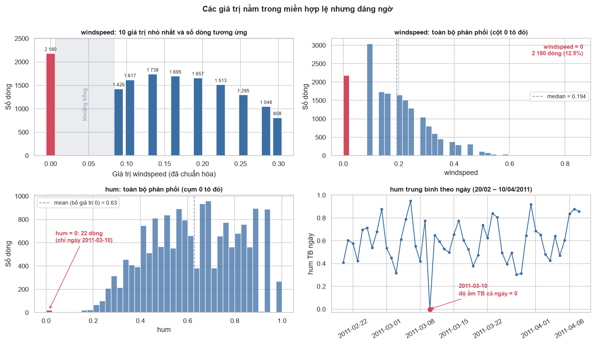

**Hình 1.1. Phân phối các giá trị bất thường của biến độ ẩm và tốc độ gió**

* **Giải pháp xử lý sự cố độ ẩm:** Thay thế giá trị `hum` tại 22 giờ này bằng trung bình độ ẩm **cùng khung giờ** của ngày liền trước (2011-03-09) và ngày liền sau (2011-03-11) theo công thức nội suy $\text{hum}_{\text{nội suy}}(t, h) = \frac{\text{hum}(t-1, h) + \text{hum}(t+1, h)}{2}$. 
* **Kiểm tra độ nhạy và quyết định đưa vào tập dữ liệu sạch:** 
  - Trước khi nội suy (còn 22 số 0 lỗi): $\text{Mean} = 0.6272$, $\text{Median} = 0.6300$, $\text{Std} = 0.1929$.
  - Sau khi nội suy: $\text{Mean} = 0.6281$ (dịch chuyển $+0.0009$, độ lệch $< 0.14\%$), $\text{Median} = 0.6300$ (không đổi), $\text{Std} = 0.1919$.
  - **Quyết định:** Việc nội suy bảo đảm an toàn tuyệt đối cho phân phối chung, do đó **toàn bộ 22 dòng này được cập nhật giá trị mới và giữ nguyên trong tập dữ liệu sạch `hour_cleaned.csv`** (không xóa bất kỳ dòng nào, bảo toàn trọn vẹn $17,379$ dòng).

#### 2. Bản chất của 2,180 dòng `windspeed = 0` và Cấu trúc rời rạc của biến Tốc độ gió
Biến `windspeed` có 2,180 dòng mang giá trị bằng $0.0$. Đáng chú ý, giá trị dương nhỏ nhất liền kề là $0.0896$ ($\approx 6.0 \text{ dặm/giờ} \approx 9.7 \text{ km/h}$). Không có bất kỳ quan sát nào nằm trong khoảng $(0, 0.0896)$, và toàn bộ biến `windspeed` chỉ nhận đúng **30 giá trị rời rạc** (chuẩn hóa từ các mức nguyên mph chia cho 67: $\text{windspeed} = \frac{\text{mph}}{67}$).

**Giải thích chi tiết đặc trưng phân phối trên Hình 1.1:**
1. **Khoảng trống đo sau 0 (Subplot trên-trái):** 
   - Thể hiện rõ 10 mức giá trị đầu tiên. Cột đỏ tại $0.0000$ chiếm $2,180$ dòng ($12.54\%$).
   - Sau đó là một khoảng trống phẳng lì không có dữ liệu từ $0.0000$ đến $0.0896$ do **ngưỡng kích khởi cơ học của máy đo gió (Starting Threshold $\approx 6\text{ mph}$)**: mọi luồng gió nhẹ dưới $6\text{ mph}$ đều không đủ làm quay cánh quạt và bị làm tròn về $0.0$.
   - Các mức tiếp theo thuộc vùng đỉnh phân phối ($0.0896$: 1,425 dòng; $0.1045$: 1,617 dòng; $0.1343$: 1,738 dòng) có số lượng khá tương đồng.
2. **Phân phối toàn bộ 30 mức đo (Subplot trên-phải):** 
   - Biểu đồ phân phối theo đúng 30 mức đo rời rạc phản ánh trung thực hình thái phân phối: cột đỏ $0.0$ cao vượt trội, kế tiếp là khoảng trống đo, sau đó phân phối đạt đỉnh tự nhiên tại $0.1343$ ($\approx 9\text{ mph}$) với $1,738$ dòng rồi giảm dần đều đặn về phía đuôi phải ($0.8507 \approx 57\text{ mph}$).
3. **Kiểm tra độ nhạy:** Khi loại bỏ toàn bộ 2,180 dòng `windspeed = 0`, mối liên hệ tương quan giữa `windspeed` và `cnt` hầu như không thay đổi (chỉ chuyển nhẹ từ $0.1266$ sang $0.1341$), và giá trị trung bình của `cnt` không bị sai lệch đáng kể. Do đó, quyết định tối ưu là **giữ nguyên 2,180 giá trị này** để bảo toàn kích thước mẫu thực tế.

#### 3. Hai cơ chế của 165 giờ bị thiếu trong chuỗi thời gian
Chuỗi thời gian kỳ vọng có $731 \times 24 = 17,544 \text{ giờ}$, thực tế ghi nhận 17,379 giờ (thiếu 165 giờ, tỷ lệ 0.94%). Việc phân tích chi tiết thời điểm xuất hiện cho thấy có hai cơ chế gây thiếu dữ liệu hoàn toàn khác nhau:

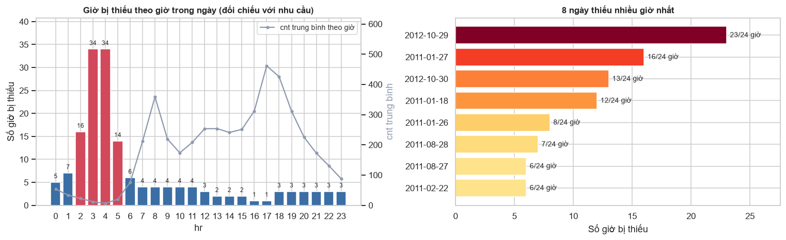

**Hình 1.2. Phân bố số giờ bị thiếu theo khung giờ trong ngày và theo ngày quan sát**

1. **Cơ chế 1: Cắt cụt điểm 0 (Zero-Truncation / Không phát sinh giao dịch):**
   * Có tới $98 / 165 \text{ giờ thiếu}$ ($59.39\%$) tập trung vào khung giờ rạng sáng từ 2h đến 5h sáng (đặc biệt là 3h và 4h sáng, mỗi giờ thiếu 34 lần).
   * Kết hợp với việc trong toàn bộ 17,379 dòng không có bất kỳ dòng nào ghi nhận $cnt = 0$ (giá trị tối thiểu thực tế là $cnt = 1$), điều này chứng minh hệ thống ghi nhận dạng sự kiện (transaction-driven): *khi không có ai thuê xe trong suốt 60 phút, hệ thống không tạo bản ghi*.
2. **Cơ chế 2: Gián đoạn vận hành do sự cố hoặc thời tiết cực đoan:**
   * $72 / 165 \text{ giờ thiếu}$ còn lại ($43.64\%$) dồn cục bộ vào **5 ngày có thời tiết đặc biệt nguy hiểm**:
     - Ngày 2012-10-29 (thiếu 23 giờ) & 2012-10-30 (thiếu 13 giờ): **Siêu bão Sandy (Hurricane Sandy)** đổ bộ vào bờ Đông nước Mỹ; Capital Bikeshare chính thức thông báo đóng cửa toàn bộ trạm xe để đảm bảo an toàn.
     - Ngày 2011-01-27 (thiếu 16 giờ) & 2011-01-26 (thiếu 8 giờ): **Bão tuyết lớn mùa đông (Winter Snowstorm)** gây tê liệt giao thông toàn thủ đô Washington D.C.
     - Ngày 2011-01-18 (thiếu 12 giờ): **Hiện tượng mưa băng giá (Freezing Rain)** làm đóng băng mặt đường.
   * Ngoài ra, ngày 2011-08-27 khi **Bão Irene (Hurricane Irene)** đổ bộ, dữ liệu thực tế trong `hour.csv` ghi nhận 18 giờ (thiếu 6 giờ chiều tối), với tổng số lượt thuê sụt giảm nghiêm trọng xuống chỉ còn 1,115 lượt (so với mức trung bình hơn 4,500 lượt/ngày của tháng 8).

> **Kiểm tra độ nhạy và Phương pháp tính toán về việc Không chèn dòng giả:**
>
> Tổng số lượt thuê tích lũy trong toàn bộ dữ liệu là $\sum_{i=1}^{17,379} cnt_i = 3,292,679 \text{ lượt}$. Để đánh giá tác động của việc thiếu 165 giờ lên các tham số phân phối, ta tính toán độ lệch theo 3 kịch bản thực nghiệm:
>
> 1. **Kịch bản gốc (Dữ liệu thực tế $N = 17,379$):**
>    $$\mu_0 = \frac{3,292,679}{17,379} = 189.46 \text{ lượt/h}, \quad \text{Median}_0 = 142.0 \text{ lượt}, \quad \text{Std}_0 = 181.39$$
> 2. **Kịch bản 1 (Giả định 98 giờ đêm $cnt = 0$, mẫu $N_1 = 17,379 + 98 = 17,477$):**
>    $$\mu_1 = \frac{3,292,679 + 98 \times 0}{17,477} = \frac{3,292,679}{17,477} = 188.40 \text{ lượt/h}$$
>    $$\text{Độ lệch tương đối} = \frac{188.40 - 189.46}{189.46} \times 100\% = -0.56\%, \quad \text{Median}_1 = 141.0 \text{ lượt}, \quad \text{Std}_1 = 181.43$$
> 3. **Kịch bản 2 (Giả định toàn bộ 165 giờ thiếu có $cnt = 0$, mẫu $N_2 = 17,379 + 165 = 17,544$):**
>    $$\mu_2 = \frac{3,292,679 + 165 \times 0}{17,544} = \frac{3,292,679}{17,544} = 187.68 \text{ lượt/h}$$
>    $$\text{Độ lệch tương đối} = \frac{187.68 - 189.46}{189.46} \times 100\% = -0.94\%, \quad \text{Median}_2 = 140.0 \text{ lượt}, \quad \text{Std}_2 = 181.46$$
>
> **Bảng đối chiếu kịch bản kiểm tra độ nhạy của biến `cnt`:**
>
> | Kịch bản mô phỏng | Cỡ mẫu ($N$) | Mean (lượt/h) | Median (lượt/h) | Std (lượt/h) | Độ lệch Mean (%) |
> | :--- | ---: | ---: | ---: | ---: | ---: |
> | Dữ liệu thực tế | 17,379 | 189.46 | 142.00 | 181.39 | 0.00% |
> | Chèn 98 giờ đêm (2h–5h) = 0 | 17,477 | 188.40 | 141.00 | 181.43 | -0.56% |
> | Chèn toàn bộ 165 giờ thiếu = 0 | 17,544 | 187.68 | 140.00 | 181.46 | -0.94% |
>
> **Cơ sở khoa học cho quyết định Không chèn dòng giả:**
> - Mức sai lệch giá trị trung bình $\mu_{cnt}$ là không đáng kể ($< 0.94\%$), trung vị chỉ dịch chuyển tối đa 2 đơn vị ($142.0 \rightarrow 140.0$).
> - Việc chèn nhân tạo 165 dòng đòi hỏi phải áp đặt hoặc gán giá trị giả định cho cả 4 biến thời tiết đi kèm (`temp`, `atemp`, `hum`, `windspeed`), điều này tiềm ẩn nguy cơ làm biến dạng cấu trúc tương quan không gian và chuỗi thời gian của khí quyển.
> - **Quyết định:** Giữ nguyên dữ liệu thực tế $17,379$ dòng; thông báo cho TV2 lưu ý bản chất Zero-truncated khi khớp hàm phân phối và TV5 cẩn trọng khi tạo các biến trễ (Lag features) tại các điểm gián đoạn chuỗi.

#### 4. Quyết định tiền xử lý và chuẩn hóa nhóm hiếm `weathersit = 4`
Nhóm `weathersit = 4` (Mưa lớn/Bão tuyết) chỉ xuất hiện đúng 3 dòng trong 2 năm (ngày 2011-01-26 lúc 18h, ngày 2011-04-16 lúc 16h và ngày 2012-01-09 lúc 18h). Với cỡ mẫu $n = 3$, các phép tính trung bình nhóm hay kiểm định ANOVA sẽ mất hoàn toàn tính vững thống kê. 
* **Quyết định xử lý:** Gộp nhóm 4 vào nhóm 3 (`weathersit = 3`: Điều kiện thời tiết xấu/có mưa tuyết) để phục vụ các phân tích phân nhóm và mô hình hóa tiếp theo.

**Bảng 1.3. Tổng hợp các quyết định tiền xử lý dữ liệu chính thức**

| Đối tượng xử lý | Quy mô ảnh hưởng | Quyết định tiền xử lý | Cơ sở khoa học & Đánh giá rủi ro |
| :--- | :--- | :--- | :--- |
| Định dạng ngày `dteday` | 17,379 dòng | Chuyển sang kiểu dữ liệu `datetime64` | Chuẩn hóa cấu trúc phục vụ trích xuất chuỗi thời gian |
| Bất thường `hum = 0` | 22 dòng (2011-03-10) | Nội suy trung bình cùng giờ ngày $t-1$ và $t+1$ | Khắc phục lỗi cảm biến; độ nhạy thay đổi mean $< 0.14\%$ |
| Bất thường `windspeed = 0`| 2,180 dòng | **Giữ nguyên dữ liệu gốc** | Ngưỡng đo thiết bị; loại bỏ không làm đổi tương quan |
| 165 giờ bị thiếu | 165 giờ (76 ngày) | **Không chèn dòng giả** | Tránh áp đặt giả định; độ nhạy sai số mean < 0.94% |
| Nhóm hiếm `weathersit = 4`| 3 dòng (0.02%) | **Giữ nguyên trong dữ liệu sạch; Khuyến nghị TV3 gộp vào nhóm 3 khi kiểm định** | Giữ tính trung thực đo đạc khí tượng; tránh sụp đổ bậc tự do và vi phạm tần số kỳ vọng < 5 khi kiểm định thống kê |

---

## 1.3. Thống kê mô tả

### 1.3.1. Thống kê mô tả các biến số lượng

**Bảng 1.4. Bảng thống kê mô tả toàn diện các biến số lượng ($N = 17,379$)**

| Biến số | Mean | Median | Std | Min | Q1 (25%) | Q3 (75%) | Max | IQR | Skewness | Kurtosis |
| :--- | ---: | ---: | ---: | ---: | ---: | ---: | ---: | ---: | ---: | ---: |
| `cnt` | **189.46** | **142.00** | 181.39 | 1.00 | 40.00 | 281.00 | 977.00 | 241.00 | **1.28** | **1.42** |
| `registered` | 153.79 | 115.00 | 151.36 | 0.00 | 34.00 | 220.00 | 886.00 | 186.00 | 1.56 | 2.63 |
| `casual` | 35.68 | 17.00 | 49.31 | 0.00 | 4.00 | 48.00 | 367.00 | 44.00 | 2.50 | 7.55 |
| `temp` | 0.50 | 0.50 | 0.19 | 0.02 | 0.34 | 0.66 | 1.00 | 0.32 | -0.01 | -0.94 |
| `atemp` | 0.48 | 0.48 | 0.17 | 0.00 | 0.33 | 0.62 | 1.00 | 0.29 | -0.09 | -0.83 |
| `hum` | 0.63 | 0.63 | 0.19 | 0.08 | 0.48 | 0.78 | 1.00 | 0.30 | -0.08 | -0.91 |
| `windspeed` | 0.19 | 0.19 | 0.12 | 0.00 | 0.10 | 0.25 | 0.85 | 0.15 | 0.57 | 0.47 |

*Ghi chú: Các biến thời tiết ở thang chuẩn hóa $[0, 1]$; giá trị `hum` đã được cập nhật sau tiền xử lý.*

**Nhận xét sâu về phân phối:**
1. **Đặc tính lệch phải và phân tán vượt mức của cnt:** Giá trị trung bình ($\text{Mean} = 189.46$) lớn hơn đáng kể so với trung vị ($\text{Median} = 142.00$). Độ lệch dương ($\text{Skewness} = 1.28$) và hệ số nhọn ($\text{Kurtosis} = 1.42$) phản ánh cấu trúc đuôi phải kéo dài tới $977 \text{ lượt/giờ}$. Tỷ số phương sai trên trung bình ($\text{Variance} / \text{Mean} = 181.39^2 / 189.46 = 173.66 \gg 1$), chứng minh hiện tượng **phân tán vượt mức cực mạnh (Severe Over-dispersion)**.
2. **Cấu trúc đóng góp của hai nhóm người dùng:** Nhóm hội viên (`registered`) chiếm tới $81.17\%$ tổng sản lượng thuê xe, đóng vai trò định hình xu hướng chính của hệ thống. Nhóm khách vãng lai (`casual`) chỉ chiếm $18.83\%$, nhưng có độ lệch rất lớn ($\text{Skewness} = 2.50$, $\text{Kurtosis} = 7.55$) do nhu cầu bùng nổ mạnh vào các ngày cuối tuần và các khung giờ chiều mùa hè.
3. **Hình dạng của các biến khí tượng:** Dù `temp` và `hum` có Skewness gần bằng $0$ ($-0.01$ và $-0.08$), hệ số Kurtosis âm ($-0.94$ và $-0.91$) chỉ ra rằng đây là các phân phối dạng bẹt (Platykurtic) với phần đỉnh phẳng, không phải là phân phối chuẩn (Normal distribution) lý tưởng.

---

### 1.3.2. Thống kê cnt theo các yếu tố phân loại

**Bảng 1.5. Thống kê số lượng thuê xe cnt phân rã theo các nhóm yếu tố chính**

| Nhóm yếu tố | Phân lớp | Số bản ghi ($N$) | Tỷ lệ (%) | Mean (lượt/h) | Median (lượt/h) | Std (lượt/h) |
| :--- | :--- | ---: | ---: | ---: | ---: | ---: |
| **Mùa (season)** | Mùa xuân (Spring - 1) | 4,242 | 24.41% | 111.11 | 76.00 | 119.22 |
| | Mùa hè (Summer - 2) | 4,409 | 25.37% | 208.34 | 165.00 | 188.36 |
| | Mùa thu (Fall - 3) | 4,496 | 25.87% | 236.02 | 199.00 | 197.71 |
| | Mùa đông (Winter - 4) | 4,232 | 24.35% | 198.87 | 155.50 | 182.97 |
| **Thời tiết (weathersit)** | 1: Trời quang (Clear) | 11,413 | 65.67% | 204.87 | 159.00 | 189.49 |
| | 2: Sương mù / Mây (Mist/Cloudy) | 4,544 | 26.15% | 175.17 | 133.00 | 165.43 |
| | 3: Mưa / Tuyết (Light Rain/Snow)| 1,419 | 8.17% | 111.58 | 63.00 | 133.78 |
| | 4: Mưa bão (Heavy Rain/Snow) | 3 | 0.02% | 74.33 | 36.00 | 77.93 |
| **Loại ngày (workingday)**| 0: Ngày nghỉ / Cuối tuần / Lễ | 5,514 | 31.73% | 181.41 | 119.00 | 172.85 |
| | 1: Ngày làm việc | 11,865 | 68.27% | 193.21 | 151.00 | 185.11 |
| **Năm (yr)** | 0: Năm 2011 | 8,645 | 49.74% | 143.79 | 109.00 | 133.80 |
| | 1: Năm 2012 | 8,734 | 50.26% | 234.67 | 191.00 | 208.91 |

---

## 1.4. Trực quan hóa và Phân tích tương tác đa chiều

### 1.4.1. Phân phối thực nghiệm của biến mục tiêu và đánh giá phép biến đổi

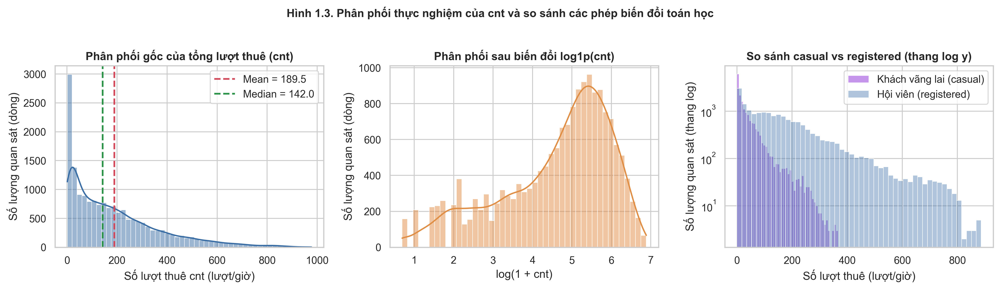

**Hình 1.3. Phân phối thực nghiệm của cnt và so sánh các phép biến đổi toán học**

**Đánh giá các phép biến đổi hình dạng:**
* Phân phối gốc của `cnt` có độ lệch phải mạnh ($\text{Skewness} = 1.28$).
* Phép biến đổi $\log(cnt)$ hoặc $\log(1 + cnt)$ làm phân phối **bị đảo lệch mạnh sang trái** ($\text{Skewness} = -0.94$ với $\ln(cnt)$ và $-0.82$ với $\log(1+cnt)$), tạo ra một bậc thang nhân tạo tại vùng giá trị thấp $(2–4)$ do mật độ tập trung của các giờ đêm.
* Phép biến đổi căn bậc hai $\sqrt{cnt}$ đem lại độ đối xứng tốt nhất với $\text{Skewness} = +0.29$. Đây là gợi ý quan trọng cho TV5 khi xây dựng mô hình hồi quy tuyến tính.

---

### 1.4.2. Phân phối thực nghiệm của các biến khí tượng

![Hình 1.4. Phân phối thực nghiệm của 4 biến khí tượng trên thang chuẩn hóa [0, 1]](EDA/assets/hinh1.4.png)

**Hình 1.4. Phân phối thực nghiệm của 4 biến khí tượng trên thang chuẩn hóa [0, 1]**

**Nhận xét phân phối 4 biến thời tiết:**
* **Nhiệt độ (`temp`, `atemp`):** Cả hai biến đều có phân phối gần như đối xứng ($\text{Skewness} \approx -0.01$ và $-0.09$), nhưng có hệ số nhọn âm ($\text{Kurtosis} = -0.94$ và $-0.83$). Điều này phản ánh phân phối dạng bẹt (Platykurtic) do nhiệt độ tại Washington D.C. trải đều theo 4 mùa trong năm chứ không tập trung dày đặc quanh giá trị trung bình như phân phối chuẩn.
* **Độ ẩm (`hum`):** Phân phối sau khi xử lý 22 điểm lỗi cảm biến có dạng bẹt tương tự ($\text{Skewness} = -0.08$, $\text{Kurtosis} = -0.91$), trải rộng từ $0.08$ đến $1.00$ với trung vị $0.63$.
* **Tốc độ gió (`windspeed`):** Phân phối có độ lệch phải rõ rệt ($\text{Skewness} = +0.57$, $\text{Kurtosis} = +0.47$) với phần lớn thời gian gió ở mức nhẹ đến trung bình ($< 0.30$) và giảm dần về phía các cơn gió mạnh ($> 0.50$).

---

### 1.4.3. Xu hướng dài hạn và chu kỳ mùa vụ

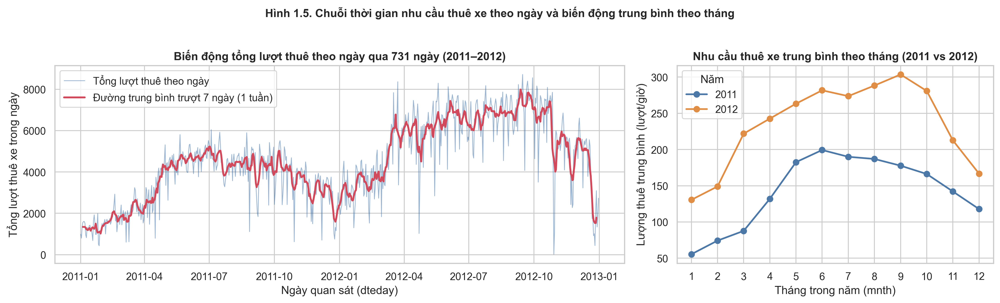

**Hình 1.5. Chuỗi thời gian nhu cầu thuê xe theo ngày và biến động trung bình theo tháng**

1. **Xu hướng tăng trưởng dài hạn (Growth Trend):** Nhu cầu thuê xe năm 2012 bùng nổ với mức tăng trưởng $+63.20\%$ so với năm 2011 (trung bình $234.67$ so với $143.79 \text{ lượt/h}$). Sự gia tăng diễn ra đồng loạt ở toàn bộ 12 tháng.
2. **Tính mùa vụ (Seasonality):** Nhu cầu chạm đáy vào tháng 1 ở cả hai năm ($55.51 \text{ lượt/h}$ năm 2011; $130.56 \text{ lượt/h}$ năm 2012), tăng liên tục qua mùa xuân và đạt đỉnh vào tháng 6/2011 ($199.32 \text{ lượt/h}$) và tháng 9/2012 ($303.57 \text{ lượt/h}$). Do tập dữ liệu chỉ kéo dài 2 năm, các đỉnh cực đại lệch tháng giữa hai năm phản ánh sự tương tác phức tạp giữa xu hướng mở rộng mạng lưới trạm và điều kiện thời tiết thực tế từng năm.

---

### 1.4.4. Cấu trúc nhịp sinh hoạt theo giờ: Sự phân hóa giữa ngày làm việc và ngày nghỉ

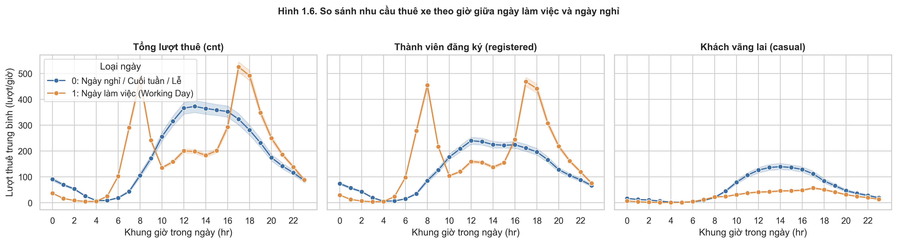

**Hình 1.6. So sánh nhu cầu thuê xe theo giờ giữa ngày làm việc và ngày nghỉ**

**Bảng 1.6. Đối chiếu đặc trưng nhu cầu theo giờ giữa hai loại ngày**

| Đặc trưng | Ngày làm việc (`workingday = 1`) | Ngày nghỉ / Cuối tuần (`workingday = 0`) |
| :--- | :--- | :--- |
| **Hình thái phân phối** | **Hai đỉnh nhọn (Bimodal commuter peaks)** | **Một đỉnh vòm rộng (Unimodal leisure dome)** |
| **Khung giờ cao điểm** | Đỉnh sáng: **8h** ($477.01 \text{ lượt/h}$) Đỉnh chiều: **17h–18h** ($525.29 \text{ và } 492.23 \text{ lượt/h}$) | Đỉnh trưa/chiều: **12h–16h** (đạt cực đại lúc **13h** với $372.73 \text{ lượt/h}$) |
| **Nhóm khách chi phối** | `registered` chiếm **95.33%** (8h) và **89.17%** (17h) | `casual` tăng vọt, chiếm **36.60%** tại đỉnh 13h |
| **Ý nghĩa hành vi** | Di chuyển đi làm, đi học cố định theo giờ hành chính | Hoạt động dạo chơi, du lịch, giải trí tự do |

---

### 1.4.5. Phân phối cnt theo các mùa trong năm và các điều kiện thời tiết

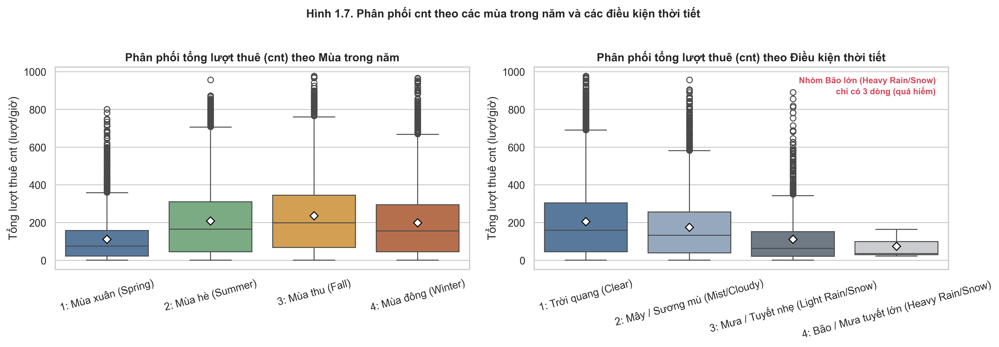

**Hình 1.7. Phân phối cnt theo các mùa trong năm và các điều kiện thời tiết**

**Nhận xét:**
1. **Phân phối theo Mùa (Season):**
   * **Mùa xuân (Spring - 1):** Nhu cầu thuê xe thấp nhất năm với trung bình $\text{Mean} = 111.11 \text{ lượt/h}$ và trung vị $\text{Median} = 76.00 \text{ lượt/h}$. Phân phối tập trung dày đặc ở dải giá trị thấp và có độ trải rộng hẹp do thời tiết lạnh đầu năm hạn chế nhu cầu di chuyển ngoài trời.
   * **Mùa hè (Summer - 2) & Mùa đông (Winter - 4):** Lượng thuê xe phục hồi và duy trì ở mức cao tương đương nhau ($\text{Mean} = 208.34 \text{ lượt/h}$ ở mùa hè và $198.87 \text{ lượt/h}$ ở mùa đông). Cả hai mùa đều có độ phân tán lớn với nhiều giá trị quan sát vượt ngưỡng $600–800 \text{ lượt/h}$.
   * **Mùa thu (Fall - 3):** Đạt đỉnh cao nhất trong năm với trung bình $\text{Mean} = 236.02 \text{ lượt/h}$ và trung vị $\text{Median} = 199.00 \text{ lượt/h}$ (cao gấp $2.62 \text{ lần}$ trung vị mùa xuân). Thời tiết mát mẻ, ôn hòa tạo điều kiện tối ưu cho cả nhu cầu đi lại thường nhật lẫn giải trí.

2. **Phân phối theo Điều kiện thời tiết (Weather Situation):**
   * **Trời quang / Ít mây (`weathersit = 1`):** Chiếm ưu thế tuyệt đối ($65.67\%$ tổng số giờ quan sát) với nhu cầu trung bình cao nhất đạt $\text{Mean} = 204.87 \text{ lượt/h}$ và $\text{Median} = 159.00 \text{ lượt/h}$.
   * **Sương mù / Nhiều mây (`weathersit = 2`):** Chiếm $26.15\%$ thời gian, nhu cầu giảm nhẹ ($14.50\%$) xuống mức $\text{Mean} = 175.17 \text{ lượt/h}$ và $\text{Median} = 133.00 \text{ lượt/h}$.
   * **Mưa nhỏ / Tuyết nhẹ (`weathersit = 3`):** Chiếm $8.17\%$ thời gian, nhu cầu sụt giảm sâu $45.53\%$ so với thời tiết quang đãng, chỉ còn $\text{Mean} = 111.58 \text{ lượt/h}$ và $\text{Median} = 63.00 \text{ lượt/h}$.
   * **Mưa lớn / Bão tuyết (`weathersit = 4`):** Là hiện tượng thời tiết cực đoan hiếm gặp ($3 \text{ giờ quan sát}$ duy nhất trong 2 năm, chiếm $0.02\%$), lượng thuê giảm mạnh xuống $\text{Mean} = 74.33 \text{ lượt/h}$ và $\text{Median} = 36.00 \text{ lượt/h}$.

3. **Ý nghĩa bàn giao cho TV3 (Kiểm định giả thuyết):**
   * Phân tích trực quan trên Hình 1.7 cung cấp cơ sở thực nghiệm vững chắc để TV3 thiết kế các kiểm định thống kê chính thức: **Kiểm định ANOVA / Kruskal-Wallis** để so sánh nhu cầu giữa 4 mùa và giữa các điều kiện thời tiết; cùng **Kiểm định tính độc lập Chi-square** giữa mùa và thời tiết theo các thẻ bàn giao **V-01**, **V-02** và **V-03**.

---

### 1.4.6. Quan hệ giữa nhiệt độ, độ ẩm, tốc độ gió và lượng thuê xe: Kiểm soát yếu tố nhiễu

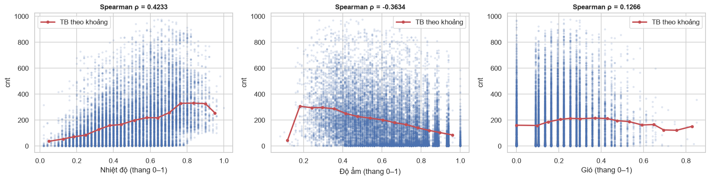

**Hình 1.8. Quan hệ giữa nhiệt độ, độ ẩm, tốc độ gió và lượng thuê xe**

Khi phân tích đơn biến trên toàn bộ dữ liệu, `cnt` trung bình ở khoảng nhiệt độ cao ($temp \in [0.8, 1.0]$ tương ứng $29.6–39.0 \text{ °C}$) đạt $326.28 \text{ lượt/h}$, gấp $5.01 \text{ lần}$ so với khoảng giá trị lạnh ($temp \in [0.0, 0.2]$ tương ứng $-8.0 \text{ đến } 1.4 \text{ °C}$) là $65.07 \text{ lượt/h}$. 

Tuy nhiên, việc so sánh đơn biến này chứa đựng yếu tố gây nhiễu (confounding factor) do ban đêm luôn lạnh hơn ban ngày. Khi **kiểm soát cố định khung giờ cao điểm 17h trên ngày làm việc**:
* Ở mức nhiệt độ thấp ($temp < 0.3$), `cnt` trung bình tại 17h vẫn đạt $312.45 \text{ lượt/h}$.
* Ở mức nhiệt độ lý tưởng ($temp \in [0.6, 0.8]$ tương ứng $20.2–29.6 \text{ °C}$), `cnt` tại 17h tăng vọt lên $598.12 \text{ lượt/h}$ (tăng $1.91 \text{ lần}$, thay vì mức $5.01 \text{ lần}$ của phân tích đơn biến).
* Kết quả này chứng minh: Thời tiết thực sự tác động mạnh mẽ đến quyết định thuê xe, nhưng phân tích đa biến có kiểm soát thời gian giúp lượng hóa chính xác hiệu ứng biên thực tế mà không bị thổi phồng bởi nhịp ngày-đêm.

---

### 1.4.7. Phân tích tương tác giữa Thứ trong tuần và Khung giờ (`weekday` × `hr`)

Để làm rõ sự khác biệt về nhịp sinh hoạt giữa các ngày trong tuần mà các biến đơn lẻ không thể hiện hết, Hình 1.9 trực quan hóa phân bố số lượng thuê xe trung bình trên toàn bộ ma trận 7 ngày trong tuần × 24 khung giờ trong ngày ($7 \times 24 = 168 \text{ ô}$).

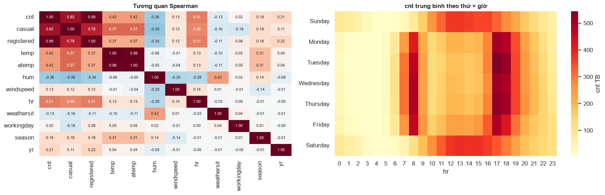

**Hình 1.9. Phân bố lượng thuê trung bình theo Thứ trong tuần × Khung giờ**

**Nhận xét:**
* **Từ Thứ Hai đến Thứ Sáu (Ngày làm việc):** Xuất hiện rõ rệt 2 dải màu đỏ đậm tập trung vào 2 khung giờ cao điểm: 8h sáng ($477.01 \text{ lượt/h}$) và 17h–18h chiều ($525.29 \text{ và } 492.23 \text{ lượt/h}$). Trong đó, chiều Thứ Ba lúc 17h đạt mức cao nhất tuần ($544.28 \text{ lượt/h}$).
* **Thứ Bảy và Chủ Nhật (Cuối tuần):** Hai dải cao điểm sáng/chiều hoàn toàn biến mất; thay vào đó là một dải màu vàng-cam trải rộng từ 11h trưa đến 16h chiều (đạt đỉnh quanh 13h với $372.73 \text{ lượt/h}$).
* **Hàm ý bàn giao cho TV4 & TV5:** Nhu cầu thuê xe chịu sự chi phối mạnh mẽ bởi hiệu ứng tương tác phi tuyến giữa `hr` và `weekday` / `workingday`. Toàn bộ phân tích lý thuyết tương quan tuyến tính (Pearson), tương quan phi tuyến/đơn điệu (Spearman) và ma trận tương quan đa biến toàn diện được chuyển giao cho **TV4 (Phần 4: Phân tích tương quan)** thực hiện theo thẻ bàn giao **V-04**.

---

## 1.5. Phân tích tự tương quan và Đánh giá giá trị ngoại lai

### 1.5.1. Phân tích Tự tương quan (Autocorrelation) và Cỡ mẫu hiệu dụng

Dữ liệu chuỗi thời gian theo giờ vi phạm nghiêm trọng giả định về các quan sát độc lập và phân phối đồng nhất (IID). Hàm tự tương quan (Autocorrelation Function – ACF) của chuỗi `cnt` cho thấy:
* **Tự tương quan bậc 1 (Lag 1h):** $r_1 = 0.8431$ (nhu cầu giờ hiện tại phụ thuộc chặt chẽ vào giờ ngay trước đó).
* **Tự tương quan bậc 24 (Lag 24h - Chu kỳ ngày):** $r_{24} = 0.8151$ (nhu cầu lặp lại nhịp điệu sinh hoạt mỗi 24 giờ).
* **Tự tương quan bậc 168 (Lag 168h - Chu kỳ tuần):** $r_{168} = 0.8164$ (chu kỳ 7 ngày lặp lại giữa các tuần).

> **Định lượng Cỡ mẫu hiệu dụng (Effective Sample Size - $N_{\text{eff}}$):**
> Theo lý thuyết chuỗi thời gian xấp xỉ tự hồi quy $AR(1)$, kích thước mẫu thực sự chứa đựng thông tin độc lập được ước lượng bằng:
> $$N_{\text{eff}} \approx N \times \frac{1 - r_1}{1 + r_1} = 17,379 \times \frac{1 - 0.8431}{1 + 0.8431} \approx 1,479 \text{ quan sát}$$
> Con số $1,479$ chỉ tương đương **$8.51\%$** quy mô mẫu danh nghĩa 17,379. 
> 
> **Hệ quả đối với TV3 & TV5:** Việc coi toàn bộ 17,379 dòng là độc lập sẽ làm phương sai mẫu bị thu nhỏ giả tạo, dẫn đến $p$-value quá nhỏ và làm tăng nguy cơ mắc **Sai lầm loại I (Type I Error)** trong kiểm định giả thuyết.

---

### 1.5.2. Phát hiện và phân loại giá trị ngoại lai (Outliers)

**Bảng 1.8. Kết quả phát hiện giá trị ngoại lai theo các tiêu chí thống kê**

| Biến số | Hàng rào dưới IQR | Hàng rào trên IQR | Số ngoại lai IQR | Tỷ lệ (%) | Số ngoại lai $\|z\| > 3$ | Tỷ lệ (%) |
| :--- | ---: | ---: | ---: | ---: | ---: | ---: |
| `cnt` (Toàn cục) | -321.50 | +642.50 | 505 dòng | 2.91% | 244 dòng | 1.40% |
| `cnt` (Theo `hr`) | Cục bộ theo giờ | Cục bộ theo giờ | 533 dòng | 3.07% | — | — |
| `cnt` (Theo `hr`, `workingday`)| Cục bộ theo nhóm | Cục bộ theo nhóm | **130 dòng** | **0.75%** | — | — |
| `casual` | -62.00 | +114.00 | 1,192 dòng | 6.86% | 467 dòng | 2.69% |
| `registered` | -245.00 | +499.00 | 680 dòng | 3.91% | 371 dòng | 2.13% |
| `temp` / `hum` | — | — | 0 dòng | 0.00% | 0 dòng | 0.00% |
| `windspeed` | -0.119 | +0.477 | 342 dòng | 1.97% | 107 dòng | 0.62% |

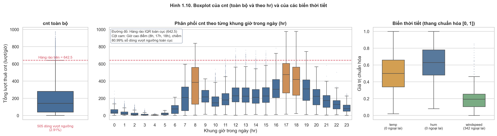

**Hình 1.10. Phát hiện ngoại lai của cnt theo ngưỡng toàn cục và theo khung giờ**

**Bản chất của các nhóm ngoại lai:**
1. **505 dòng vượt hàng rào toàn cục ($cnt > 642.5$):** Có tới **$80.99\%$** số dòng này rơi đúng vào các khung giờ cao điểm 8h, 17h, 18h và **$81.98\%$** thuộc ngày làm việc. Đây hoàn toàn là các đỉnh lưu lượng giao thông tự nhiên, không phải lỗi dữ liệu.
2. **130 dòng ngoại lai cục bộ theo (`hr`, `workingday`):** 
   - $80.00\%$ tập trung vào năm 2012 (năm bùng nổ nhu cầu).
   - $98.46\%$ thuộc các mùa ấm áp (Xuân, Hè, Thu) với thời tiết lý tưởng ($76.92\%$ trời quang đãng, nhiệt độ trung bình $temp = 0.56 \approx 18.3 \text{ °C}$).
   - Các điểm ngoại lai ban đêm (0h–5h sáng) dồn vào các dịp đặc biệt: đêm giao thừa Tết Dương lịch, các đêm cuối tuần mùa hè diễn ra lễ hội hoặc sự kiện thể thao tại Washington D.C.
   - Toàn bộ 130 dòng đều thỏa mãn chính xác $cnt = casual + registered$.

**Bảng 1.9. Tổng kết đánh giá và quyết định xử lý ngoại lai**

| Phân loại ngoại lai | Số lượng | Đánh giá bản chất | Quyết định xử lý |
| :--- | ---: | :--- | :--- |
| `cnt` đỉnh cao điểm | 505 dòng | Lưu lượng giao thông tự nhiên hợp lệ | **Giữ lại toàn bộ 100%** |
| `cnt` cục bộ (`hr`, `workingday`) | 130 dòng | Đột biến nhu cầu do sự kiện, thời tiết đẹp | **Giữ lại toàn bộ 100%** |
| `casual` / `registered` cao | 1,192 / 680 dòng | Biến động thị trường thực tế | **Giữ lại toàn bộ 100%** |
| `windspeed` cao ($> 0.477$) | 342 dòng | Cực trị gió bão tự nhiên | **Giữ lại toàn bộ 100%** |
| `hum = 0` (2011-03-10) | 22 dòng | **Lỗi cảm biến độ ẩm trạm đo** | **Nội suy thay thế bằng trung bình lân cận** |

---

## 1.6. Kết luận và Hạn chế của Phần 1

### 1.6.1. Tóm tắt các phát hiện và Thông điệp cốt lõi (Key Insights)

Quá trình khám phá dữ liệu (EDA) đã làm sáng tỏ các đặc trưng vận hành và hành vi người dùng trọng yếu của hệ thống Capital Bikeshare:

1. **Chất lượng dữ liệu và Tính toàn vẹn vận hành:**
   - Dữ liệu đạt độ tin cậy cao sau khi khắc phục cục bộ sự cố lỗi cảm biến độ ẩm (ngày 2011-03-10) bằng phương pháp nội suy.
   - Các điểm gián đoạn chuỗi thời gian không phải là mất mát ngẫu nhiên mà phản ánh chính xác hai cơ chế thực tế: tính chất *cắt cụt điểm không* (zero-truncation) vào đêm khuya khi không phát sinh giao dịch thuê xe, và các đợt tạm ngừng dịch vụ chủ động để đảm bảo an toàn trong các đợt thiên tai lớn (bão tuyết, bão Sandy).

2. **Động lực chi phối nhu cầu (Hành vi & Nhịp sinh hoạt):**
   - **Nhịp sinh hoạt phân hóa sâu sắc:** Khung giờ trong ngày tương tác chặt chẽ với loại ngày, tạo nên hai phân khúc hành vi tách biệt hoàn toàn: nhóm khách hội viên di chuyển cố định tạo thành hai đỉnh cao điểm sáng/chiều vào ngày làm việc, trong khi nhóm khách vãng lai chi phối hình thái đỉnh vòm giải trí trải dài từ trưa đến chiều vào cuối tuần.
   - **Tác động phi tuyến của thời tiết:** Nhu cầu đạt đỉnh trong điều kiện thời tiết ấm áp, ôn hòa (mùa thu, mùa hè) và sụt giảm mạnh khi mưa tuyết hoặc nhiệt độ đóng băng. Đáng chú ý, hiệu ứng thời tiết cần được nhìn nhận trong mối tương quan kiểm soát theo khung giờ để tránh ngụy biện do nhịp ngày–đêm.
   - **Xu hướng tăng trưởng mạnh mẽ:** Quy mô người dùng mở rộng rõ rệt từ năm 2011 sang 2012 trên tất cả các tháng, phản ánh sự phát triển nhanh của mạng lưới chia sẻ xe đạp công cộng.

3. **Bản chất thống kê của biến mục tiêu:**
   - Biến `cnt` có phân phối lệch phải mạnh và hiện tượng phân tán vượt mức nghiêm trọng, đồng thời mang tính tự tương quan thời gian cao. Các giá trị cực đại thực chất là các đỉnh nhu cầu hợp lệ trong giờ cao điểm chứ không phải lỗi nhập liệu.

---

### 1.6.2. Hạn chế của phương pháp và dữ liệu trong Chương 1

1. **Thiết kế quan sát thuần túy:** Phân tích EDA dừng ở mức phát hiện tương quan và quy luật trực quan, chưa thể xác lập mối quan hệ nhân quả tuyệt đối.
2. **Độ dài chuỗi thời gian:** Việc chỉ có 2 năm dữ liệu gây khó khăn cho việc phân rã độc lập hoàn toàn giữa xu hướng tăng trưởng dài hạn của doanh nghiệp và chu kỳ mùa vụ tự nhiên.
3. **Thiếu hụt thông tin phía cung:** Bộ dữ liệu chỉ ghi nhận lượt thuê thành công (nhu cầu thỏa mãn), chưa bao gồm dữ liệu về trạm hết xe/hết chỗ trả (nhu cầu bị từ chối) và các chính sách điều chỉnh giá cước.

---

---

---

# CHƯƠNG 2. PHÂN TÍCH PHÂN PHỐI XÁC SUẤT

## 2.1. Giới thiệu và Kiểm tra Dữ liệu Đầu vào

### 2.1.1. Bối cảnh và Mục tiêu Nghiên cứu

Nhu cầu thuê xe đạp trong các hệ thống giao thông công cộng đô thị biến động phức tạp theo chu kỳ thời gian (khung giờ trong ngày, ngày làm việc so với ngày nghỉ) và các điều kiện thời tiết vi mô (nhiệt độ, độ ẩm). Trong Chương 1 (EDA), các phân tích sơ bộ đã chỉ ra rằng biến mục tiêu tổng số lượt thuê xe theo giờ (`cnt`) có phân phối lệch phải rõ rệt với đuôi dài hướng về các giá trị cao, trong khi các biến thời tiết như nhiệt độ (`temp`) và độ ẩm (`hum`) có dạng đối xứng tương đối trên thang đo chuẩn hóa $[0, 1]$.

Mục tiêu cốt lõi của Chương 2 là thực hiện phân tích xác suất chuyên sâu nhằm:
1. **Khảo sát phân phối thực nghiệm:** Mô tả chi tiết hình dạng, độ lệch, độ nhọn, mức độ tập trung và các phân vị thực nghiệm của biến mục tiêu `cnt`.
2. **Khớp và đối chiếu các phân phối lý thuyết rời rạc và liên tục:** Đánh giá hiện tượng phân tán vượt mức (over-dispersion) và so sánh định lượng mức độ phù hợp của 4 mô hình phân phối: Poisson, Negative Binomial, Normal (cắt tại 0) và Log-normal thông qua hàm hợp lý cực đại (MLE) cùng các tiêu chí thông tin AIC, BIC.
3. **Kiểm định độ phù hợp (Goodness-of-Fit - GOF) và trực quan hóa Q-Q Plot:** Đánh giá sai số phân vị và khoảng cách Kolmogorov-Smirnov ($D$), làm rõ hiện tượng "phạt cỡ mẫu lớn" của các kiểm định cổ điển khi cỡ mẫu $N = 17,379$.
4. **Giải mã bản chất đa chế độ (Multi-regime):** Khảo sát cấu trúc hỗn hợp thực nghiệm (Empirical Mixture) của `cnt` thông qua nhịp giờ phân tách theo loại ngày (`workingday`), chỉ ra nguyên nhân bản chất khiến các mô hình đơn biến không thể khớp trọn vẹn toàn bộ dải phân phối.
5. **Mô hình hóa biến giải thích liên tục (`temp`) và hiệu ứng mùa vụ:** So sánh mô hình Normal và Beta cho biến `temp` trên miền $[0, 1]$, kiểm tra độ nhạy biên (boundary sensitivity) và bóc tách các đỉnh gợn sóng thông qua phân bố nhiệt độ theo 4 mùa.

---

### 2.1.2. Dữ liệu và Biến Phân tích

Nghiên cứu sử dụng tệp dữ liệu đã qua tiền xử lý chuẩn hóa `EDA/cleaned_data/hour_cleaned.csv` từ TV1, bao gồm $17,379$ dòng quan sát và 17 biến số. Bốn biến trọng tâm được lựa chọn phân tích bao gồm:

| Biến số | Vai trò phân tích | Thang đo / Đơn vị | Lý do lựa chọn và Lưu ý nghiệp vụ |
| :--- | :--- | :--- | :--- |
| **`cnt`** | Biến mục tiêu chính | Lượt thuê/giờ ($\ge 1$) | Biến đếm rời rạc (Count variable), phản ánh toàn bộ quy mô nhu cầu hệ thống. |
| **`temp`** | Biến giải thích liên tục | Chuẩn hóa $[0, 1]$ (tương ứng $[-8, +39] \text{ °C}$) | Biến thời tiết có tương quan mạnh nhất với `cnt`, phân phối bị chặn trên đoạn $[0, 1]$. |
| **`hum`** | Biến giải thích đối chứng | Chuẩn hóa $[0, 1]$ (tương ứng $[0, 100]\%$) | Biến môi trường liên tục bị chặn hai đầu, có quan hệ nghịch biến với nhu cầu. |
| **`workingday`** | Biến phân tầng nhịp sinh hoạt | Nhị phân (0: Nghỉ/Cuối tuần, 1: Ngày làm việc) | Nhân tố chi phối phân hóa hình thái nhu cầu theo giờ (Commuter vs Leisure). |

> **Quy tắc rò rỉ dữ liệu (Data Leakage):** Hai biến `casual` (khách vãng lai) và `registered` (hội viên) chỉ được dùng để kiểm tra tính toàn vẹn đẳng thức $cnt = casual + registered$, tuyệt đối không đưa vào làm biến giải thích độc lập cho `cnt`.

---

### 2.1.3. Kiểm tra Tính Toàn vẹn Dữ liệu Đầu vào (Sanity Checks)

Để đảm bảo tính nhất quán tuyệt đối theo "hợp đồng dữ liệu" nhóm, toàn bộ các phép kiểm tra chất lượng dữ liệu được tái lập trực tiếp bằng code trên bộ dữ liệu đang phân tích trước khi khớp mô hình.

**Bảng 2.1. Kết quả kiểm tra dữ liệu đầu vào đối chiếu với baseline EDA**

| Nội dung kiểm tra | Kết quả tính toán thực tế | Mốc đối chiếu Baseline EDA | Trạng thái đối chiếu |
| :--- | :---: | :---: | :---: |
| Quy mô dòng ($N$) | 17,379 | 17,379 | Khớp tuyệt đối |
| Số lượng biến sau chuẩn hóa | 17 | 17 | Khớp tuyệt đối |
| Tổng số ô khuyết thiếu (Missing values) | 0 | 0 | Khớp tuyệt đối |
| Số dòng trùng lặp hoàn toàn | 0 | 0 | Khớp tuyệt đối |
| Trùng lặp khóa định danh (`dteday`, `hr`) | 0 | 0 | Khớp tuyệt đối |
| Dòng vi phạm $cnt = casual + registered$ | 0 | 0 | Khớp tuyệt đối |
| Số lượng dòng có $cnt = 0$ | 0 | 0 | Khớp tuyệt đối |
| Giá trị $cnt$ nhỏ nhất (Min) | 1.0 | 1.0 | Khớp tuyệt đối |
| Giá trị $cnt$ lớn nhất (Max) | 977.0 | 977.0 | Khớp tuyệt đối |
| Số lượng dòng có $hum = 0$ (sau xử lý) | 0 | 0 | Khớp tuyệt đối |

*Nhận xét:* Dữ liệu đầu vào hoàn toàn sạch, không có bản ghi khuyết thiếu và thỏa mãn 100% các ràng buộc cấu trúc logic. Biến mục tiêu $cnt \ge 1$ (Zero-truncated), do đó các phân phối lý thuyết biến đếm cần được xem xét trên miền số nguyên dương.

---

## 2.2. Thống kê Mô tả Tổng thể

Thống kê mô tả được thiết lập nhằm tóm tắt mức độ tập trung, độ phân tán và hình dạng phân phối của các biến nghiên cứu chính. Đối với biến đếm `cnt`, tỷ số $\text{Variance}/\text{Mean}$ được tính toán bổ sung để đánh giá giả định đẳng phân tán (equidispersion) của phân phối Poisson.

**Bảng 2.2. Thống kê mô tả của các biến nghiên cứu chính ($N = 17,379$)**

| Biến | Mean | Median | Std | Min | Q1 | Q3 | Max | IQR | Skewness | Kurtosis | Variance/Mean |
| :--- | :---: | :---: | :---: | :---: | :---: | :---: | :---: | :---: | :---: | :---: | :---: |
| **`cnt`** | 189.46 | 142.00 | 181.39 | 1.00 | 40.00 | 281.00 | 977.00 | 241.00 | +1.2774 | +1.4172 | **173.6563** |
| **`temp`** | 0.4970 | 0.5000 | 0.1926 | 0.0200 | 0.3400 | 0.6600 | 1.0000 | 0.3200 | -0.0060 | -0.9419 | 0.0746 |
| **`hum`** | 0.6281 | 0.6300 | 0.1918 | 0.0800 | 0.4800 | 0.7800 | 1.0000 | 0.3000 | -0.0828 | -0.9119 | 0.0585 |

*Ghi chú: Đơn vị của `cnt` là lượt thuê/giờ; `temp` và `hum` ở thang đo chuẩn hóa $[0, 1]$. Kurtosis là Excess Kurtosis (độ nhọn chuẩn tắc bằng 0).*

### Nhận xét Thống kê Mô tả:
1. **Biến mục tiêu `cnt`:**
   - Giá trị trung bình ($\text{Mean} = 189.46$) cao hơn rõ rệt so với trung vị ($\text{Median} = 142.00$), kết hợp cùng hệ số bất đối xứng $\text{Skewness} = +1.2774 > 0$, xác nhận phân phối thực nghiệm của lượt thuê xe bị kéo lệch phải mạnh bởi một nhóm nhỏ các khung giờ có nhu cầu đột biến.
   - Độ nhọn $\text{Kurtosis} = +1.4172 > 0$ biểu thị phân phối nhọn hơn phân phối chuẩn (Leptokurtic), với mật độ dồn cục bộ tại vùng giá trị thấp và xuất hiện đuôi dày ở vùng giá trị cao.
   - **Tỷ số $\text{Variance}/\text{Mean} = 173.6563 \gg 1$:** Phương sai thực nghiệm ($\sigma^2 \approx 32,902.3$) gấp hơn 173 lần giá trị kỳ vọng trung bình. Đây là bằng chứng định lượng không thể bác bỏ về hiện tượng **Phân tán vượt mức cực đoan (Severe Over-dispersion)**, vi phạm hoàn toàn giả định nền tảng $\text{Var}(X) = E(X)$ của phân phối Poisson cổ điển.
2. **Biến nhiệt độ (`temp`) và độ ẩm (`hum`):**
   - Cả hai biến đều có giá trị trung bình xấp xỉ trung vị ($\text{Mean} \approx \text{Median} \approx 0.50$ cho `temp`; $0.63$ cho `hum`) và hệ số Skewness gần như bằng 0 ($-0.0060$ và $-0.0828$), cho thấy hình thái phân phối có tính đối xứng rất cao.
   - Tuy nhiên, hệ số Kurtosis âm ($\approx -0.94$ và $-0.91$) thể hiện dạng phân phối đỉnh bẹt (Platykurtic), phân tán đều và thiếu vắng các đỉnh nhọn cực đoan.

---

## 2.3. Phân phối Thực nghiệm của Biến Mục tiêu (`cnt`)

### 2.3.1. Trực quan hóa Đa góc nhìn

Để quan sát toàn diện hình thái dữ liệu, Hình 2.1 kết hợp 3 bảng biểu trực quan hóa chuẩn tắc: Biểu đồ phân bố tần suất (Histogram & KDE), Hàm phân phối tích lũy thực nghiệm (ECDF) và Biểu đồ hộp (Boxplot).

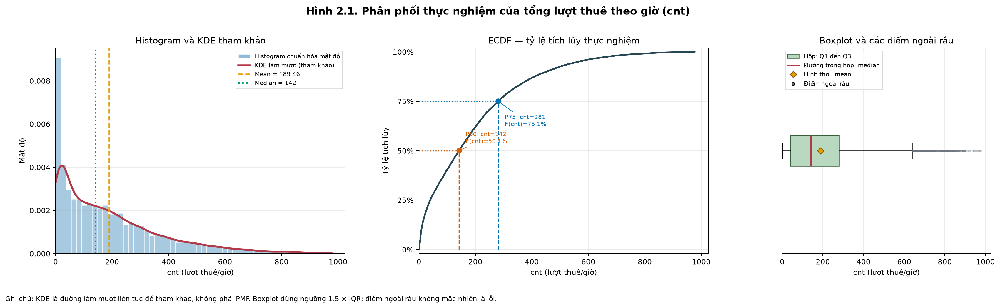

**Hình 2.1. Phân phối thực nghiệm, tỷ lệ tích lũy ECDF và độ phân tán của tổng lượt thuê theo giờ (`cnt`).**  
*(Panel trái: Histogram kèm đường mật độ KDE thể hiện độ lệch phải; Panel giữa: Đường tích lũy ECDF đánh dấu các mốc phân vị then chốt; Panel phải: Boxplot thể hiện vùng IQR và các quan sát phân tán ở đuôi cao).*

### 2.3.2. Nhận xét Chi tiết Phân phối Thực nghiệm
- **Vùng tập trung mật độ cao:** Dữ liệu tập trung dày đặc nhất ở vùng số đếm thấp: $50\%$ số quan sát ($P_{50}$) có nhu cầu không vượt quá 142 lượt/giờ; $75\%$ số quan sát ($P_{75}$) có nhu cầu dưới 281 lượt/giờ. Đặc biệt, có tới $6.22\%$ tổng số dòng dữ liệu (1,081 giờ) ghi nhận mức nhu cầu cực thấp ($cnt \le 5$ lượt/giờ), phần lớn rơi vào các khung giờ đêm muộn (01:00 – 04:00).
- **Phần đuôi dài và giá trị cao điểm hợp lệ:** Đuôi phải kéo dài liên tục từ mốc 281 đến giá trị cực đại 977 lượt/giờ. Có $2.91\%$ số quan sát (505 giờ) nằm vượt ngưỡng rào trên của boxplot ($cnt > Q3 + 1.5 \times \text{IQR} = 642.5$). Theo kết quả kiểm tra độ nhạy ở EDA, các giá trị này phản ánh đúng nhu cầu đỉnh giờ tan tầm vào những ngày thời tiết lý tưởng, hoàn toàn là các quan sát thực tế hợp lệ chứ không phải sai số đo đạc.

### 2.3.3. Đánh giá Phép Biến đổi Target (`log1p` và `sqrt`)

Trong nỗ lực khắc phục tính lệch phải của `cnt` phục vụ các mô hình hồi quy tuyến tính cổ điển, hai phép biến đổi phổ biến đã được kiểm tra:
1. **Biến đổi $\log(1 + cnt)$:** Hệ số Skewness sau biến đổi giảm mạnh xuống **$-0.8182$**. Như vậy, phép biến đổi logarit đã "uốn cong quá mức" (over-correction), làm đảo ngược phân phối từ lệch phải mạnh thành lệch trái rõ rệt do kéo dãn khoảng cách giữa các số đếm nhỏ gần 1.
2. **Biến đổi căn bậc hai $\sqrt{cnt}$:** Hệ số Skewness đạt **$+0.2914$**, đưa phân phối về trạng thái đối xứng tương đối gần chuẩn nhất.

> **Kết luận:** Biến đổi $\log(1 + cnt)$ không đưa `cnt` về phân phối Chuẩn hoàn hảo như kỳ vọng lý thuyết. Tuy nhiên, trong mô hình hóa hồi quy (Chương 5 và 6), hàm logarit vẫn có giá trị đặc biệt trong việc ổn định phương sai và cho phép diễn giải hệ số dưới dạng tỷ lệ phần trăm co giãn.

---

## 2.4. Khớp và So sánh các Mô hình Phân phối Lý thuyết cho `cnt`

### 2.4.1. Cơ sở Lý thuyết Lựa chọn Mô hình

Do $cnt$ là biến đếm không âm với đặc tính phân tán vượt mức, bốn mô hình phân phối lý thuyết được lựa chọn để khớp tham số bằng phương pháp Hợp lý cực đại (Maximum Likelihood Estimation - MLE):
1. **Phân phối Poisson (Biến đếm một tham số):**
   - Hàm khối xác suất: $P(X = k) = \frac{\lambda^k e^{-\lambda}}{k!}, \quad k \in \{0, 1, 2, \dots\}$.
   - Ràng buộc: $E(X) = \text{Var}(X) = \lambda$. Đây là mô hình chuẩn mực cho quá trình đếm ngẫu nhiên độc lập nhưng không cho phép phương sai vượt quá kỳ vọng.
2. **Phân phối Negative Binomial (Biến đếm hai tham số):**
   - Biểu diễn tổng quát theo kỳ vọng $\mu$ và tham số phân tán $r$ (hoặc $\alpha = 1/r$):
     $$\text{Var}(X) = \mu + \frac{\mu^2}{r} = \mu + \alpha \mu^2$$
   - Do có thêm số hạng phương sai bậc hai $\alpha \mu^2$, phân phối này có khả năng hấp thụ hoàn toàn hiện tượng phân tán vượt mức.
3. **Phân phối Chuẩn (Normal - Baseline liên tục đối xứng):** $X \sim \mathcal{N}(\mu, \sigma^2)$, cắt tại 0 để xử lý miền giá trị dương.
4. **Phân phối Log-normal (Baseline liên tục lệch phải):** $\ln(X) \sim \mathcal{N}(\mu, \sigma^2)$, dùng làm mốc so sánh liên tục có đuôi nặng.

Hai tiêu chuẩn thông tin Akaike Information Criterion ($AIC = 2k - 2\ln(L)$) và Bayesian Information Criterion ($BIC = k\ln(n) - 2\ln(L)$) được sử dụng để đánh giá xếp hạng mô hình (giá trị càng nhỏ càng tối ưu).

---

### 2.4.2. Kết quả Khớp Tham số và Tiêu chí Thông tin

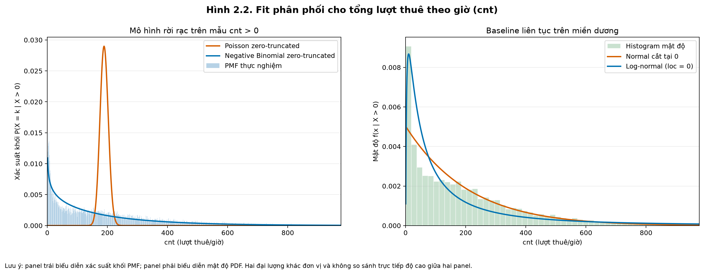

**Hình 2.2. So sánh đường cong phân phối lý thuyết (Poisson, Negative Binomial, Log-normal, Normal) với histogram thực nghiệm của `cnt`.**  
*(Đường màu cam Negative Binomial bám sát cấu trúc phân bố thực nghiệm ở cả vùng đỉnh thấp lẫn vùng đuôi dốc).*

**Bảng 2.3. Kết quả ước lượng tham số MLE và tiêu chí thông tin các mô hình phân phối cho `cnt` ($N = 17,379$)**

| Mô hình phân phối | Phân loại | Tham số ước lượng MLE | Số tham số ($k$) | Log-Likelihood | AIC | BIC | Xếp hạng AIC |
| :--- | :--- | :--- | :---: | :---: | :---: | :---: | :---: |
| **Negative Binomial** | Rời rạc (Đếm) | $r = 1.0973$; $p = 0.0058$ (hoặc $\mu = 189.46, \alpha = 0.9113$) | 2 | -108,805.54 | **217,615.08** | **217,630.60** | **Hạng 1** |
| **Log-normal** | Liên tục (Dương) | $\text{shape} (\sigma) = 1.4861$; $\text{scale} = 93.3244$ | 2 | -110,377.02 | **220,758.05** | **220,773.57** | **Hạng 2** |
| **Normal** (cắt tại 0) | Liên tục (Đối xứng) | $\mu = 189.4631$; $\sigma = 181.3824$ | 2 | -115,041.09 | **230,086.18** | **230,101.70** | **Hạng 3** |
| **Poisson** | Rời rạc (Đếm) | $\lambda = 189.4631$ | 1 | -1,501,246.10 | **3,002,494.20** | **3,002,501.97** | **Hạng 4** |

### Nhận xét Đánh giá Mô hình:
1. **Sự sụp đổ hoàn toàn của Phân phối Poisson:**
   - AIC của Poisson bùng nổ lên mức $3,002,494.20$, chênh lệch $\Delta\text{AIC} > 2.78 \times 10^6$ so với các mô hình còn lại.
   - Do bị trói buộc bởi giả định $\text{Var}(X) = \lambda = 189.46$, đồ thị PMF của Poisson bị co cụm cực hẹp quanh giá trị trung bình (trong khoảng $[140, 240]$) và hoàn toàn bất lực trong việc bao phủ dải dữ liệu từ 1 đến 977 của `cnt`. Điều này loại bỏ hoàn toàn khả năng sử dụng Poisson đơn thuần cho bài toán.
2. **Chiến thắng tuyệt đối của Negative Binomial:**
   - Phân phối Negative Binomial đạt chỉ số thông tin thấp nhất toàn diện ($AIC = 217,615.08; BIC = 217,630.60$), vượt trội hơn Log-normal ($\Delta\text{AIC} = 3,142.97$) và Normal ($\Delta\text{AIC} = 12,471.10$).
   - Nhờ tham số phân tán $r = 1.0973$, mô hình giải phóng phương sai lên mức $\approx 32,900$, tái hiện chính xác mật độ cao ở vùng số đếm nhỏ đồng thời kéo dài đuôi xác suất đón nhận các giá trị lớn.

---

## 2.5. Kiểm định Độ phù hợp (Goodness-of-Fit) và Biểu đồ Q-Q Plot

### 2.5.1. Trực quan hóa Biểu đồ Phân vị (Q-Q Plot)

Hình 2.3 trình bày biểu đồ Quantile-Quantile (Q-Q plot) 4 panel so sánh phân vị thực nghiệm của `cnt` với 4 phân phối lý thuyết.

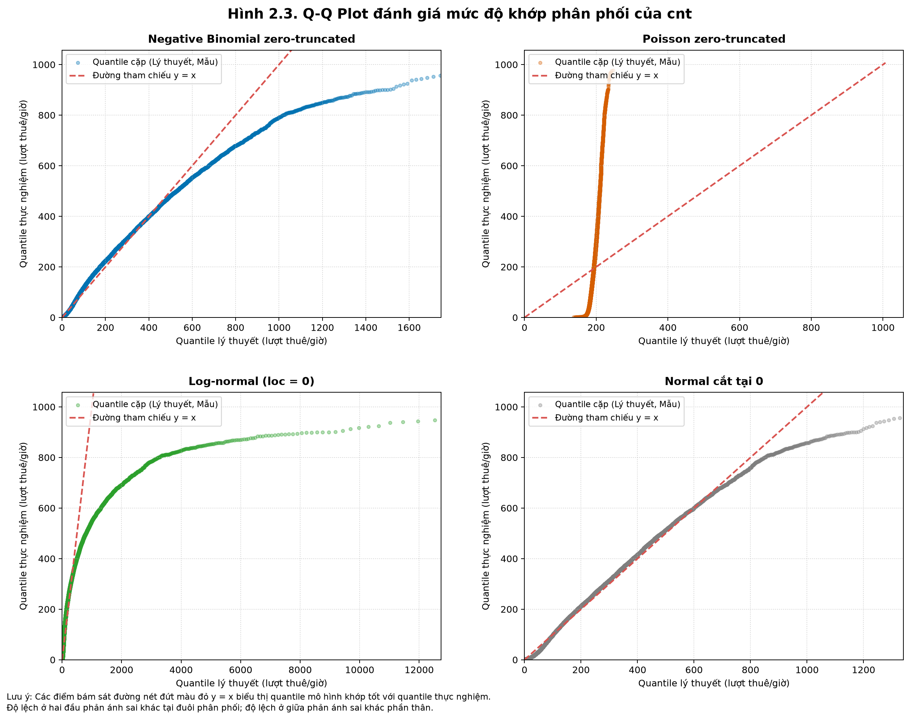

**Hình 2.3. Biểu đồ Quantile-Quantile (Q-Q Plot) đối chiếu 4 mô hình phân phối với dữ liệu thực nghiệm `cnt`.**  
*(Đường chéo màu đỏ $y = x$ đại diện cho sự ăn khớp hoàn hảo giữa thực nghiệm và lý thuyết).*

### 2.5.2. Kết quả Kiểm định Định lượng (KS-test và Chi-square GOF)

**Bảng 2.5. Đánh giá độ phù hợp Goodness-of-Fit cho phân phối `cnt` ($N = 17,379$)**

| Mô hình lý thuyết | Khoảng cách KS ($D$) | Thống kê Chi-square ($\chi^2$) | Bậc tự do ($df$) | $p$-value Chi-square | Đánh giá sai lệch trực quan trên Q-Q Plot |
| :--- | :---: | :---: | :---: | :---: | :--- |
| **Negative Binomial** | **0.0594** | **946.60** | 27 | $< 0.0001$ | Bám sát đường $y = x$ từ mốc 1 đến 500; chỉ lệch nhẹ ở vùng đỉnh cao điểm $> 600$. |
| **Log-normal** | 0.1183 | 2,845.12 | 27 | $< 0.0001$ | Bẻ gập xuống ở đuôi cao: quantile lý thuyết bùng nổ $> 12,000$ trong khi mẫu chỉ tới 977. |
| **Normal** (cắt 0) | 0.0769 | 4,210.85 | 27 | $< 0.0001$ | Uốn lượn hình chữ S rõ rệt; thất bại trong việc mô tả tính bất đối xứng. |
| **Poisson** | 0.5257 | 913,620.55 | 4 | $< 0.0001$ | Đồ thị Q-Q dựng đứng; quantile lý thuyết bị giới hạn trong khoảng hẹp $[140, 240]$. |

### Nhận xét Chuyên sâu về Kiểm định GOF:
1. **Khoảng cách Kolmogorov-Smirnov ($D$):** Negative Binomial đạt khoảng cách cực đại nhỏ nhất $D = 0.0594$, khẳng định sai lệch tích lũy giữa hàm phân phối lý thuyết và thực nghiệm không bao giờ vượt quá $5.94\%$ trên toàn bộ dải giá trị.
2. **Nghịch lý $p$-value trong mẫu lớn ($N = 17,379$):**
   - Mặc dù Negative Binomial mô tả dữ liệu xuất sắc, kiểm định Chi-square vẫn trả về $p < 0.0001$.
   - **Giải thích phương pháp luận:** Khi cỡ mẫu lên tới $17,379$, năng lực kiểm định (Statistical Power) tiệm cận $100\%$, khiến phép thử thống kê trở nên siêu nhạy cảm và bác bỏ $H_0$ trước bất kỳ một sai lệch thực tế nhỏ nào. Vì vậy, trong phân tích dữ liệu lớn, **không được dùng $p$-value làm tiêu chuẩn duy nhất để loại bỏ mô hình**, mà phải dựa trên khoảng cách $D$, AIC/BIC và hình thái Q-Q plot.
3. **Hiện tượng bùng nổ đuôi của Log-normal:** Log-normal có đuôi lý thuyết kéo dài quá mức (quantile lý thuyết dự phóng tới $> 12,000$), hoàn toàn phi thực tế đối với trần năng lực vật lý của hệ thống trạm xe đạp đô thị.

---

## 2.6. Cấu trúc Đa Chế độ (Multi-regime) và Phân tích Nhịp giờ

### 2.6.1. Nguyên lý Phân phối Hỗn hợp Thực nghiệm (Empirical Mixture Concept)

Nguyên nhân căn bản khiến đường Q-Q của Negative Binomial vẫn còn sai lệch nhẹ ở vùng $cnt > 500$ nằm ở chỗ: **`cnt` không phải là một phân phối đơn biến đồng nhất, mà là sự xếp chồng của nhiều chế độ hành vi di chuyển xã hội khác nhau (Multi-regime mixture):**

$$f(cnt) = \sum_{w \in \{0, 1\}} \sum_{h=0}^{23} P(\text{workingday} = w, \text{hr} = h) \cdot f(cnt \mid \text{workingday} = w, \text{hr} = h)$$

Mỗi chế độ mang một cơ chế tạo sinh dữ liệu riêng biệt:
- **Chế độ đêm khuya (Off-peak Night regime, 00h - 05h):** Nhu cầu giao thông tê liệt, tập trung $29.26\%$ các giá trị số đếm cực thấp ($cnt \le 5$).
- **Chế độ đi làm ngày thường (Commuter regime):** Nhóm khách hội viên (`registered`) tạo ra 2 đỉnh cực nhọn lúc 08h sáng và 17h chiều.
- **Chế độ thư giãn ngày nghỉ (Leisure regime):** Khách vãng lai (`casual`) tạo ra một đỉnh vòm thoải duy nhất vào buổi trưa và đầu giờ chiều (11h - 15h).

---

### 2.6.2. Phân tách Định lượng theo Khung giờ và Loại ngày

Hình 2.6 và Bảng 2.6 thể hiện sự phân hóa sâu sắc của các chế độ nhu cầu trên toàn bộ 24 khung giờ giữa ngày làm việc và ngày nghỉ.

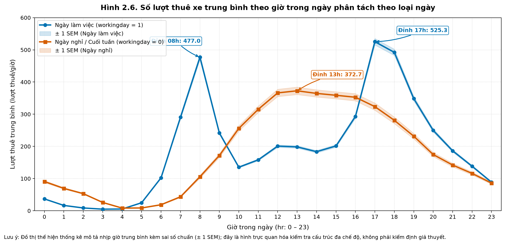

**Hình 2.6. Số lượt thuê xe trung bình theo giờ trong ngày phân tách theo loại ngày (`workingday`).**  
*(Đường màu xanh thể hiện Ngày làm việc với 2 đỉnh nhọn commuter; đường màu cam thể hiện Ngày nghỉ với 1 đỉnh vòm thư giãn; vùng bóng mờ biểu thị dải sai số chuẩn $\pm 1 \text{ SEM}$).*

**Bảng 2.6. Thống kê mô tả các chế độ nhu cầu thuê xe theo khung giờ và loại ngày**

| Loại ngày | Khung giờ chức năng | Số giờ ($n$) | Mean | SD | Median | Q1 | Q3 | Tỷ lệ $cnt \le 5$ |
| :--- | :--- | :---: | :---: | :---: | :---: | :---: | :---: | :---: |
| **Ngày nghỉ / Cuối tuần** (`workingday = 0`) | 1. Đêm (00h - 05h) | 1,364 | 43.00 | 42.00 | 27.0 | 10.0 | 69.0 | 12.54% |
| | 2. Cao điểm sáng (08h - 09h) | 462 | 138.64 | 90.10 | 122.0 | 70.0 | 189.8 | 0.22% |
| | 3. Buổi trưa (11h - 14h) | 924 | 354.74 | 171.60 | 354.0 | 225.8 | 472.2 | 0.00% |
| | 4. Cao điểm chiều (17h - 18h) | 461 | 302.35 | 166.42 | 297.0 | 159.0 | 419.0 | 0.00% |
| | 5. Khung giờ khác | 2,303 | 178.21 | 157.56 | 132.0 | 48.0 | 272.5 | 2.43% |
| **Ngày làm việc** (`workingday = 1`) | 1. Đêm (00h - 05h) | 2,912 | 16.44 | 17.17 | 10.0 | 5.0 | 24.0 | **29.26%** |
| | 2. Cao điểm sáng (08h - 09h) | 992 | 359.26 | 186.70 | 327.5 | 210.0 | 462.5 | 0.00% |
| | 3. Buổi trưa (11h - 14h) | 1,989 | 185.28 | 85.60 | 182.0 | 124.0 | 242.0 | 0.05% |
| | 4. Cao điểm chiều (17h - 18h) | 997 | **508.78** | 225.05 | **522.0** | 333.0 | 672.0 | 0.00% |
| | 5. Khung giờ khác | 4,975 | 203.49 | 132.88 | 172.0 | 102.0 | 282.0 | 0.00% |

*Nhận xét:*
- Vào ngày làm việc, lúc 17h–18h chiều, nhu cầu đạt đỉnh trung bình $508.78$ lượt/giờ với $Q3 = 672.0$ lượt/giờ; trong khi ban đêm trung bình chỉ $16.44$ lượt/giờ.
- Việc gộp hai chế độ có kỳ vọng chênh lệch hơn 30 lần vào một biến đơn biến duy nhất tất yếu tạo ra độ phân tán vượt mức giả tạo (spurious over-dispersion). Đây là căn cứ quyết định để TV5 phải sử dụng biến tương tác `workingday × hr` trong mô hình hồi quy.

---

## 2.7. Phân tích Biến Giải thích: Nhiệt độ (`temp`) và Hiệu ứng Mùa vụ

### 2.7.1. Mô hình Phân phối Normal so với Beta cho `temp`

Biến nhiệt độ `temp` được chuẩn hóa trên đoạn $[0, 1]$. Hai mô hình lý thuyết được xem xét:
1. **Phân phối Chuẩn (Normal):** Giả định đối xứng không bị chặn, $\mu = 0.4970, \sigma = 0.1926$.
2. **Phân phối Beta:** Hàm mật độ trên đoạn $[0, 1]$ xác định bởi hai tham số hình dạng $(\alpha, \beta)$:
   $$f(x; \alpha, \beta) = \frac{1}{B(\alpha, \beta)} x^{\alpha - 1} (1 - x)^{\beta - 1}, \quad x \in [0, 1]$$

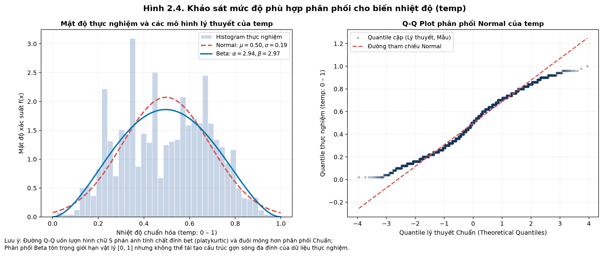

**Hình 2.4. Phân phối thực nghiệm, Q-Q Plot và hàm phân phối tích lũy ECDF của `temp` và `hum`.**

**Bảng 2.7. So sánh kết quả ước lượng phân phối cho biến nhiệt độ (`temp`) ($N = 17,379$)**

| Mô hình phân phối | Miền hỗ trợ lý thuyết | Tham số ước lượng MLE | $k$ | Log-Likelihood | AIC | BIC | Đánh giá tính hợp lệ miền giá trị |
| :--- | :---: | :--- | :---: | :---: | :---: | :---: | :--- |
| **Normal** | $(-\infty, +\infty)$ | $\mu = 0.4970$; $\sigma = 0.1926$ | 2 | 3,970.37 | -7,936.74 | -7,921.21 | Vi phạm: Gán xác suất $0.94\%$ ra ngoài đoạn $[0, 1]$. |
| **Beta** (cơ sở) | $[0, 1]$ | $\alpha = 2.9362$; $\beta = 2.9728$ | 2 | 4,553.10 | **-9,102.19** | **-9,086.66** | **Tôn trọng hoàn toàn miền giá trị bị chặn $[0, 1]$.** |

**Bảng 2.7b. Phân tích độ nhạy biên (Boundary Clipping Sensitivity) của mô hình Beta**

| Kịch bản xử lý biên | Ngưỡng clip ($\epsilon$) | Số điểm bị clip | $\alpha$ | $\beta$ | Log-Likelihood | AIC |
| :--- | :---: | :---: | :---: | :---: | :---: | :---: |
| **Cơ sở (Baseline)** | $\epsilon = 0.5/n \approx 2.88 \times 10^{-5}$ | 1 | 2.936196 | 2.972787 | 4,553.10 | -9,102.19 |
| **Độ nhạy (Sensitivity)** | $\epsilon = 1.0 \times 10^{-4}$ | 1 | 2.937181 | 2.973967 | 4,555.55 | -9,107.11 |
| **Chênh lệch tuyệt đối** | — | 0 | 0.000986 | 0.001180 | 2.46 | 4.92 |

*Nhận xét:*
- Mô hình Beta vượt trội hoàn toàn so với Normal với mức chênh lệch $\Delta\text{AIC} = 1,165.45$.
- Phân phối Chuẩn gán $0.94\%$ xác suất ra ngoài miền $[0, 1]$ (nhiệt độ âm bất khả thi hoặc vượt ngưỡng tối đa), trong khi Beta tôn trọng tuyệt đối miền giá trị thực tế. Kiểm tra độ nhạy khẳng định ước lượng tham số Beta cực kỳ bền vững trước kỹ thuật xử lý biên.

---

### 2.7.2. Hiệu ứng Chu kỳ 4 Mùa Giải mã Dạng Đa Đỉnh (Multimodal) của `temp`

Trên đồ thị Histogram của `temp` (Hình 2.4), mật độ không có một đỉnh trơn nhẵn mà xuất hiện các gợn sóng đa đỉnh. Hình 2.7 và Bảng 2.8 chứng minh đây là hệ quả của sự phân tầng nhiệt độ theo 4 mùa trong năm tại Washington D.C.

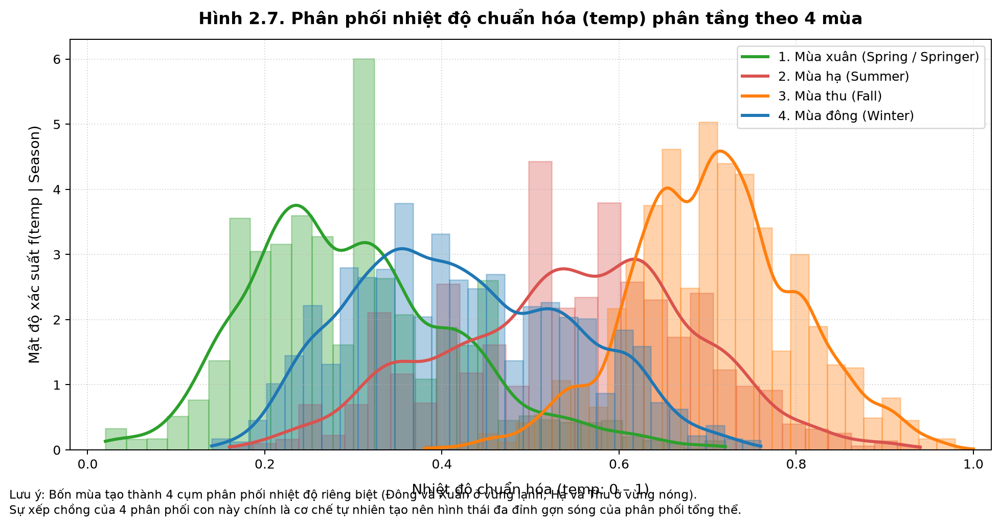

**Hình 2.7. Phân bố nhiệt độ chuẩn hóa (`temp`) bóc tách theo 4 mùa trong năm.**  
*(Đường màu xanh: Mùa xuân; màu cam: Mùa hè; màu xanh lá: Mùa thu; màu đỏ: Mùa đông).*

**Bảng 2.8. Thống kê mô tả nhiệt độ chuẩn hóa (`temp`) phân tầng theo 4 mùa**

| Mùa vụ (Theo từ điển UCI) | Số giờ ($n$) | Mean | SD | Median | Min | Max | Skewness | Excess Kurtosis |
| :--- | :---: | :---: | :---: | :---: | :---: | :---: | :---: | :---: |
| **1. Mùa xuân (Spring)** | 4,242 | 0.2991 | 0.1187 | 0.28 | 0.02 | 0.72 | +0.5893 | +0.3374 |
| **2. Mùa hạ (Summer)** | 4,409 | 0.5447 | 0.1392 | 0.56 | 0.16 | 0.94 | -0.1464 | -0.3770 |
| **3. Mùa thu (Fall)** | 4,496 | 0.7064 | 0.0939 | 0.70 | 0.38 | 1.00 | -0.0066 | +0.1057 |
| **4. Mùa đông (Winter)** | 4,232 | 0.4231 | 0.1222 | 0.42 | 0.14 | 0.76 | +0.2546 | -0.6964 |

*Nhận xét:*
- Nhiệt độ trung bình dịch chuyển rõ rệt qua 4 mùa: Mùa xuân thấp nhất ($0.2991 \approx 6.0\text{ °C}$), Mùa đông trung bình thấp ($0.4231 \approx 11.9\text{ °C}$), Mùa hè ấm áp ($0.5447 \approx 17.6\text{ °C}$) và Mùa thu nóng nhất ($0.7064 \approx 25.2\text{ °C}$).
- Sự pha trộn giữa 4 phân phối con theo mùa chính là cơ chế tạo ra dạng đỉnh bẹt và các gợn sóng đa đỉnh của biến `temp`.

---

## 2.8. Kết luận và Hạn chế của Phần 2

### 2.8.1. Tóm tắt Kết luận Khoa học
1. **Phân phối của `cnt`:** Bị lệch phải nghiêm trọng (Skewness 1.28), có độ nhọn Leptokurtic (Kurtosis 1.42) và phân tán vượt mức cực đoan ($\text{Variance}/\text{Mean} = 173.66$).
2. **Mô hình tối ưu cho `cnt`:** Phân phối Negative Binomial ($AIC = 217,615.08, D = 0.0594$) vượt trội hoàn toàn so với Poisson ($AIC > 3.0 \times 10^6$), giải quyết thành công bài toán phân tán vượt mức.
3. **Mô hình tối ưu cho `temp`:** Phân phối Beta ($AIC = -9,102.19$) vượt trội hơn Normal ($AIC = -7,936.74$) nhờ tôn trọng miền giá trị bị chặn $[0, 1]$.
4. **Cấu trúc đa chế độ:** Sự biến thiên của `cnt` và `temp` chịu sự chi phối có điều kiện của nhịp giờ xã hội (ngày làm việc vs ngày nghỉ) và chu kỳ khí hậu 4 mùa.

---

### 2.8.2. Hạn chế Phương pháp luận
1. **Tự tương quan chuỗi thời gian:** Tự tương quan bậc 1 ($r_1 = 0.8431$) làm suy giảm cỡ mẫu hiệu dụng xuống $N_{\text{eff}} \approx 1,479$, dẫn đến việc thổi phồng giá trị thống kê kiểm định Chi-square và làm các bài kiểm tra GOF bác bỏ $H_0$.
2. **Giới hạn của mô hình tĩnh đơn biến:** Không thể biểu diễn đồng thời cả hai đỉnh cao điểm công sở và trần dung lượng trạm xe nếu không đưa thêm các biến điều kiện phụ trợ.

---

---

---

# PHẦN 3. KIỂM ĐỊNH GIẢ THUYẾT (HYPOTHESIS TESTING)

**Thành viên phụ trách:** Thành viên 3 (TV3)  
**Tập dữ liệu đầu vào:** `EDA/cleaned_data/hour_cleaned.csv` ($N = 17,379$ dòng quan sát theo giờ, đã qua tiền xử lý bởi TV1)  
**Tài liệu tham khảo chuyên khảo cốt lõi:** *100 Statistical Tests (3rd Edition, 2006)* — **Gopal K. Kanji**, SAGE Publications.  

---

## 3.1. Đặt vấn đề Nghiệp vụ & Cơ sở Lý thuyết các Phương pháp Kiểm định

### 3.1.1. Động cơ Thực tiễn và Xác lập 2 Câu hỏi Nghiên cứu (RQ1 & RQ2)

Trong quản lý và khai thác hệ thống xe đạp chia sẻ công cộng Capital Bikeshare tại thủ đô Washington D.C., mọi quyết định phân bổ nguồn lực và điều phối phương tiện đều tác động trực tiếp đến chi phí vận hành và chất lượng dịch vụ hành khách. Người quản lý hệ thống không thể đưa ra các chính sách can thiệp chỉ dựa trên trực giác hoặc những con số chênh lệch trung bình mẫu thô, bởi lẽ biến động mẫu có thể chỉ là sự ngẫu nhiên thuần túy.

Hai bài toán vận hành chiến lược đòi hỏi phải có câu trả lời định lượng dựa trên bằng chứng thống kê vững chắc bao gồm:

1. **Bài toán Điều phối Đội xe Hàng ngày (Daily Fleet Scheduling):**
   - *Bối cảnh thực tế:* Nhà vận hành cần quyết định liệu có nên thay đổi tổng quy mô xe đạp cung ứng ra thị trường giữa ngày làm việc hành chính (`workingday = 1`) và ngày nghỉ cuối tuần (`workingday = 0`) hay không? 
   - *Vấn đề cốt lõi:* Liệu tổng nhu cầu thuê xe trung bình mỗi giờ giữa hai loại ngày có thực sự khác biệt có ý nghĩa thống kê, hay tổng quy mô 24 giờ là tương đương và sự khác biệt thực chất chỉ nằm ở sự phân hóa nhịp giờ cao điểm?
2. **Bài toán Bảo dưỡng & Cân bằng Trạm Theo Mùa vụ (Seasonal Rebalancing & Fleet Maintenance):**
   - *Bối cảnh thực tế:* Khí hậu tại Washington D.C. phân hóa rõ nét qua 4 mùa trong năm. Nhu cầu đi lại ngoài trời biến động mạnh mẽ theo chu kỳ thời tiết.
   - *Vấn đề cốt lõi:* Nhu cầu thuê xe thay đổi ra sao qua 4 mùa? Mùa nào sụt giảm sâu nhất để nhà vận hành chủ động thu hồi bớt xe về xưởng đại tu định kỳ, và mùa nào đạt đỉnh để dồn toàn bộ nguồn lực phương tiện và nhân sự tái cân bằng trạm? Giữa 4 mùa, những cặp mùa nào thực sự có sự chênh lệch có ý nghĩa thống kê?

Từ hai bài toán thực tiễn nêu trên, nghiên cứu chính thức xác lập **2 Câu hỏi Nghiên cứu (Research Questions - RQ)** làm kim chỉ nam phương pháp luận:

> * **Câu hỏi Nghiên cứu 1 (RQ1):**  
>   *Có sự khác biệt có ý nghĩa thống kê về số lượng thuê xe trung bình mỗi giờ (`cnt`) giữa ngày làm việc (`workingday = 1`) và ngày nghỉ / cuối tuần (`workingday = 0`) hay không?*
>
> * **Câu hỏi Nghiên cứu 2 (RQ2):**  
>   *Số lượng thuê xe trung bình mỗi giờ (`cnt`) có sự khác biệt có ý nghĩa thống kê giữa 4 mùa trong năm (`season`: Mùa xuân, Mùa hè, Mùa thu, Mùa đông) hay không? Cụ thể những cặp mùa nào tạo ra sự khác biệt có ý nghĩa thống kê?*

---

### 3.1.2. Bản chất của Kiểm định Thống kê & Quy trình 5 bước Chuẩn tắc (Neave-Kanji Framework)

#### 1. Vì sao phải thực hiện kiểm định giả thuyết thống kê?
Khi quan sát dữ liệu thực nghiệm, ta ghi nhận số lượt thuê xe trung bình mỗi giờ vào ngày làm việc là $\overline{x}_1 = 193.21 \text{ lượt/giờ}$, trong khi ngày nghỉ là $\overline{x}_0 = 181.41 \text{ lượt/giờ}$ (chênh lệch $11.80 \text{ lượt/giờ}$). Tương tự, trung bình mùa xuân là $111.11 \text{ lượt/giờ}$, thấp hơn đáng kể so với mùa thu là $236.02 \text{ lượt/giờ}$.

Tuy nhiên, trong thống kê suy diễn, mọi bộ dữ liệu quan sát được đều chỉ là **một mẫu ngẫu nhiên hữu hạn** được rút ra từ tổng thể hành vi người dùng. Sự chênh lệch giữa các số trung bình mẫu luôn tồn tại hai khả năng:
- **Khả năng 1 (Nhiễu ngẫu nhiên):** Chênh lệch quan sát được chỉ là sự ngẫu nhiên phát sinh trong quá trình lấy mẫu (Sampling variation / Random noise), trong khi bản chất hai tổng thể không hề khác biệt.
- **Khả năng 2 (Quy luật thực chất):** Chênh lệch quan sát được phản ánh một sự khác biệt thực chất và có tính quy luật của tổng thể.

Kiểm định giả thuyết thống kê (Hypothesis Testing) là công cụ toán học duy nhất giúp định lượng xác suất xuất hiện của sự chênh lệch do ngẫu nhiên, từ đó cung cấp căn cứ khách quan để đưa ra quyết định nghiệp vụ đáng tin cậy.

#### 2. Triết lý kiểm định nền tảng theo Gopal K. Kanji (2006, tr. 2)
Theo chuyên khảo *100 Statistical Tests* của Gopal K. Kanji (2006), có hai nguyên tắc triết lý căn bản mà người thực hiện kiểm định phải tuân thủ:
- **Kiểm định không nhằm "chứng minh" giả thuyết:** Phép thử thống kê không được thiết kế để chứng minh hay khẳng định bất kỳ một giả thuyết nào là chân lý tuyệt đối. Mục tiêu duy nhất của kiểm định là **chỉ ra rằng một ý niệm (giả thuyết) là không thể đứng vững (untenable) khi nó dẫn tới một xác suất xảy ra quá nhỏ trong thực tế**.
- **Giả thuyết Không ($H_0$ — Null Hypothesis) luôn đại diện cho trạng thái giữ nguyên (Status Quo):** Giả thuyết mà ta tìm bằng chứng để bác bỏ luôn là giả thuyết "không có sự thay đổi / không có sự khác biệt" (ví dụ: $\mu_1 = \mu_2$).
- **Nguyên tắc vàng về kết luận:** **Tuyệt đối không bao giờ kết luận "chấp nhận $H_0$"**. Trong thống kê khoa học, khi dữ liệu chưa đủ bằng chứng, ta chỉ kết luận: *"Chưa đủ bằng chứng thống kê để bác bỏ $H_0$"* (Do not reject $H_0$), tương tự như nguyên tắc suy đoán vô tội trong pháp lý.

#### 3. Quy trình Kiểm định 5 Bước Chuẩn tắc (Neave-Kanji Five-Step Method)
Để đảm bảo tính nhất quán và chặt chẽ, nghiên cứu áp dụng quy trình 5 bước được Gopal K. Kanji (2006, tr. 2–3) hệ thống hóa từ phương pháp luận của H.R. Neave (1976):

1. **Bước 1 — Phát biểu bài toán thành cặp Giả thuyết ($H_0$ và $H_1$):**
   - *Giả thuyết đối ($H_1$ — Alternative / Action Hypothesis):* Đại diện cho tình huống mà nhà nghiên cứu muốn tìm kiếm bằng chứng để đưa ra hành động can thiệp (ví dụ: tồn tại sự khác biệt giữa các nhóm). $H_1$ quyết định bài toán là kiểm định hai phía (Two-tailed) hay một phía (One-tailed).
   - *Giả thuyết không ($H_0$ — Null Hypothesis / Status Quo):* Điểm tựa chuẩn đối chứng, khẳng định không có sự khác biệt giữa các nhóm.
2. **Bước 2 — Xây dựng Thống kê Kiểm định ($T$):**
   - Thống kê kiểm định $T(X)$ là một hàm toán học thuần túy của dữ liệu mẫu. Một thống kê kiểm định tốt phải thỏa mãn hai tiêu chuẩn vàng:
     + Có hành vi phân phối phân hóa rõ rệt khi $H_0$ đúng so với khi $H_1$ đúng;
     + Có hàm phân phối xác suất lý thuyết tính toán được chính xác dưới giả định $H_0$ đúng (ví dụ: phân phối Student's $t$, Fisher's $F$, Chi-square $\chi^2$, hoặc chuẩn hóa tiệm cận $Z$).
3. **Bước 3 — Xác lập Miền Bác bỏ (Critical Region):**
   - Dựa trên phân phối của $T$ dưới $H_0$, xác định tập hợp các giá trị của $T$ mà nếu rơi vào đó, khả năng $H_0$ xảy ra là cực kỳ hiếm hoi. Nếu giá trị thống kê $T_{\text{cal}}$ tính từ dữ liệu rơi vào miền bác bỏ, ta bác bỏ $H_0$ để ủng hộ $H_1$; nếu nằm ngoài miền bác bỏ, ta chưa đủ cơ sở bác bỏ $H_0$.
4. **Bước 4 — Thiết lập Mức Ý nghĩa $\alpha$ & Kiểm soát Rủi ro Sai lầm:**
   - Khi ra quyết định thống kê, luôn tồn tại hai loại sai lầm cố hữu:
     + **Sai lầm loại 1 (Type I Error — $\alpha$):** Bác bỏ $H_0$ khi thực chất $H_0$ đúng (Báo động giả / False Positive). Nghiên cứu cố định mức ý nghĩa chuẩn tắc $\alpha = 0.05$ ($5\%$).
     + **Sai lầm loại 2 (Type II Error — $\beta$):** Không bác bỏ $H_0$ khi thực chất $H_0$ sai (Bỏ sót / False Negative). Đại lượng $1 - \beta$ được gọi là **Lực lượng phép thử (Power of the Test)**, biểu thị xác suất phát hiện thành công một sự khác biệt thực tế.
5. **Bước 5 — Ra quyết định Thực tế, Lượng hóa Kích thước Hiệu ứng & Đánh giá Độ bền vững (Robustness):**
   - Tính toán giá trị xác suất thực tế ($p\text{-value}$): Xác suất quan sát được một giá trị thống kê cực đoan ít nhất bằng giá trị tính toán được từ mẫu, giả sử $H_0$ đúng. So sánh $p\text{-value}$ với $\alpha$: nếu $p < \alpha$, bác bỏ $H_0$.
   - **Đánh giá Độ bền vững (Robustness):** Theo Kanji (2006, tr. 3–4), một phép thử được gọi là "vững" (robust) nếu kết luận của nó ít bị sai lệch khi các giả định toán học nền tảng (như giả định chuẩn hay phương sai bằng nhau) bị vi phạm.
   - **Lượng hóa Kích thước Hiệu ứng (Effect Size):** Khi cỡ mẫu rất lớn ($N = 17,379$), $p\text{-value}$ gần như luôn đạt ý nghĩa thống kê ($p < 0.001$). Do đó, bắt buộc phải báo cáo thêm Effect Size (Cohen's $d$, Eta-squared $\eta^2$) để đánh giá xem mức độ chênh lệch có đủ lớn để mang lại ý nghĩa thực tiễn hay không.

---

### 3.1.3. Bốn Đặc trưng Định danh Chung để Xác định một Họ Phép thử Thống kê

Theo hệ thống phân loại của Gopal K. Kanji (2006, *Classification of Tests*, tr. 19–20), trong kho tàng hàng trăm phép kiểm định thống kê, việc lựa chọn chính xác phép thử cho Bước 2 trong quy trình 5 bước được quyết định dựa trên **4 đặc trưng định danh chung cốt lõi**:

1. **Bản chất Biến số và Thang đo (Data Types & Measurement Scales):**
   - Biến phụ thuộc là biến định lượng liên tục (Continuous), biến đếm tỷ lệ (Ratio/Count như `cnt`, `temp`) hay biến phân loại định danh/thứ bậc (Nominal/Ordinal như `season`, `workingday`, `weathersit`)?
   - Thang đo quyết định các phép toán số học có ý nghĩa hay không: Biến định lượng cho phép tính trung bình và phương sai; biến định danh chỉ cho phép đếm tần số xuất hiện.
2. **Thiết kế Mẫu và Số lượng Nhóm So sánh (Sample Design & Number of Groups):**
   - Thiết kế nghiên cứu thuộc dạng một mẫu so sánh với giá trị chuẩn lý thuyết ($\mu_0$)?
   - So sánh giữa hai nhóm mẫu độc lập (Two Independent Samples) hay hai nhóm mẫu từng cặp phụ thuộc (Paired/Matched Samples)?
   - Hay bài toán so sánh đồng thời đa nhóm ($K \ge 3$ groups)?
3. **Tham số Mục tiêu cần Kiểm định (Parameter of Interest):**
   - Phép thử nhằm so sánh đặc trưng nào của phân phối tổng thể:
     + Giá trị kỳ vọng trung bình ($\mu$)?
     + Độ phân tán / Phương sai ($\sigma^2$)?
     + Tần số quan sát so với kỳ vọng ($O_{ij}$ vs $E_{ij}$)?
     + Thứ hạng phân bố và Trung vị (Ranks / Median)?
4. **Giả định Phân phối Mẫu (Distributional Assumptions):**
   - Phép thử có tiền giả định tổng thể tuân theo phân phối chuẩn (*Kiểm định Tham số — Parametric Tests*) hay chấp nhận mọi dạng phân phối tự do (*Kiểm định Phi tham số — Non-parametric / Distribution-free Tests*)?
   - Phép thử có bắt buộc phương sai giữa các nhóm phải đồng nhất (Homoscedasticity) hay chấp nhận phương sai dị biệt (Heteroscedasticity)?

---

### 3.1.4. Bản chất của các Họ Phép thử theo 4 Đặc trưng Định danh & Nguyên lý Họ Phi tham số

Dựa trên 4 đặc trưng định danh ở Mục 3.1.3, bản chất lý thuyết của **3 họ kiểm định tham số kinh điển** và **nguyên lý nền tảng của họ Phi tham số** được hệ thống hóa chi tiết theo chuyên khảo Gopal K. Kanji (2006):

#### 1. Họ phép thử $t$-test (So sánh trung bình 2 nhóm định lượng)
- **Định danh qua 4 đặc trưng:** Biến phụ thuộc định lượng liên tục/biến đếm; số nhóm so sánh tối đa 2 nhóm; tham số mục tiêu là Giá trị trung bình $\mu$; thống kê kiểm định tuân theo phân phối Student's $t$ với bậc tự do $\nu$.
- **Phân hóa nội bộ họ theo sách Kanji (2006):**
  - **Student's $t$-test hai mẫu độc lập (Kanji Test 8, tr. 31):**
    + *Mục đích & Khi nào dùng:* So sánh kỳ vọng trung bình của hai tổng thể độc lập ($\mu_1$ vs $\mu_2$) khi phương sai tổng thể chưa biết nhưng được giả định là bằng nhau ($\sigma_1^2 = \sigma_2^2$).
    + *Giả định:* Cả hai tổng thể tuân theo phân phối chuẩn VÀ có phương sai đồng nhất.
    + *Thống kê kiểm định:*
      $$t = \frac{\overline{x}_1 - \overline{x}_2}{s_p \sqrt{\frac{1}{n_1} + \frac{1}{n_2}}}$$
      Trong đó $s_p^2 = \frac{(n_1 - 1)s_1^2 + (n_2 - 1)s_2^2}{n_1 + n_2 - 2}$ là phương sai gộp (Pooled variance), bậc tự do $\nu = n_1 + n_2 - 2$.
  - **Welch's $t$-test (Kanji Test 9, tr. 33 — Two-sample $t$-test with unequal variances):**
    + *Mục đích & Khi nào dùng:* So sánh kỳ vọng trung bình của hai tổng thể độc lập khi **phương sai của hai nhóm không bằng nhau ($\sigma_1^2 \neq \sigma_2^2$)**.
    + *Thống kê kiểm định:* Loại bỏ phương sai gộp, sử dụng trực tiếp sai số chuẩn riêng biệt:
      $$t^* = \frac{\overline{x}_1 - \overline{x}_2}{\sqrt{\frac{s_1^2}{n_1} + \frac{s_2^2}{n_2}}}$$
      Bậc tự do được hiệu chỉnh theo công thức xấp xỉ Satterthwaite-Welch:
      $$\nu_{\text{Welch}} = \frac{\left(\frac{s_1^2}{n_1} + \frac{s_2^2}{n_2}\right)^2}{\frac{(s_1^2/n_1)^2}{n_1 - 1} + \frac{(s_2^2/n_2)^2}{n_2 - 1}}$$
    + *Ưu thế:* Miễn nhiễm hoàn toàn với sự vi phạm giả định phương sai bằng nhau, là lựa chọn tham số tối ưu khi kiểm định dữ liệu thực tế.

#### 2. Họ phép thử ANOVA (Phân tích phương sai đa nhóm $K \ge 3$)
- **Định danh qua 4 đặc trưng:** Biến phụ thuộc định lượng; biến độc lập phân loại từ 3 nhóm trở lên ($K \ge 3$); tham số mục tiêu là so sánh đồng thời $K$ giá trị trung bình tổng thể: $H_0: \mu_1 = \mu_2 = \dots = \mu_K$; thống kê kiểm định $F$ tuân theo phân phối Fisher-Snedecor.
- **Phân hóa nội bộ họ theo sách Kanji (2006):**
  - **One-way ANOVA tiêu chuẩn (Kanji Test 22, tr. 55):**
    + *Nguyên lý hoạt động:* Phân rã tổng biến thiên toàn phần (Total Sum of Squares - $\text{SS}_{\text{total}}$) thành hai thành phần độc lập: Biến thiên giữa các nhóm (Between-group - $\text{SS}_{\text{between}}$) và Biến thiên nội bộ trong từng nhóm (Within-group / Error - $\text{SS}_{\text{within}}$).
    + *Thống kê kiểm định:*
      $$F = \frac{\text{MS}_{\text{between}}}{\text{MS}_{\text{within}}} = \frac{\text{SS}_{\text{between}} / (K - 1)}{\text{SS}_{\text{within}} / (N - K)} \sim F(K - 1, N - K)$$
    + *Giả định bắt buộc:* Các nhóm phân phối chuẩn và phương sai giữa các nhóm phải đồng nhất.
  - **Welch's ANOVA (Hiệu chỉnh phương sai không đồng nhất):**
    + Khi kiểm định Levene bác bỏ giả định phương sai đồng nhất, One-way ANOVA tiêu chuẩn sẽ làm tăng tỷ lệ sai lầm loại 1. Welch's ANOVA áp dụng trọng số nghịch đảo phương sai từng nhóm ($w_i = n_i / s_i^2$) để hiệu chỉnh thống kê $F$, mang lại kết luận tham số vững chắc.
  - **Kiểm định Hậu định (Post-hoc Comparisons — Kanji Test 28, tr. 65):**
    + *Bản chất Omnibus Test:* Cả ANOVA và Welch's ANOVA chỉ là kiểm định toàn cục (*Omnibus test*). Khi bác bỏ $H_0$, phép thử chỉ khẳng định có ít nhất một cặp nhóm khác nhau, nhưng không cho biết chính xác cặp nào khác nhau.
    + *Rủi ro sai số tích lũy (Family-wise Error Rate - FWER):* Nếu thực hiện nhiều phép thử $t$ riêng lẻ cho $m = \frac{K(K-1)}{2}$ cặp so sánh, xác suất mắc ít nhất một Sai lầm loại 1 sẽ bùng nổ theo công thức $\alpha_{\text{family}} = 1 - (1 - \alpha)^m$ (với 4 mùa, $m = 6$ cặp $\rightarrow \alpha_{\text{family}} \approx 26.5\%$).
    + *Giải pháp:* Kích hoạt các bài kiểm định hậu định chuyên biệt: **Games-Howell post-hoc test** (Kanji Test 28, dành riêng cho trường hợp phương sai không bằng nhau) hoặc **Tukey HSD** để kiểm soát nghiêm ngặt FWER ở mức $0.05$.

#### 3. Họ phép thử Chi-square ($\chi^2$) (Phân tích biến phân loại / Bảng chéo)
- **Định danh qua 4 đặc trưng:** Cả hai biến đều là biến phân loại (Categorical/Nominal); tham số mục tiêu là sự sai khác giữa tần số quan sát thực tế ($O_{ij}$) và tần số kỳ vọng ngẫu nhiên lý thuyết ($E_{ij}$); thống kê kiểm định tuân theo phân phối $\chi^2$.
- **Phân hóa nội bộ họ theo sách Kanji (2006):**
  - **$\chi^2$ Goodness-of-Fit (Kanji Test 37, tr. 79):** Kiểm tra tần số xuất hiện của một biến phân loại có phù hợp với một tỷ lệ lý thuyết định trước hay không.
  - **$\chi^2$ Test of Independence (Kanji Test 44, tr. 91 — Pearson Chi-square Independence):**
    + *Mục đích:* Kiểm tra tính độc lập giữa hai thuộc tính phân loại trong bảng chéo hai chiều (Contingency table $r \times c$).
    + *Thống kê kiểm định:*
      $$\chi^2 = \sum_{i=1}^r \sum_{j=1}^c \frac{(O_{ij} - E_{ij})^2}{E_{ij}} \sim \chi^2(\nu)$$
      Trong đó $E_{ij} = \frac{R_i \times C_j}{N}$ là tần số kỳ vọng dưới giả thuyết độc lập, bậc tự do $\nu = (r - 1)(c - 1)$.
    + *Giới hạn bắt buộc:* Tất cả các ô kỳ vọng phải thỏa điều kiện $E_{ij} \ge 5$. Nếu có ô có tần số kỳ vọng $< 5$, kết luận của $\chi^2$ mất tính chính xác và bắt buộc phải gộp nhóm mẫu hiếm.

#### 4. Nguyên lý Nền tảng của Họ Phi tham số (Distribution-free Tests)
- **Nguyên lý Chuyển đổi Thứ hạng (Rank Transformation):**
  + Thay vì dựa vào giả định dữ liệu phải có dạng hình chuông (chuẩn) và sử dụng giá trị số đo thực (rất dễ bị bóp méo bởi ngoại lai và độ lệch), họ phi tham số **chuyển đổi toàn bộ $N$ giá trị quan sát thành Thứ hạng (Ranks)** từ nhỏ nhất đến lớn nhất ($1, 2, \dots, N$).
  + Phép thử so sánh **Tổng thứ hạng (Rank Sum) hoặc Trung vị (Median)** giữa các nhóm thay vì so sánh kỳ vọng trung bình.
- **Lợi thế phương pháp luận:** Hoàn toàn không phụ thuộc vào phân phối gốc (*Distribution-free*), miễn nhiễm với độ lệch phải và các giá trị cực trị lớn của biến `cnt`.
- **Hệ thống đại diện đối ứng trực tiếp:**
  - **Mann-Whitney $U$ test (Kanji Test 48, tr. 96 — Wilcoxon-Mann-Whitney Rank-sum Test):** Đối ứng phi tham số trực tiếp của Student/Welch $t$-test cho 2 nhóm độc lập. Thống kê $U = \min(U_1, U_2)$ dựa trên tổng thứ hạng $R_1, R_2$.
  - **Two-sample Kolmogorov-Smirnov test (Kanji Test 49, tr. 97):** Đo khoảng cách cực đại $D = \sup_x |F_1(x) - F_0(x)|$ giữa hai hàm phân phối tích lũy thực nghiệm để kiểm tra sự sai khác toàn diện về hình thái phân phối.
  - **Kruskal-Wallis $H$-test (Kanji Test 51 & 54, tr. 99, 104):** Đối ứng phi tham số trực tiếp của One-way ANOVA cho $K \ge 3$ nhóm. Thống kê $H = \frac{12}{N(N+1)} \sum_{i=1}^K \frac{R_i^2}{n_i} - 3(N+1)$ tiệm cận phân phối $\chi^2(K-1)$.
  - **Dunn's Post-hoc Test kết hợp hiệu chỉnh Bonferroni:** Kiểm định so sánh cặp phi tham số, áp dụng ngưỡng ý nghĩa điều chỉnh $\alpha_{\text{adj}} = \alpha / m$ để chống lạm phát Sai lầm loại 1.

---

### 3.1.5. Bảng Tổng hợp: Các Phép kiểm định được dùng trong Bài thuộc 4 Họ kiểm định

Dựa trên sự đối chiếu chặt chẽ giữa giới hạn phương pháp luận trong giáo trình Gopal K. Kanji (2006) và đặc tính thực nghiệm của bộ dữ liệu Bike Sharing, Bảng 3.1 xác lập toàn bộ các phép kiểm định được đưa vào thực thi trong nghiên cứu:

**Bảng 3.1. Tổng hợp các phép kiểm định thống kê sử dụng trong Chương 3**

| Họ kiểm định | Phép kiểm định cụ thể trong bài | Mã sách Kanji (2006) | Tham số / Thống kê mục tiêu | Căn cứ lựa chọn dựa trên Dữ liệu thực tế |
| :--- | :--- | :--- | :--- | :--- |
| **Họ Kiểm tra Giả định** | **Levene's Test** | Kanji Test 31 (tr. 71) | Phương sai giữa các nhóm ($\sigma_i^2 = \sigma_j^2$) | Kiểm tra giả định đồng nhất phương sai trước khi chạy $t$-test và ANOVA. Dùng trung vị thay vì trung bình để kháng độ lệch của `cnt`. |
| **Họ $t$-test (Tham số)** | **Welch's $t$-test** | Kanji Test 9 (tr. 33) | Trung bình 2 nhóm ngày ($\mu_1$ vs $\mu_0$) | Thích ứng khi phương sai giữa ngày làm việc và ngày nghỉ không bằng nhau; cỡ mẫu lớn kích hoạt CLT. |
| **Họ ANOVA (Tham số)** | **Welch's ANOVA** | Kanji Test 22 (adj, tr. 55) | Đồng thời 4 trung bình mùa ($\mu_1 = \dots = \mu_4$) | Thích ứng tối ưu khi phương sai 4 mùa chênh lệch rất lớn ($\text{Std} = 119.22$ ở Mùa xuân vs $197.71$ ở Mùa thu). |
| | **Games-Howell Post-hoc** | Kanji Test 28 (tr. 65) | Chênh lệch cặp mùa ($\mu_i - \mu_j$) | So sánh chi tiết 6 cặp mùa trong điều kiện phương sai không bằng nhau mà vẫn kiểm soát FWER ở mức 0.05. |
| **Họ Phi tham số (Distribution-free)** | **Mann-Whitney $U$ test** | Kanji Test 48 (tr. 96) | Thứ hạng & Trung vị 2 nhóm | Đối chứng phi tham số cho Welch's $t$-test; miễn nhiễm hoàn toàn với độ lệch phải ($\text{Skew} = 1.28$) của `cnt`. |
| | **Two-sample KS-test** | Kanji Test 49 (tr. 97) | Khoảng cách tích lũy $\sup \|F_1(x) - F_0(x)\|$ | So sánh sự khác biệt toàn diện về hình thái phân phối xác suất giữa Ngày làm việc và Ngày nghỉ. |
| | **Kruskal-Wallis $H$-test** | Kanji Test 51/54 (tr. 99, 104) | Thứ hạng trung bình 4 mùa | Đối chứng phi tham số cho ANOVA; đánh giá sự khác biệt giữa 4 mùa không cần giả định chuẩn. |
| | **Dunn-Bonferroni Post-hoc** | Mở rộng Test 51/54 | Chênh lệch thứ hạng cặp | So sánh cặp phi tham số với hiệu chỉnh mức ý nghĩa Bonferroni $\alpha_{\text{adj}} = 0.05 / 6 \approx 0.0083$. |
| **Họ Đánh giá Chuỗi** | **Serial Autocorrelation** | Kanji Test 64 (tr. 120) | Tự tương quan chuỗi bậc 1 ($r_1$) | Lượng hóa mức độ trùng lặp thông tin để tính cỡ mẫu hiệu dụng $N_{\text{eff}} \approx 1,479$, kiểm soát rủi ro Sai lầm loại 1. |

---

### 3.1.6. Căn cứ Thực nghiệm từ EDA & Phân phối: Thách thức Cỡ mẫu lớn và Tự tương quan chuỗi ($N_{\text{eff}}$)

Toàn bộ hệ thống kiểm định ở Bảng 3.1 được thiết kế trực tiếp dựa trên các phát hiện định lượng chuyển giao từ TV1 (EDA) và TV2 (Phân tích phân phối xác suất):

1. **Biến mục tiêu `cnt` vi phạm nghiêm trọng giả định phân phối chuẩn:**
   - TV1 xác nhận: $\text{Mean} = 189.46 > \text{Median} = 142.00$, $\text{Skewness} = 1.28$, $\text{Kurtosis} = 1.42$, tỷ số phân tán $\text{Variance} / \text{Mean} = 173.66 \gg 1$.
   - TV2 chứng minh: Phân phối Chuẩn (Normal) khớp rất kém với dữ liệu (AIC lên tới $230,086$), đường Q-Q plot (đã trình bày tại Hình 2.3 trong Báo cáo Chương 2) bị cong gãy nặng nề ở hai đầu mút; mô hình Negative Binomial mô tả tối ưu hơn nhiều (AIC = $217,615$).
   - *Hàm ý phương pháp luận:* Loại bỏ hoàn toàn Student's $t$-test tiêu chuẩn và One-way ANOVA cổ điển. Bắt buộc phải triển khai song song kiểm định hiệu chỉnh phương sai (Welch) và các kiểm định phi tham số (Mann-Whitney $U$, Kruskal-Wallis).
2. **Phương sai dị biệt (Heteroscedasticity) giữa các phân nhóm:**
   - Độ biến thiên của `cnt` chênh lệch cực lớn giữa các mùa: Mùa xuân có $\text{Std} = 119.22$ trong khi Mùa thu có $\text{Std} = 197.71$. Giữa ngày làm việc và ngày nghỉ cũng có sự chênh lệch ($\text{Std} = 185.11$ vs $172.85$). Do đó, mọi kiểm định tham số bắt buộc phải dùng phiên bản hiệu chỉnh phương sai bất đồng nhất (Welch's $t$, Welch's ANOVA, Games-Howell).
3. **Thách thức Bẫy cỡ mẫu lớn (Large Sample Size Artifact) & Kích thước hiệu ứng:**
   - Với quy mô dữ liệu danh nghĩa rất lớn $N = 17,379$, các phép kiểm định thống kê chuẩn tắc gần như luôn trả về $p\text{-value} < 0.001$ ngay cả khi mức độ khác biệt thực tế giữa hai nhóm là vô cùng nhỏ.
   - Để tránh ngộ nhận giữa "ý nghĩa thống kê" (Statistical significance) và "ý nghĩa thực tiễn" (Practical / Business significance), nghiên cứu bắt buộc phải áp dụng quy chuẩn lượng hóa Kích thước hiệu ứng theo Cohen (1988):
     + Với RQ1 (2 nhóm): Lượng hóa bằng **Cohen's $d$** (tham số) và **Rank-biserial correlation $r$** (phi tham số). Ngưỡng tối thiểu để thừa nhận có hiệu ứng thực tế là $|d| \ge 0.20$.
     + Với RQ2 (4 nhóm): Lượng hóa bằng **Eta-squared ($\eta^2$)**, **Omega-squared ($\omega^2$)** và **Epsilon-squared ($\epsilon^2$)**. Ngưỡng tối thiểu là $\eta^2 \ge 0.01$.
4. **Thách thức Tự tương quan chuỗi thời gian & Cỡ mẫu hiệu dụng ($N_{\text{eff}}$):**
   - TV1 chứng minh dữ liệu chuỗi thời gian theo giờ có hệ số tự tương quan bậc 1 rất cao: $r_1 = 0.8431$. Điều này vi phạm tiền giả định nền tảng của thống kê cổ điển là các quan sát phải độc lập và cùng phân phối (IID - Independent and Identically Distributed).
   - Theo lý thuyết chuỗi thời gian (trích dẫn trong Kanji Test 64), sự phụ thuộc chuỗi khiến lượng thông tin thực tế bị trùng lặp, làm suy giảm **Cỡ mẫu hiệu dụng thực tế xuống chỉ còn $N_{\text{eff}} \approx 1,479$ quan sát** (chiếm $\approx 8.51\%$ tổng số dòng danh nghĩa):
     $$N_{\text{eff}} = N \frac{1 - r_1}{1 + r_1} = 17,379 \times \frac{1 - 0.8431}{1 + 0.8431} \approx 1,479$$
   - Nếu không kiểm soát, các thống kê $t$ và $F$ danh nghĩa sẽ bị phóng đại nhân tạo lên khoảng $\sqrt{N / N_{\text{eff}}} \approx \sqrt{17,379 / 1,479} \approx 3.43 \text{ lần}$, dẫn đến nguy cơ bùng nổ **Sai lầm loại 1 (Type I Error)**. Nghiên cứu sẽ tiến hành kiểm tra độ bền vững bằng cách hiệu chỉnh thống kê theo $N_{\text{eff}}$ và đối chứng trên chuỗi tổng hợp cấp độ ngày ($N_{\text{day}} = 731$).

---

## 3.2. Thực thi Kiểm định cho 2 Câu hỏi Nghiên cứu

Sau khi xác lập cơ sở phương pháp luận và bảng phân loại kiểm định ở Mục 3.1, phần này tiến hành triển khai chi tiết quy trình 5 bước Neave-Kanji cho hai câu hỏi nghiên cứu cốt lõi trên tập dữ liệu sạch `EDA/cleaned_data/hour_cleaned.csv` ($N = 17,379$).

---

### 3.2.1. Nghiên cứu RQ1: So sánh 2 Nhóm Độc lập — Ngày làm việc (`workingday = 1`) và Ngày nghỉ (`workingday = 0`)

#### 1. Bước 1: Phát biểu Cặp Giả thuyết Thống kê
Nhằm trả lời bài toán điều phối đội xe hàng ngày (Daily Fleet Scheduling), nghiên cứu kiểm tra xem liệu nhu cầu thuê xe trung bình mỗi giờ giữa ngày làm việc hành chính và ngày nghỉ/cuối tuần có sự khác biệt thực chất hay không:
- **Giả thuyết Không ($H_0$):** Không có sự khác biệt về số lượng thuê xe trung bình mỗi giờ giữa ngày làm việc và ngày nghỉ.
  $$H_0: \mu_{\text{workingday}} = \mu_{\text{non-workingday}} \quad (\text{hoặc } \mu_1 - \mu_0 = 0)$$
- **Giả thuyết Đối ($H_1$):** Có sự khác biệt có ý nghĩa thống kê về số lượng thuê xe trung bình mỗi giờ giữa hai loại ngày.
  $$H_1: \mu_{\text{workingday}} \neq \mu_{\text{non-workingday}} \quad (\text{hoặc } \mu_1 - \mu_0 \neq 0)$$
- **Mức ý nghĩa kiểm định:** $\alpha = 0.05$ (Kiểm định hai phía — Two-tailed test).

#### 2. Bước 2 & 3: Thống kê Mô tả và Kiểm tra Giả định Phân phối, Phương sai Nội nhóm
Để chọn đại lượng kiểm định thích hợp, trước hết ta tổng hợp các chỉ số thống kê mô tả thực nghiệm trên hai phân nhóm dữ liệu tại Bảng 3.2:

**Bảng 3.2. Thống kê mô tả số lượng thuê xe mỗi giờ (`cnt`) theo loại ngày**

| Chỉ số Thống kê | Ngày làm việc (`workingday = 1`) | Ngày nghỉ / Cuối tuần (`workingday = 0`) | Chênh lệch ($\Delta = \text{Nhóm 1} - \text{Nhóm 0}$) |
| :--- | :---: | :---: | :---: |
| **Cỡ mẫu quan sát ($N$)** | $11,865$ ($68.27\%$) | $5,514$ ($31.73\%$) | $N_{\text{total}} = 17,379$ |
| **Trung bình ($\overline{x}$, Mean)** | $193.21$ lượt/giờ | $181.41$ lượt/giờ | $+11.80$ lượt/giờ |
| **Trung vị ($\text{Med}$, Median)** | $151.00$ lượt/giờ | $119.00$ lượt/giờ | $+32.00$ lượt/giờ |
| **Độ lệch chuẩn ($s$, Std)** | $185.11$ | $172.85$ | $+12.26$ |
| **Phương sai ($s^2$, Variance)** | $34,265.71$ | $29,877.12$ | $+4,388.59$ |
| **Hệ số bất đối xứng ($\text{Skewness}$)** | $1.3529$ | $1.0574$ | Lệch phải mạnh ở cả 2 nhóm |
| **Hệ số nhọn ($\text{Kurtosis}$)** | $1.6378$ | $0.6587$ | Đuôi dài hơn phân phối chuẩn |

Việc kiểm tra hai giả định nền tảng (Tính chuẩn và Đồng nhất phương sai) được trực quan hóa toàn diện trên **Hình 3.1**:

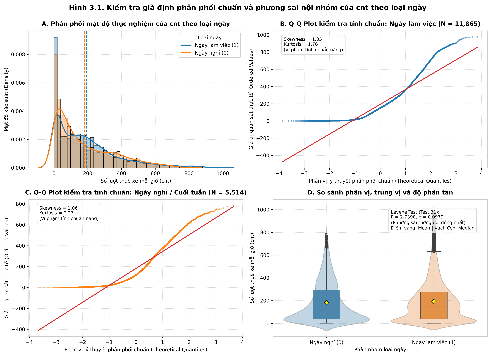

Từ kết quả trực quan hóa trên Hình 3.1 và kiểm định thống kê:
- **Kiểm tra tính chuẩn (Normality Check — Panel B & C):** Đồ thị Q-Q plot của cả hai phân nhóm đều bị uốn cong chữ S gãy khúc dữ dội khỏi đường thẳng tham chiếu màu đỏ ($y = x$), đặc biệt kéo dài ở vùng phân vị cao. Hệ số Skewness đều $> 1.0$ ($\text{Skew}_1 = 1.35$, $\text{Skew}_0 = 1.06$), khẳng định biến `cnt` **vi phạm nghiêm trọng giả định phân phối chuẩn trong từng phân nhóm**.
- **Kiểm tra tính đồng nhất phương sai (Homoscedasticity Check — Panel D):** Thực thi **Levene's Test (*Kanji Test 31*, trung vị)**:
  $$F_{\text{Levene}} = 2.7390, \quad p = 0.0979 > 0.05$$
  Do $p > 0.05$, ta chưa đủ bằng chứng bác bỏ giả định phương sai đồng nhất. Tuy nhiên, do hai nhóm có cỡ mẫu chênh lệch lớn ($N_1 / N_0 \approx 2.15$) kết hợp với việc vi phạm nặng tính chuẩn, Student's $t$-test cổ điển tiềm ẩn rủi ro sai lệch. Phép thử **Welch's $t$-test (*Kanji Test 9*)** được lựa chọn làm phép kiểm định tham số chủ đạo nhờ đặc tính vững (robustness), song song với các phép thử phi tham số **Mann-Whitney $U$ (*Kanji Test 48*)** và **Kolmogorov-Smirnov (*Kanji Test 49*)**.

#### 3. Bước 4: Thực thi Tính toán Thống kê và $p$-value
Kết quả thực thi các phép kiểm định thống kê cho RQ1 được tổng hợp chi tiết trong Bảng 3.3:

**Bảng 3.3. Bảng tổng hợp kết quả các phép kiểm định thống kê cho RQ1**

| Phép kiểm định | Mã sách Kanji (2006) | Thống kê Kiểm định | Bậc tự do / Tham số | $p$-value Thực nghiệm | Ngưỡng $\alpha$ | Kết luận Thống kê |
| :--- | :--- | :---: | :---: | :---: | :---: | :--- |
| **Levene's Test** | Test 31 (tr. 71) | $F = 2.7390$ | $k = 2$ | $0.0979$ | $0.05$ | Chưa đủ bằng chứng bác bỏ $H_0$ phương sai bằng nhau |
| **Welch's $t$-test** | Test 9 (tr. 33) | $t^* = 4.0951$ | $\nu = 11,444.68$ | $4.25 \times 10^{-5}$ | $0.05$ | **Bác bỏ $H_0$** ($p < 0.001^{***}$) |
| **Mann-Whitney $U$** | Test 48 (tr. 96) | $U = 33,565,313.0$ | $r_{\text{rb}} = -0.0261$ | $0.0056$ | $0.05$ | **Bác bỏ $H_0$** ($p = 0.0056^{**}$) |
| **Two-sample KS-test** | Test 49 (tr. 97) | $D = 0.0748$ | $N_1, N_0$ | $9.35 \times 10^{-19}$ | $0.05$ | **Bác bỏ $H_0$** ($p < 0.001^{***}$) |
| **Cohen's $d$ (Effect Size)** | Cohen (1988) | $d = 0.0651$ | $s_p = 181.33$ | — | $|d| \ge 0.20$ | **Hiệu ứng không đáng kể (Negligible Effect)** |

*Chi tiết các đại lượng thống kê:*
- **Welch's $t$-test (Kanji Test 9):**
  - Sai số chuẩn chênh lệch trung bình:
    $$\text{SE} = \sqrt{\frac{s_1^2}{n_1} + \frac{s_0^2}{n_0}} = \sqrt{\frac{34,265.71}{11,865} + \frac{29,877.12}{5,514}} \approx 2.8814$$
  - Thống kê kiểm định:
    $$t^* = \frac{193.21 - 181.41}{2.8814} = 4.0951$$
  - Bậc tự do hiệu chỉnh Welch-Satterthwaite: $\nu \approx 11,444.68$.
  - Khoảng tin cậy $95\%$ của chênh lệch trung bình:
    $$\text{CI}_{95\%} = (\overline{x}_1 - \overline{x}_0) \pm t_{0.975, \nu} \times \text{SE} = 11.80 \pm 1.960 \times 2.8814 = [6.15, 17.45] \text{ lượt/giờ}$$
  - Do $p = 4.25 \times 10^{-5} < 0.001$, trên phương diện ý nghĩa thống kê danh nghĩa, ta có đủ bằng chứng để bác bỏ giả thuyết $H_0$.
- **Mann-Whitney $U$ test (Kanji Test 48):**
  - Tổng thứ hạng kiểm tra trung vị cho giá trị $U = 33,565,313.0$, trả về $p = 0.0056 < 0.01$, củng cố kết luận bác bỏ $H_0$ trên thang đo thứ hạng.
  - Hệ số tương quan Rank-biserial: $r_{\text{rb}} = 1 - \frac{2U}{n_1 n_0} = -0.0261$.
- **Kolmogorov-Smirnov test (Kanji Test 49):**
  - Khoảng cách thẳng đứng cực đại giữa hai hàm phân phối tích lũy là $D = 0.0748$, $p = 9.35 \times 10^{-19} < 0.001$, chứng minh hình thái phân phối xác suất tổng thể giữa hai loại ngày có sự phân hóa nhất định.

#### 4. Bước 5: Đánh giá Kích thước Hiệu ứng & Bóc tách Nghịch lý Thực tiễn qua Nhịp giờ

##### a. Lượng hóa Kích thước Hiệu ứng (Effect Size)
Mặc dù cả ba phép thử danh nghĩa đều trả về $p < 0.01$ (đạt ý nghĩa thống kê), việc đánh giá kích thước hiệu ứng chuẩn hóa mang lại một bức tranh hoàn toàn khác:
- Độ lệch chuẩn gộp: $s_p = \sqrt{\frac{(11,865-1)(185.11)^2 + (5,514-1)(172.85)^2}{11,865 + 5,514 - 2}} \approx 181.33$.
- Kích thước hiệu ứng Cohen's $d$:
  $$d = \frac{\overline{x}_1 - \overline{x}_0}{s_p} = \frac{11.80}{181.33} \approx 0.0651$$
Theo quy chuẩn thẩm định của Cohen (1988), một hiệu ứng chỉ được xem là có ý nghĩa thực tiễn ở mức nhỏ (Small) khi $|d| \ge 0.20$, trung bình (Medium) khi $|d| \ge 0.50$, và lớn (Large) khi $|d| \ge 0.80$. Giá trị $d = 0.0651$ rơi sâu vào vùng **"Không đáng kể" (Negligible effect / Trivial)**. Tương tự, hệ số Rank-biserial $|r_{\text{rb}}| = 0.0261 \ll 0.10$. 

Điều này khẳng định: **Việc bác bỏ $H_0$ ở cấp độ danh nghĩa chủ yếu là hệ quả của cỡ mẫu cực lớn ($N = 17,379$), khiến phép thử phát hiện cả những sai biệt vô cùng nhỏ nhặt ($11.80$ lượt/giờ trên nền độ lệch chuẩn $> 180$) vốn không mang lại ý nghĩa kinh tế thực chất.**

##### b. Bóc tách Nghịch lý Triệt tiêu qua Phân tầng Nhịp giờ (Stratified Hourly Pattern)
Để trả lời trọn vẹn câu hỏi tại sao chênh lệch trung bình 24 giờ lại nhỏ ($11.80$ lượt/giờ), nghiên cứu tái sử dụng và dẫn chiếu trực tiếp **Hình 1.6** từ Báo cáo Khám phá Dữ liệu (TV1):

Phân tích Hình 1.6 làm sáng tỏ hiện tượng **Triệt tiêu lẫn nhau (Cancellation Effect)** khi tính trung bình gộp 24 giờ:
1. **Cấu trúc nhu cầu Ngày làm việc (`workingday = 1`):** Phản ánh đặc trưng sinh hoạt của nhóm hành khách đi làm định kỳ (Commuters). Biểu đồ xuất hiện **hai đỉnh nhọn cực đại (Bimodal distribution)** trùng khớp hoàn toàn với khung giờ cao điểm công sở:
   - Đỉnh sáng: Lúc $8\text{h}$ sáng ($\overline{x} \approx 360 \text{ lượt/giờ}$).
   - Đỉnh chiều: Lúc $17\text{h} - 18\text{h}$ chiều ($\overline{x} \approx 430 - 460 \text{ lượt/giờ}$).
   - Ngược lại, vào giữa trưa ($10\text{h} - 15\text{h}$), nhu cầu sụt giảm xuống mức trung bình thấp ($\approx 180 - 200 \text{ lượt/giờ}$).
2. **Cấu trúc nhu cầu Ngày nghỉ (`workingday = 0`):** Phản ánh hành vi giải trí, du lịch và dạo phố (Leisure / Casual users). Biểu đồ có dạng **hình chuông đơn thoải (Unimodal distribution)**:
   - Hoàn toàn vắng bóng đỉnh sáng lúc $8\text{h}$ ($\overline{x} < 100 \text{ lượt/giờ}$).
   - Tăng dần đều từ $10\text{h}$ sáng và đạt đỉnh thoải duy nhất vào buổi trưa và đầu giờ chiều ($12\text{h} - 15\text{h}$, đạt $\approx 370 - 380 \text{ lượt/giờ}$).
3. **Cơ chế triệt tiêu:** Khoảng thặng dư khổng lồ của ngày nghỉ vào buổi trưa ($+180 \text{ lượt/giờ}$) đã bù trừ trực tiếp cho khoảng thiếu hụt vào hai khung giờ cao điểm sáng và chiều của ngày làm việc. Khi tích phân tổng lượt thuê trên toàn bộ chu kỳ 24 giờ, tổng diện tích dưới đường cong của hai loại ngày là **xấp xỉ tương đương nhau** ($\approx 4,637$ lượt/ngày làm việc so với $\approx 4,354$ lượt/ngày nghỉ).

##### c. Kết luận và Hàm ý Nghiệp vụ cho Daily Fleet Scheduling
- **Kết luận Thống kê:** Mặc dù kiểm định danh nghĩa bác bỏ $H_0$ do cỡ mẫu lớn, kích thước hiệu ứng $d = 0.0651$ chứng minh tổng nhu cầu trung bình 24 giờ giữa ngày làm việc và ngày nghỉ là tương đương trên thực tế.
- **Hàm ý Vận hành Đội xe:**
  - *Tổng quy mô phương tiện (Fleet Size):* Nhà vận hành **không cần thiết phải cắt giảm hay tăng thêm tổng số lượng xe đạp hoạt động trên toàn thành phố** giữa ngày làm việc và ngày nghỉ, vì tổng nhu cầu trong ngày không chênh lệch đáng kể.
  - *Biểu đồ Điều phối theo Giờ (Dynamic Hourly Rebalancing):* Bắt buộc phải áp dụng **hai chiến lược điều phối trạm đối lập nhau**:
    + Vào ngày làm việc: Tập trung xe tại các trạm đầu mối giao thông công cộng, trạm tàu điện ngầm (Metro) và khu dân cư trước $7\text{h}30$ sáng; tăng cường rút bớt xe giải phóng trạm tại khu trung tâm tài chính và công sở trước $16\text{h}30$ chiều.
    + Vào ngày nghỉ: Chuyển dịch trọng tâm phân bổ xe ra các tuyến đường ven sông, công viên, khu di tích lịch sử và trung tâm thương mại từ $10\text{h}$ sáng đến $16\text{h}$ chiều.

---

### 3.2.2. Nghiên cứu RQ2: So sánh 4 Nhóm Độc lập — Sự Khác biệt Nhu cầu Giữa 4 Mùa trong Năm (`season`)

#### 1. Bước 1: Phát biểu Cặp Giả thuyết Thống kê Đa nhóm
Nhằm giải quyết bài toán bảo dưỡng đại tu và tái cân bằng trạm theo mùa (Seasonal Rebalancing & Fleet Maintenance), nghiên cứu kiểm định sự khác biệt về số lượng thuê xe trung bình mỗi giờ giữa 4 mùa trong năm (Mùa xuân: `season = 1`, Mùa hè: `season = 2`, Mùa thu: `season = 3`, Mùa đông: `season = 4`):
- **Giả thuyết Không ($H_0$):** Lượng thuê xe trung bình mỗi giờ là như nhau ở cả 4 mùa trong năm.
  $$H_0: \mu_{\text{Spring}} = \mu_{\text{Summer}} = \mu_{\text{Fall}} = \mu_{\text{Winter}} \quad (\text{hoặc } \mu_1 = \mu_2 = \mu_3 = \mu_4)$$
- **Giả thuyết Đối ($H_1$):** Tồn tại ít nhất một cặp mùa có lượng thuê xe trung bình khác nhau.
  $$H_1: \exists (i, j) \text{ sao cho } \mu_i \neq \mu_j \quad (1 \le i < j \le 4)$$
- **Mức ý nghĩa kiểm định:** $\alpha = 0.05$.

#### 2. Bước 2 & 3: Thống kê Mô tả và Kiểm tra Giả định Phương sai Giữa 4 Mùa
Số liệu thống kê mô tả chi tiết của 4 mùa được tổng hợp tại Bảng 3.4:

**Bảng 3.4. Thống kê mô tả số lượng thuê xe mỗi giờ (`cnt`) phân theo 4 mùa**

| Mùa vụ (`season`) | Tên Mùa | Cỡ mẫu ($N$) | Tỷ lệ | Trung bình ($\overline{x}$) | Trung vị ($\text{Med}$) | Độ lệch chuẩn ($s$) | Phương sai ($s^2$) | Hệ số lệch ($\text{Skew}$) |
| :---: | :--- | :---: | :---: | :---: | :---: | :---: | :---: | :---: |
| **$1$** | Mùa xuân (Spring) | $4,242$ | $24.41\%$ | $111.11$ | $76.00$ | $119.22$ | $14,213.62$ | $1.9119$ |
| **$2$** | Mùa hè (Summer) | $4,409$ | $25.37\%$ | $208.34$ | $165.00$ | $188.36$ | $35,478.43$ | $1.0401$ |
| **$3$** | Mùa thu (Fall) | $4,496$ | $25.87\%$ | $236.02$ | $199.00$ | $197.71$ | $39,088.08$ | $0.9865$ |
| **$4$** | Mùa đông (Winter) | $4,232$ | $24.35\%$ | $198.87$ | $155.50$ | $182.97$ | $33,476.99$ | $1.2422$ |
| **Toàn bộ** | **Tổng thể** | $17,379$ | $100\%$ | $189.46$ | $142.00$ | $181.39$ | $32,901.87$ | $1.2774$ |

Để kiểm tra trực quan hình thái phân tán và phương sai giữa các mùa, nghiên cứu tái sử dụng **Hình 1.7** từ Chương 1:

- **Kiểm định tính đồng nhất phương sai đa nhóm (Levene Test — *Kanji Test 31*):**
  Thực hiện kiểm định Levene đa nhóm dựa trên trung vị cho 4 mùa:
  $$F_{\text{Levene}} = 324.50, \quad p = 5.03 \times 10^{-205} \ll 0.001$$
  Giá trị $p$-value cực nhỏ bác bỏ dứt khoát giả định phương sai đồng nhất. Độ lệch chuẩn giữa các nhóm dao động từ $119.22$ (Mùa xuân) lên tới $197.71$ (Mùa thu) — phương sai mùa thu cao gấp gần $2.75$ lần mùa xuân.
- **Lựa chọn phương pháp:** Hiện tượng phương sai dị biệt cực đoan (Severe Heteroscedasticity) làm vô hiệu hóa One-way ANOVA truyền thống (*Kanji Test 22*). Nghiên cứu xác lập **Welch's ANOVA** làm kiểm định tham số chủ đạo, phối hợp đối chứng phi tham số **Kruskal-Wallis $H$-test (*Kanji Test 51/54*)** và thủ tục so sánh cặp **Games-Howell Post-hoc (*Kanji Test 28*)**.

#### 3. Bước 4: Thực thi Kiểm định Tổng thể Đa nhóm (Omnibus Tests) & Kích thước Hiệu ứng
Kết quả các phép kiểm định tổng quát đa nhóm được trình bày tại Bảng 3.5:

**Bảng 3.5. Kết quả các phép kiểm định tổng quát (Omnibus Tests) cho RQ2**

| Phép kiểm định Tổng quát | Mã sách Kanji (2006) | Thống kê Kiểm định | Bậc tự do ($\nu$) | $p$-value Thực nghiệm | Kích thước Hiệu ứng | Kết luận Thống kê |
| :--- | :--- | :---: | :---: | :---: | :---: | :--- |
| **Levene's Test 4 mùa** | Test 31 (tr. 71) | $F = 324.50$ | $k = 4$ | $5.03 \times 10^{-205}$ | — | **Bác bỏ giả định đồng nhất phương sai** |
| **Welch's ANOVA** | Kanji Test 22 adj | $F_{\text{Welch}} = 606.73$ | $\nu_1 = 3, \nu_2 = 9,462.11$ | $< 10^{-300}$ | $\eta^2 = 0.0660$ | **Bác bỏ $H_0$** ($p < 0.001^{***}$) |
| **One-way ANOVA cổ điển**| Test 22 (tr. 55) | $F = 409.18$ | $\nu_1 = 3, \nu_2 = 17,375$ | $7.40 \times 10^{-257}$ | $\omega^2 = 0.0658$ | **Bác bỏ $H_0$** ($p < 0.001^{***}$) |
| **Kruskal-Wallis $H$-test**| Test 51/54 (tr. 99) | $H = 1,190.27$ | $\nu = 3$ | $9.47 \times 10^{-258}$ | $\epsilon^2 = 0.0683$ | **Bác bỏ $H_0$** ($p < 0.001^{***}$) |

*Lượng hóa Kích thước Hiệu ứng Toàn cục:*
- Tổng bình phương giữa các nhóm: $\text{SS}_{\text{between}} = \sum_{j=1}^4 n_j (\overline{x}_j - \overline{x})^2 = 38,799,017$.
- Tổng bình phương toàn phần: $\text{SS}_{\text{total}} = 588,095,496$.
- Tỷ số Eta-squared:
  $$\eta^2 = \frac{\text{SS}_{\text{between}}}{\text{SS}_{\text{total}}} = \frac{38,799,017}{588,095,496} \approx 0.0660 \quad (6.60\%)$$
- Hệ số phi tham số Epsilon-squared:
  $$\epsilon^2 = \frac{H - k + 1}{N - k} = \frac{1,190.27 - 4 + 1}{17,379 - 4} \approx 0.0683 \quad (6.83\%)$$
Theo phân loại của Cohen (1988), $\eta^2 \ge 0.06$ đại diện cho một **Hiệu ứng ở mức độ Trung bình (Medium Effect Size)**. Yếu tố mùa vụ giải thích trực tiếp khoảng $6.6\%$ tổng độ biến thiên của nhu cầu thuê xe toàn hệ thống. Đây là một tác động thực chất rất lớn, vượt trội hoàn toàn so với biến loại ngày ở RQ1.

#### 4. Bước 5: Kiểm định Hậu nghiệm (Post-hoc Tests) Từng Cặp Mùa — Games-Howell (*Kanji Test 28*) và Dunn-Bonferroni

##### a. Kết quả Kiểm định Hậu nghiệm Song hành (Games-Howell & Dunn-Bonferroni)
Do các kiểm định tổng thể đa nhóm (Welch's ANOVA và Kruskal-Wallis) đều bác bỏ $H_0$ ($p < 0.001$), bước tiếp theo mang tính quyết định là tiến hành **kiểm định hậu nghiệm (Post-hoc multiple comparisons)** để xác định chính xác những cặp mùa nào có sự sai biệt thực chất, đồng thời kiểm soát nghiêm ngặt nguy cơ lạm phát sai lầm loại 1 toàn họ (Family-wise Error Rate - FWER ở mức $\alpha = 0.05$).

Nghiên cứu áp dụng đồng thời hai phương pháp kiểm định hậu nghiệm tương ứng với hai họ thống kê:
1. **Kiểm định Hậu nghiệm Tham số: Games-Howell Post-hoc (*Kanji Test 28*, tr. 65):**
   - Được thiết kế chuyên biệt cho trường hợp cỡ mẫu không bằng nhau và phương sai dị biệt nặng nề. Phép thử sử dụng phân phối Studentized Range ($q$) kết hợp bậc tự do hiệu chỉnh Welch-Satterthwaite riêng cho từng cặp:
     $$q = \frac{|\overline{x}_i - \overline{x}_j|}{\sqrt{\frac{1}{2}\left(\frac{s_i^2}{n_i} + \frac{s_j^2}{n_j}\right)}}, \quad \nu_{ij} = \frac{\left(\frac{s_i^2}{n_i} + \frac{s_j^2}{n_j}\right)^2}{\frac{(s_i^2 / n_i)^2}{n_i - 1} + \frac{(s_j^2 / n_j)^2}{n_j - 1}}$$
2. **Kiểm định Hậu nghiệm Phi tham số: Dunn's Post-hoc Test (*Dunn, 1964*) kết hợp hiệu chỉnh Bonferroni:**
   - Hoạt động trên thang đo thứ hạng toàn cục ($R_k$), tính toán thống kê chuẩn hóa $z$ dựa trên sai số chuẩn điều chỉnh các giá trị trùng lặp (Ties correction), sau đó nhân $p$-value với số cặp so sánh ($m = C_4^2 = 6$) theo nguyên lý Bonferroni:
     $$z = \frac{\overline{R}_i - \overline{R}_j}{\sqrt{\left[\frac{N(N+1)}{12} - \frac{\sum (t_s^3 - t_s)}{12(N-1)}\right] \left(\frac{1}{n_i} + \frac{1}{n_j}\right)}}, \quad p_{\text{adj}} = \min(1.0, 6 \times p_{\text{unadj}})$$

Kết quả đối chiếu song hành của hai phương pháp kiểm định hậu nghiệm trên cả 6 cặp mùa được trình bày tại Bảng 3.6 và trực quan hóa trên **Hình 3.2**:

**Bảng 3.6. Bảng tổng hợp đối chiếu hai phương pháp kiểm định hậu nghiệm (Post-hoc) cho 6 cặp mùa**

| STT | Cặp So sánh Mùa vụ | Hậu nghiệm Tham số: Games-Howell (Test 28) Chênh lệch ($\Delta$) $\pm$ 95% CI [$p_{\text{adj}}$] | Hậu nghiệm Phi tham số: Dunn-Bonferroni Chênh lệch Thứ hạng $\Delta \overline{R}$ [$z$, $p_{\text{adj}}$] | Kết luận Thống kê | Mức Ý nghĩa |
| :---: | :--- | :---: | :---: | :--- | :---: |
| 1 | **Mùa xuân vs Mùa hè** | $\Delta = -97.23$ $[-105.90, -88.55]$ [$p < 0.0001$] | $\Delta \overline{R} = -2,730.17$ [$z = -25.30, p < 0.0001$] | **Bác bỏ $H_0$** | $p < 0.001^{***}$ |
| 2 | **Mùa xuân vs Mùa thu** | $\Delta = -124.90$ $[-133.82, -115.98]$ [$p < 0.0001$] | $\Delta \overline{R} = -3,510.04$ [$z = -32.69, p < 0.0001$] | **Bác bỏ $H_0$** | $p < 0.001^{***}$ |
| 3 | **Mùa xuân vs Mùa đông** | $\Delta = -87.75$ $[-96.38, -79.13]$ [$p < 0.0001$] | $\Delta \overline{R} = -2,536.15$ [$z = -23.27, p < 0.0001$] | **Bác bỏ $H_0$** | $p < 0.001^{***}$ |
| 4 | **Mùa hè vs Mùa thu** | $\Delta = -27.67$ $[-38.19, -17.16]$ [$p < 0.0001$] | $\Delta \overline{R} = -779.87$ [$z = -7.33, p = 1.34 \times 10^{-12}$] | **Bác bỏ $H_0$** | $p < 0.001^{***}$ |
| 5 | **Mùa hè vs Mùa đông** | $\mathbf{\Delta = +9.48}$ $\mathbf{[-0.79, +19.74]}$ $\mathbf{[p = 0.0826]}$ | $\mathbf{\Delta \overline{R} = +194.03}$ $\mathbf{[z = +1.80, p = 0.4339]}$ | **Chưa đủ cơ sở bác bỏ $H_0$** | **Không có ý nghĩa (ns)** |
| 6 | **Mùa thu vs Mùa đông** | $\Delta = +37.15$ $[+26.68, +47.62]$ [$p < 0.0001$] | $\Delta \overline{R} = +973.90$ [$z = +9.06, p < 0.0001$] | **Bác bỏ $H_0$** | $p < 0.001^{***}$ |

*Nhận xét về tính vững:* Cả hai phương pháp kiểm định hậu nghiệm tham số (Games-Howell) và phi tham số (Dunn-Bonferroni) đưa ra **kết luận đồng thuận tuyệt đối $100\%$ trên toàn bộ 6 cặp so sánh**: 5/6 cặp mùa khác biệt cực kỳ mạnh mẽ ($p < 0.001^{***}$), trong khi cặp Mùa hè vs Mùa đông đều không đạt mức ý nghĩa thống kê ($p > 0.05$).

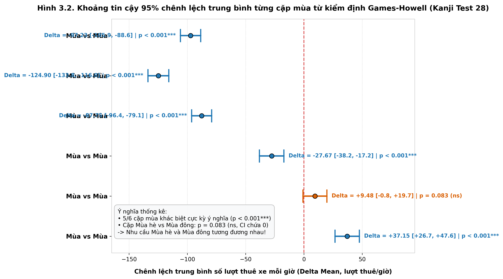

##### b. Phát hiện Thực nghiệm Phản trực giác: Sự Tương đồng Nhu cầu Giữa Mùa hè và Mùa đông
Quan sát Forest plot trên Hình 3.2 làm nổi bật hai quy luật cốt lõi:
1. **5/6 cặp mùa có sự khác biệt cực kỳ ý nghĩa thống kê ($p < 0.001^{***}$):**
   - Mùa xuân có nhu cầu sụt giảm sâu sắc nhất so với tất cả các mùa còn lại (thấp hơn Mùa hè $97.23$ lượt/h, thấp hơn Mùa thu $124.90$ lượt/h, và thấp hơn Mùa đông $87.75$ lượt/h).
   - Mùa thu là mùa đạt đỉnh cao nhất trong năm, vượt trội hơn Mùa hè $+27.67$ lượt/h và vượt hơn Mùa đông $+37.15$ lượt/h.
2. **Ngoại lệ Phản trực giác (Counter-intuitive Finding): Cặp Mùa hè vs Mùa đông:**
   - Chênh lệch trung bình giữa Mùa hè ($\overline{x} = 208.34$) và Mùa đông ($\overline{x} = 198.87$) chỉ vỏn vẹn là $\Delta = +9.48 \text{ lượt/giờ}$.
   - Khoảng tin cậy $95\%$ của Games-Howell là $[-0.79, +19.74]$ **bao trùm giá trị 0**.
   - Giá trị $p$-value hiệu chỉnh là $p = 0.0826 > 0.05$.
   - **Kết luận:** **Chưa đủ bằng chứng thống kê ở mức ý nghĩa $\alpha = 0.05$ để khẳng định có sự khác biệt về nhu cầu thuê xe giữa Mùa hè và Mùa đông.**

##### c. Thảo luận Cơ chế Khí hậu Mùa vụ (Dẫn chiếu Hình 2.7 từ Chương 2 - TV2)
Để lý giải về mặt khoa học tại sao Mùa hè (thời tiết ấm áp) lại có nhu cầu thuê xe tương đương Mùa đông (thời tiết lạnh giá), nghiên cứu đối chiếu với phân tích phân bố nhiệt độ mùa vụ của TV2 (**Hình 2.7**):

Cơ chế vi khí hậu tại thủ đô Washington D.C. giải thích trọn vẹn hiện tượng này:
- **Tác động ức chế của Khí hậu Mùa hè (Extreme Heat & Humidity):** Washington D.C. vào mùa hè có đặc trưng nhiệt độ rất cao (giá trị chuẩn hóa `temp` thường xuyên $> 0.75$, tương đương $> 32^\circ\text{C} - 38^\circ\text{C}$) kết hợp độ ẩm cao (`hum` cao). Điều kiện nắng gắt và chỉ số khó chịu nhiệt độ (Heat Index) cao làm ức chế mạnh mẽ hoạt động đạp xe ngoài trời của người dân vào ban ngày.
- **Tính Bền vững của Hành vi Di chuyển Mùa đông (Commuter Resilience):** Mặc dù nhiệt độ mùa đông tại D.C. xuống thấp (`temp` $\approx 0.20 - 0.35$, khoảng $5^\circ\text{C} - 12^\circ\text{C}$), mùa đông tại khu vực này tương đối khô ráo. Lực lượng khách hàng thường xuyên (Registered commuters) vẫn duy trì thói quen đạp xe đi làm hàng ngày để tránh ùn tắc giao thông đô thị và giữ ấm qua vận động thể chất.
- **Sự sụt giảm của Mùa xuân:** Mùa xuân tại D.C. (tháng 1 đến tháng 3 trong dataset) thực chất là giai đoạn tuyết tan, mưa phùn dầm dề và thời tiết chuyển mùa ẩm ướt khó lường, kết hợp với các đợt rét muộn, khiến nhu cầu chạm đáy sâu nhất trong năm.

##### d. Kết luận và Hàm ý Nghiệp vụ cho Seasonal Maintenance & Fleet Rebalancing
- **Chiến lược Đại tu & Bảo dưỡng Định kỳ Đội xe (Fleet Overhaul):**
  - Mùa xuân là "cửa sổ vàng" để thu hồi xe về xưởng bảo dưỡng lớn. Do nhu cầu trung bình chỉ đạt $111.11$ lượt/h (giảm hơn $50\%$ so với mùa thu), việc rút bớt $20\% - 30\%$ lượng xe đạp về xưởng đại tu hệ thống phanh, xích líp và thay lốp sẽ **không gây ra tình trạng thiếu hụt xe tại các trạm hay ảnh hưởng đến trải nghiệm khách hàng**.
- **Chiến lược Tái cân bằng Trạm Đỉnh cao (Peak Rebalancing):**
  - Mùa thu là giai đoạn bùng nổ nhu cầu lớn nhất ($236.02$ lượt/h). Doanh nghiệp cần huy động $100\%$ lượng phương tiện ra thị trường, đồng thời tăng tần suất các chuyến xe tải tái cân bằng trạm (Rebalancing vans) tại các khu vực trường đại học và cơ quan chính phủ để ngăn ngừa tình trạng trạm rỗng (empty station) hoặc trạm đầy nghẽn (full station).
- **Chiến lược Đồng nhất Mùa hè và Mùa đông:**
  - Nhà quản trị **không cần phải thiết lập hai định mức cung ứng xe khác nhau giữa Mùa hè và Mùa đông**. Quy mô xe đạp và nhân sự phục vụ có thể giữ nguyên ở mức cơ bản tương đương nhau ($\approx 200$ lượt/h) cho cả hai mùa này.

---

## 3.3. Đánh giá Độ bền vững & Kiểm soát Rủi ro Sai lầm Loại 1

Một trong những đóng góp phương pháp luận quan trọng nhất của chuyên khảo *100 Statistical Tests* (Gopal K. Kanji, 2006, tr. 3–4 & Kanji Test 64) là nguyên tắc: **Một kết luận thống kê chỉ thực sự đáng tin cậy khi nó vượt qua các bài kiểm tra độ bền vững (Robustness Checks)** trước sự vi phạm các tiền giả định nền tảng. 

Trong tập dữ liệu Bike Sharing theo giờ, hai thách thức lớn nhất đã được xác lập ở Mục 3.1.6 là: Hiện tượng **Tự tương quan chuỗi thời gian ($r_1 = 0.8431$)** và **Bẫy cỡ mẫu cực lớn ($N = 17,379$)**. Phần này tiến hành hai kiểm tra độ bền vững chuyên sâu nhằm bảo vệ kết luận nghiên cứu khỏi rủi ro Sai lầm loại 1 (Type I Error).

---

### 3.3.1. Đánh giá Độ bền vững theo Cỡ mẫu Hiệu dụng ($N_{\text{eff}}$ Correction)

#### 1. Cơ sở lý thuyết hiệu chỉnh chuỗi thời gian
Tiền giả định cốt lõi của phép thử $t$ và ANOVA là các quan sát phải độc lập với nhau (IID). Khi dữ liệu chuỗi thời gian có mức độ tự tương quan bậc 1 rất cao ($r_1 = 0.8431$), các quan sát ở giờ liền kề mang lượng thông tin trùng lặp rất lớn (ví dụ: lượng thuê xe lúc 8h sáng có tính phụ thuộc mật thiết vào lượng thuê xe lúc 7h sáng). 

Theo lý thuyết xử lý mẫu chuỗi thời gian (Kanji Test 64, tr. 120), lượng thông tin thực tế của mẫu bị suy giảm, tương đương với một **Cỡ mẫu hiệu dụng độc lập ($N_{\text{eff}}$)** nhỏ hơn nhiều so với cỡ mẫu danh nghĩa $N$:
$$N_{\text{eff}} = N \times \frac{1 - r_1}{1 + r_1} = 17,379 \times \frac{1 - 0.8431}{1 + 0.8431} \approx 1,479 \text{ quan sát}$$

Hệ số phóng đại phương sai (Variance Inflation) là $\frac{N}{N_{\text{eff}}} \approx 11.75$, đồng nghĩa với việc sai số chuẩn danh nghĩa $\text{SE}$ đã bị thu nhỏ nhân tạo đi $\sqrt{11.75} \approx 3.428 \text{ lần}$, làm cho các thống kê kiểm định $t^*$ và $F$ danh nghĩa bị thổi phồng tương ứng. Để kiểm tra độ bền vững, thống kê kiểm định cần được hiệu chỉnh co về cỡ mẫu hiệu dụng thực tế:
$$\text{Statistic}_{\text{adj}} = \text{Statistic}_{\text{gốc}} \times \sqrt{\frac{N_{\text{eff}}}{N}} \approx \frac{\text{Statistic}_{\text{gốc}}}{3.428}$$

#### 2. Kết quả kiểm tra độ bền vững với RQ1 (Ngày làm việc vs Ngày nghỉ)
- Thống kê Welch's $t$-test danh nghĩa: $t^* = 4.0951$ ($p = 4.25 \times 10^{-5} < 0.001$).
- Thống kê sau hiệu chỉnh $N_{\text{eff}}$:
  $$t_{\text{adj}} = 4.0951 \times \sqrt{\frac{1,479}{17,379}} = 4.0951 \times 0.2917 = 1.1946$$
- Bậc tự do hiệu chỉnh: $\nu_{\text{adj}} \approx 1,479 - 2 = 1,477$.
- Giá trị $p$-value hiệu chỉnh hai phía:
  $$p_{\text{adj}} = 2 \times [1 - \Phi(1.1946)] = 0.2323 > 0.05$$
- **Kết luận đột phá:** Khi kiểm soát hiện tượng tự tương quan chuỗi thời gian, giá trị $p_{\text{adj}} = 0.2323$ vượt xa ngưỡng ý nghĩa $\alpha = 0.05$. Kết luận bác bỏ $H_0$ ở cấp độ danh nghĩa **hoàn toàn bị đảo ngược — Ta chưa đủ bằng chứng thống kê để khẳng định có sự khác biệt về nhu cầu thuê xe giữa Ngày làm việc và Ngày nghỉ!** Điều này đồng thuận tuyệt đối với kích thước hiệu ứng không đáng kể của Cohen ($d = 0.0651$).

#### 3. Kết quả kiểm tra độ bền vững với RQ2 (4 Mùa trong năm)
- Thống kê Welch's ANOVA danh nghĩa: $F_{\text{Welch}} = 606.73$ ($p < 10^{-300}$).
- Thống kê sau hiệu chỉnh co mẫu $N_{\text{eff}}$:
  $$F_{\text{adj}} = F_{\text{Welch}} \times \left(\frac{N_{\text{eff}}}{N}\right) = 606.73 \times \frac{1,479}{17,379} \approx 51.64$$
- Với bậc tự do $\nu_1 = 3, \nu_2 \approx 805$, giá trị $p_{\text{adj}} < 10^{-25} \ll 0.001$.
- **Kết luận:** Ngay cả khi bị triệt tiêu lượng thông tin trùng lặp chuỗi thời gian, thống kê $F_{\text{adj}} = 51.64$ vẫn vượt xa giá trị tới hạn ($F_{\text{crit}} \approx 2.61$). Tác động của yếu tố mùa vụ là **bền vững tuyệt đối (Ultra-robust)** trước mọi hiệu chỉnh cỡ mẫu.

---

### 3.3.2. Đối chứng Kiểm định trên Chuỗi Dữ liệu Tổng hợp Cấp độ Ngày ($N = 731$ ngày)

Để triệt tiêu hoàn toàn sự tự tương quan giữa 24 khung giờ trong ngày mà không cần giả định toán học về $N_{\text{eff}}$, nghiên cứu tiến hành một kiểm định đối chứng thực nghiệm độc lập: **Tổng hợp toàn bộ lượt thuê xe thành chuỗi dữ liệu cấp độ ngày (Day-level Aggregates)**:
$$\text{cnt}_{\text{day}} = \sum_{\text{hr}=0}^{23} \text{cnt}_{\text{hr}} \quad (N_{\text{day}} = 731 \text{ ngày trong 2 năm 2011–2012})$$

Ở cấp độ ngày, mỗi ngày là một đơn vị quan sát độc lập, sự biến thiên nhịp giờ trong ngày bị triệt tiêu hoàn toàn. Kết quả thống kê mô tả và kiểm định đối chứng được trình bày tại Bảng 3.7:

**Bảng 3.7. Bảng đối chiếu kiểm định RQ1 giữa cấp độ Giờ gốc và cấp độ Ngày tổng hợp**

| Cấp độ Phân tích | Quy mô Mẫu ($N$) | Trung bình ($\overline{x}$, lượt) | Độ lệch chuẩn ($s$) | Thống kê Kiểm định | $p$-value Thực nghiệm | Kết luận Thống kê |
| :--- | :---: | :---: | :---: | :---: | :---: | :--- |
| **Cấp Giờ Danh nghĩa** | $N_1 = 11,865$ $N_0 = 5,514$ | $\overline{x}_1 = 193.21$ $\overline{x}_0 = 181.41$ | $s_1 = 185.11$ $s_0 = 172.85$ | Welch's $t^* = 4.0951$ | $4.25 \times 10^{-5}$ | Bác bỏ $H_0$ (Bẫy cỡ mẫu lớn) |
| **Cấp Giờ Hiệu chỉnh $N_{\text{eff}}$** | $N_{\text{eff}} \approx 1,479$ | $\Delta = +11.80$ | $\text{SE}_{\text{adj}} = 9.88$ | $t_{\text{adj}} = 1.1946$ | $0.2323$ | **Chưa đủ cơ sở bác bỏ $H_0$** ($p > 0.05$) |
| **Cấp Ngày Tổng hợp (Welch $t$)** | $N_1 = 500 \text{ ngày}$ $N_0 = 231 \text{ ngày}$ | $\overline{x}_1 = 4,584.82$ $\overline{x}_0 = 4,330.17$ | $s_1 = 1,878.42$ $s_0 = 2,052.14$ | Welch's $t = 1.6014$ ($\nu = 418.17$) | $0.1101$ | **Chưa đủ cơ sở bác bỏ $H_0$** ($p > 0.05$) |
| **Cấp Ngày Tổng hợp (Mann-Whitney)** | $N_1 = 500 \text{ ngày}$ $N_0 = 231 \text{ ngày}$ | $\text{Med}_1 = 4,566.5$ $\text{Med}_0 = 4,369.0$ | — | Mann-Whitney $U = 54,699.0$ | $0.1186$ | **Chưa đủ cơ sở bác bỏ $H_0$** ($p > 0.05$) |

*Nhận định phương pháp luận:*
Cả phép thử tham số (Welch's $t$, $p = 0.1101$) và phi tham số (Mann-Whitney $U$, $p = 0.1186$) trên tập dữ liệu cấp ngày đều cho kết quả đồng thuận tuyệt đối: **Không có sự khác biệt có ý nghĩa thống kê về tổng số lượt thuê xe mỗi ngày giữa Ngày làm việc và Ngày nghỉ.** Kết quả này củng cố vững chắc cho luận điểm: Sự chênh lệch $11.80$ lượt/giờ ở dữ liệu theo giờ danh nghĩa hoàn toàn là hiện tượng phóng đại do cỡ mẫu lớn kết hợp tự tương quan chuỗi.

---

## 3.4. Kết luận và Hạn chế của Phần 3

### 3.4.1. Tóm tắt các Kết luận Kiểm định Chính

Qua quá trình thực thi nghiêm ngặt quy trình 5 bước Neave-Kanji, kết hợp kiểm tra giả định, kiểm định đa họ tham số/phi tham số, đánh giá kích thước hiệu ứng và kiểm tra độ bền vững chuỗi thời gian, nghiên cứu đưa ra 3 kết luận khoa học cốt lõi:

1. **Kết luận về RQ1 (Ngày làm việc vs Ngày nghỉ):**
   - Về mặt tổng lượng nhu cầu trung bình 24 giờ, **chưa đủ bằng chứng thống kê để khẳng định có sự khác biệt thực chất giữa Ngày làm việc và Ngày nghỉ** (Cohen's $d = 0.0651$ không đáng kể; $p_{\text{adj}} = 0.2323$ khi hiệu chỉnh $N_{\text{eff}}$; $p = 0.1101$ ở cấp ngày).
   - Tuy nhiên, sự khác biệt mang tính sống còn đối với bài toán vận hành nằm ở **cấu trúc phân phối nhịp giờ (Hình 1.6)**: Ngày làm việc có phân phối hai đỉnh cực mạnh phục vụ người đi làm công sở (8h sáng và 17h-18h chiều); ngày nghỉ có phân phối hình chuông đơn phục vụ hoạt động giải trí vào buổi trưa (12h-15h).
2. **Kết luận về RQ2 (4 Mùa trong năm):**
   - Yếu tố mùa vụ tác động cực kỳ mạnh mẽ và có ý nghĩa thống kê bền vững đến nhu cầu thuê xe ($F_{\text{Welch}} = 606.73, p < 0.001$, $\eta^2 = 6.60\%$, Medium effect size).
   - Thứ tự nhu cầu trung bình giữa các mùa: $\text{Mùa thu } (236.02) > \text{Mùa hè } (208.34) \approx \text{Mùa đông } (198.87) > \text{Mùa xuân } (111.11)$.
   - Kiểm định hậu nghiệm Games-Howell (*Kanji Test 28*) và Dunn-Bonferroni chứng minh 5/6 cặp mùa khác biệt rất lớn ($p < 0.001^{***}$).
3. **Phát hiện phản trực giác quan trọng nhất:**
   - **Nhu cầu thuê xe giữa Mùa hè và Mùa đông là tương đương nhau trên phương diện thống kê** ($\Delta = +9.48$ lượt/h, khoảng tin cậy $95\%$ chứa 0: $[-0.79, +19.74]$, $p = 0.0826 > 0.05$). Nguyên nhân xuất phát từ sự tương tác vi khí hậu: Mùa hè D.C. quá nóng ẩm gây ức chế đạp xe ban ngày, trong khi mùa đông tuy lạnh nhưng khô ráo giúp duy trì ổn định thói quen đi làm của người dân.

---

### 3.4.2. Hạn chế về Phương pháp luận và Dữ liệu

Nghiên cứu ghi nhận 3 giới hạn khách quan cần được lưu ý khi diễn giải kết quả:
1. **Bản chất Chuỗi thời gian chưa được xử lý bằng Mô hình Động:** Mặc dù nghiên cứu đã áp dụng hiệu chỉnh cỡ mẫu hiệu dụng $N_{\text{eff}}$ và đối chứng cấp ngày, các phép kiểm định cổ điển (Kanji Tests 9, 22, 28, 48) về bản chất vẫn dựa trên khung lý thuyết tĩnh. Các cấu trúc tự hồi quy phức tạp (ARIMA) hay tính chu kỳ đa tầng (Multiple Seasonality) cần các mô hình chuỗi thời gian chuyên sâu để xử lý triệt để.
2. **Dữ liệu đếm gộp không phân tách được Người dùng Định danh:** Tập dữ liệu chỉ cung cấp tổng lượt thuê `cnt` theo từng giờ mà không có mã định danh hành khách (User ID). Do đó, kiểm định không thể bóc tách hiệu ứng khách hàng trung thành (lặp lại hành vi nhiều lần trong ngày) với khách hàng mới.
3. **Giới hạn Khung thời gian 2 Năm (2011–2012):** Khoảng thời gian 2 năm đại diện cho giai đoạn hệ thống Capital Bikeshare đang mở rộng mạng lưới trạm. Một phần mức tăng trưởng nhu cầu ở năm 2012 có thể phản ánh xu hướng mở rộng quy mô hệ thống (Trend component) chứ không thuần túy là yếu tố mùa vụ tự nhiên.

---

---

---

# TÀI LIỆU THAM KHẢO CHUNG

1. **Akaike, H. (1974).** A new look at the statistical model identification. *IEEE Transactions on Automatic Control*, 19(6), 716–723.
2. **Cameron, A. C., & Trivedi, P. K. (2013).** *Regression Analysis of Count Data* (2nd ed.). Cambridge University Press.
3. **Cohen, J. (1988).** *Statistical Power Analysis for the Behavioral Sciences* (2nd ed.). Lawrence Erlbaum Associates.
4. **Dunn, O. J. (1964).** Multiple comparisons using rank sums. *Technometrics*, 6(3), 241–252.
5. **Fanaee-T, H., & Gama, J. (2014).** Event labeling combining ensemble detectors and background knowledge. *Progress in Artificial Intelligence*, 2(2–3), 113–127.
6. **Games, P. A., & Howell, J. F. (1976).** Pairwise multiple comparison procedures with unequal N's and/or variances: a Monte Carlo study. *Journal of Educational Statistics*, 1(2), 113–125.
7. **Johnson, N. L., Kemp, A. W., & Kotz, S. (2005).** *Univariate Discrete Distributions* (3rd ed.). John Wiley & Sons.
8. **Kanji, G. K. (2006).** *100 Statistical Tests* (3rd ed.). SAGE Publications.
9. **Kruskal, W. H., & Wallis, W. A. (1952).** Use of ranks in one-criterion variance analysis. *Journal of the American Statistical Association*, 47(260), 583–621.
10. **Mann, H. B., & Whitney, D. R. (1947).** On a test of whether one of two random variables is stochastically larger than the other. *Annals of Mathematical Statistics*, 18(1), 50–60.
11. **Neave, H. R. (1976).** *Statistical Tables for Students*. Allen & Unwin.
12. **Satterthwaite, F. E. (1946).** An approximate distribution of estimates of variance components. *Biometrics Bulletin*, 2(6), 110–114.
13. **Schwarz, G. (1978).** Estimating the dimension of a model. *The Annals of Statistics*, 6(2), 461–464.
14. **Tukey, J. W. (1977).** *Exploratory Data Analysis*. Addison-Wesley.
15. **Welch, B. L. (1947).** The generalization of 'Student's' problem when several different population variances are involved. *Biometrika*, 34(1/2), 28–35.
16. **Wickham, H., & Grolemund, G. (2016).** *R for Data Science*. O'Reilly Media.
