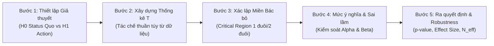

# KẾ HOẠCH CHI TIẾT: PHẦN 3 — KIỂM ĐỊNH GIẢ THUYẾT (HYPOTHESIS TESTING)
**Thành viên phụ trách:** Thành viên 3 (TV3)  
**Bộ dữ liệu đầu vào:** `EDA/cleaned_data/hour_cleaned.csv` ($N = 17,379$ dòng, đã qua tiền xử lý bởi TV1)  
**Tài liệu tham khảo chuyên khảo cốt lõi:** *100 Statistical Tests (3rd Edition, 2006)* — **Gopal K. Kanji**, SAGE Publications.  
**Quy chuẩn áp dụng:** `outline.md` (Mục 3), `rules.md`, `HANDOFF.md`  

---

## 1. Động cơ Thực tiễn & Xác lập 2 Câu hỏi Nghiên cứu Cốt lõi

### 1.1. Bối cảnh Vận hành Hệ thống Capital Bikeshare
Trong quản lý và khai thác hệ thống xe đạp công cộng tại thủ đô Washington D.C., các nhà vận hành không thể đưa ra quyết định điều phối dựa trên cảm tính hay những con số trung bình mẫu thô. Hai bài toán phân bổ nguồn lực sống còn đòi hỏi phải có bằng chứng thống kê xác thực bao gồm:

1. **Bài toán Điều phối Đội xe Hàng ngày (Daily Fleet Scheduling):**
   - *Vấn đề thực tế:* Liệu tổng nhu cầu thuê xe trung bình mỗi giờ giữa ngày làm việc thông thường và ngày nghỉ/cuối tuần có thực sự khác biệt đáng kể để nhà vận hành phải thay đổi tổng số lượng xe đưa vào lưu thông mỗi ngày hay không? Hay tổng quy mô là tương đương và sự khác biệt thực sự chỉ nằm ở nhịp giờ cao điểm?
2. **Bài toán Bảo dưỡng & Cân bằng Trạm Theo Mùa (Seasonal Rebalancing & Fleet Maintenance):**
   - *Vấn đề thực tế:* Khí hậu 4 mùa tại Washington D.C. phân hóa rất rõ nét. Nhu cầu thuê xe biến động ra sao qua 4 mùa? Mùa nào sụt giảm sâu nhất để tranh thủ thu hồi xe về xưởng bảo dưỡng quy mô lớn, và mùa nào đạt đỉnh để tối đa hóa năng lực phục vụ? Giữa 4 mùa, những cặp mùa nào thực sự có sự chênh lệch có ý nghĩa thống kê?

---

### 1.2. Xác lập 2 Câu hỏi Nghiên cứu Chính thức (Research Questions)
Xuất phát từ 2 động cơ thực tiễn nêu trên, nghiên cứu chính thức xác lập **2 Câu hỏi nghiên cứu trọng tâm** làm kim chỉ nam cho toàn bộ Chương 3:

> * **Câu hỏi nghiên cứu 1 (RQ1):**  
>   *Có sự khác biệt có ý nghĩa thống kê về số lượng thuê xe trung bình mỗi giờ (`cnt`) giữa ngày làm việc (`workingday = 1`) và ngày nghỉ / cuối tuần (`workingday = 0`) hay không?*
>
> * **Câu hỏi nghiên cứu 2 (RQ2):**  
>   *Số lượng thuê xe trung bình mỗi giờ (`cnt`) có sự khác biệt có ý nghĩa thống kê giữa 4 mùa trong năm (`season`: Mùa xuân, Mùa hè, Mùa thu, Mùa đông) hay không? Cụ thể những cặp mùa nào tạo ra sự khác biệt có ý nghĩa thống kê?*

---

## 2. Nền tảng Phương pháp luận: Căn cứ Thực nghiệm từ TV1 (EDA) & TV2 (Phân phối)

Để giải quyết 2 câu hỏi nghiên cứu trên một cách chuẩn xác, TV3 không áp dụng các bài kiểm định một cách mù quáng mà tiếp nhận toàn bộ các phát hiện định lượng đã được chứng minh bởi TV1 và TV2:

1. **Biến mục tiêu `cnt` vi phạm nghiêm trọng giả định phân phối chuẩn:** 
   - TV1 chỉ ra: $\text{Mean} = 189.46 > \text{Median} = 142.00$, $\text{Skewness} = 1.28$, $\text{Kurtosis} = 1.42$, tỷ số phân tán vượt mức cực mạnh $\text{Variance} / \text{Mean} = 173.66 \gg 1$.
   - TV2 chứng minh: Mô hình Negative Binomial mô tả tốt nhất (AIC = $217,615$), trong khi phân phối chuẩn (Normal) fit rất kém với AIC lên tới $230,086$. Mọi kiểm định Goodness-of-Fit chuẩn tắc đều bác bỏ tính chuẩn ($p < 0.001$).
2. **Phương sai dị biệt (Heteroscedasticity) giữa các phân nhóm:**
   - Độ lệch chuẩn của `cnt` chênh lệch rất lớn giữa các mùa: Mùa xuân có $\text{Std} = 119.22$ trong khi Mùa thu có $\text{Std} = 197.71$. Giữa ngày làm việc và ngày nghỉ cũng có sự khác biệt về độ phân tán ($\text{Std} = 185.11$ vs $172.85$).
3. **Hiện tượng bẫy cỡ mẫu lớn (Large Sample Size Artifact):**
   - Với quy mô dữ liệu $N = 17,379$, các phép kiểm định thống kê gần như luôn cho $p\text{-value} < 0.001$ ngay cả khi mức độ khác biệt thực tế rất nhỏ. Do đó, $p\text{-value}$ không đủ để kết luận về ý nghĩa nghiệp vụ mà bắt buộc phải lượng hóa **Kích thước hiệu ứng (Effect Size)**.
4. **Hiện tượng tự tương quan chuỗi thời gian (Serial Autocorrelation):**
   - TV1 chỉ ra tự tương quan bậc 1 đạt $r_1 = 0.8431$, khiến các quan sát không độc lập (vi phạm giả định IID) và thu hẹp **cỡ mẫu hiệu dụng thực tế chỉ còn $N_{\text{eff}} \approx 1,479$** (chiếm $\approx 8.5\%$ mẫu danh nghĩa). Nguy cơ dính Sai lầm loại 1 (Type I Error) rất cao nếu chỉ dựa vào $p\text{-value}$ thông thường.

---

## 3. Cơ sở Lý thuyết các Phương pháp Kiểm định Thống kê (Theo Gopal K. Kanji, 2006)

### 3.1. Bản chất của Kiểm định Thống kê & Quy trình 5 bước Chuẩn tắc (Neave-Kanji Framework)

#### 1. Vì sao phải thực hiện kiểm định giả thuyết thống kê?
Khi quan sát dữ liệu thực tế, sự chênh lệch giữa hai số trung bình mẫu (ví dụ: ngày làm việc $\text{Mean} = 193.21$ vs ngày nghỉ $\text{Mean} = 181.41$) luôn chứa đựng hai khả năng:
- **Khả năng 1:** Chênh lệch này chỉ là sự ngẫu nhiên thuần túy do quá trình lấy mẫu (Sampling variation / Random noise).
- **Khả năng 2:** Chênh lệch này phản ánh một sự khác biệt thực chất và có tính quy luật của tổng thể hành vi người dùng.

Kiểm định giả thuyết thống kê là công cụ toán học duy nhất cho phép định lượng xác suất xảy ra của sự chênh lệch do ngẫu nhiên, từ đó cung cấp căn cứ khách quan để đưa ra quyết định nghiệp vụ.

#### 2. Triết lý kiểm định nền tảng theo Gopal K. Kanji (2006, tr. 2)
Theo Gopal K. Kanji (2006, *Introduction to Statistical Testing*), có hai nguyên tắc triết lý cốt tử cần nắm vững:
- **Kiểm định không nhằm mục đích "chứng minh" giả thuyết:** Các phép thử thống kê không được thiết kế để chứng minh hay bác bỏ một điều gì là chân lý tuyệt đối. Mục tiêu duy nhất của kiểm định là **chỉ ra rằng một ý niệm (giả thuyết) là không thể đứng vững (untenable) khi nó dẫn tới một xác suất xảy ra quá nhỏ trong thực tế**.
- **Giả thuyết Không ($H_0$) luôn đại diện cho trạng thái giữ nguyên (Status Quo):** Giả thuyết mà ta cố gắng tìm bằng chứng bác bỏ luôn là giả thuyết "không có sự thay đổi / không có sự khác biệt" (ví dụ: $\mu_1 = \mu_2$).
- **Nguyên tắc vàng về kết luận:** **Tuyệt đối không bao giờ kết luận "chấp nhận $H_0$"**. Ta chỉ kết luận: *"Có đủ bằng chứng bác bỏ $H_0$"* hoặc *"Chưa đủ bằng chứng bác bỏ $H_0$"* (Do not reject $H_0$).

#### 3. Quy trình Kiểm định 5 Bước Chuẩn tắc (Neave-Kanji Five-Step Method)
Để giải quyết bài toán kiểm định một cách khoa học, nghiên cứu tuân thủ nghiêm ngặt quy trình 5 bước được Gopal K. Kanji (2006, tr. 2–3) trích dẫn từ phương pháp luận của H.R. Neave (1976):



- **Bước 1 — Phát biểu bài toán thực tiễn thành cặp giả thuyết ($H_0$ và $H_1$):**
  + Giả thuyết đối ($H_1$ — *Action hypothesis*): Đại diện cho tình huống mà nhà nghiên cứu muốn phát hiện để đưa ra hành động can thiệp (ví dụ: có sự khác biệt giữa các nhóm). Việc xác lập $H_1$ quyết định phép thử là 1 đuôi hay 2 đuôi.
  + Giả thuyết không ($H_0$ — *Status quo*): Điểm tựa chuẩn đối chứng, khẳng định không có sự khác biệt.
- **Bước 2 — Xây dựng Thống kê kiểm định ($T$):**
  + Thống kê $T(X)$ là một hàm toán học thuần túy của dữ liệu mẫu. Một thống kê tốt phải thỏa mãn 2 điều kiện: (a) Có hành vi khác biệt rõ rệt khi $H_0$ đúng so với khi $H_1$ đúng; (b) Có hàm phân phối xác suất tính toán được dưới giả định $H_0$ đúng.
- **Bước 3 — Xác lập Miền bác bỏ (Critical Region):**
  + Xác định tập hợp các giá trị của $T$ có xác suất xuất hiện cực nhỏ dưới $H_0$. Nếu giá trị tính toán của $T$ rơi vào miền này, ta có cơ sở bác bỏ $H_0$ để ủng hộ $H_1$.
- **Bước 4 — Thiết lập Mức ý nghĩa $\alpha$ & Kiểm soát Sai lầm:**
  + Mức ý nghĩa $\alpha$ (thường chọn $\alpha = 0.05$) là giới hạn rủi ro chấp nhận được của **Sai lầm loại 1 (Type I Error)** — rủi ro bác bỏ $H_0$ khi $H_0$ thực sự đúng.
  + **Sai lầm loại 2 (Type II Error — $\beta$):** Rủi ro không bác bỏ $H_0$ khi $H_0$ thực sự sai. Lực lượng của phép thử (Power of test) được định nghĩa là $1 - \beta$.
- **Bước 5 — Ra quyết định thực tế, Lượng hóa Hiệu ứng & Đánh giá Độ bền vững (Robustness):**
  + Thay vì chỉ dừng lại ở việc $T$ có rơi vào miền bác bỏ hay không, bước 5 tính toán chính xác $p\text{-value}$ thực tế.
  + **Đặc biệt theo Kanji (2006, tr. 3–4):** Bắt buộc phải đánh giá **Độ bền vững (Robustness)** của phép thử trước sự vi phạm các giả định (như vi phạm tính chuẩn hay phương sai đồng nhất), đồng thời kết hợp Kích thước hiệu ứng (Effect Size) để xác định ý nghĩa thực tiễn.

---

### 3.2. Bốn đặc trưng định danh chung để xác định một Họ phép thử thống kê
Để lựa chọn chính xác phép thử cho Bước 2 trong quy trình 5 bước, Gopal K. Kanji (2006, *Classification of Tests*, tr. 19–20) hệ thống hóa việc phân loại dựa trên **4 đặc trưng định danh chung cốt lõi**:
1. **Bản chất biến số và Thang đo (Data Types & Measurement Scale):** Biến đang phân tích là biến định lượng liên tục/biến đếm (`cnt`, `temp`) hay biến phân loại/định danh (`workingday`, `season`, `weathersit`)? Thang đo là khoảng/tỷ lệ (Interval/Ratio) hay thứ bậc/định danh (Ordinal/Nominal)?
2. **Thiết kế mẫu và Số lượng nhóm so sánh (Sample Design & Number of Groups):** Bài toán nghiên cứu thuộc dạng 1 mẫu so sánh với chuẩn ($\mu_0$), 2 nhóm mẫu độc lập (Independent samples), 2 nhóm mẫu từng cặp (Paired samples), hay đa nhóm ($K \ge 3$ groups)?
3. **Tham số mục tiêu cần kiểm định (Parameter of Interest):** Kiểm định nhằm so sánh đặc trưng nào của tổng thể? Giá trị trung bình ($\mu$), Phương sai ($\sigma^2$), Tần số xuất hiện quan sát so với kỳ vọng ($O_{ij}$ vs $E_{ij}$), hay Thứ hạng phân bố và Trung vị (Ranks / Median)?
4. **Giả định phân phối mẫu (Distributional Assumptions):** Phép thử có bắt buộc tổng thể phải tuân theo phân phối chuẩn (*Parametric tests*) hay chấp nhận mọi dạng phân phối tự do (*Distribution-free / Non-parametric tests*)?

---

### 3.3. Bản chất các Họ phép thử theo 4 đặc trưng định danh & Nguyên lý Họ Phi tham số

Dựa trên 4 đặc trưng định danh ở Mục 3.2, bản chất của **3 họ kiểm định tham số kinh điển** và **nguyên lý nền tảng của họ Phi tham số** được trình bày như sau:

1. **Họ phép thử $t$-test (So sánh trung bình 2 nhóm định lượng):**
   - *Đặc trưng định danh:* Biến phụ thuộc định lượng; số nhóm so sánh tối đa 2 nhóm; tham số mục tiêu là Giá trị trung bình $\mu$; thống kê kiểm định tuân theo phân phối Student's $t$ với bậc tự do $\nu$.
   - *Phân hóa nội bộ họ:*
     + **Student's $t$-test (Kanji Test 8, tr. 31):** Đòi hỏi cả 2 nhóm có phân phối chuẩn VÀ phương sai đồng nhất ($\sigma_1^2 = \sigma_2^2$).
     + **Welch's $t$-test (Kanji Test 9, tr. 33):** Loại bỏ giả định phương sai bằng nhau, áp dụng hiệu chỉnh bậc tự do Satterthwaite khi $\sigma_1^2 \neq \sigma_2^2$.
2. **Họ phép thử ANOVA (Phân tích phương sai đa nhóm $K \ge 3$):**
   - *Đặc trưng định danh:* Biến phụ thuộc định lượng, biến độc lập phân loại từ 3 nhóm trở lên; tham số mục tiêu là so sánh đồng thời $K$ giá trị trung bình $\mu_1 = \mu_2 = \dots = \mu_K$; thống kê kiểm định $F = \frac{\text{MS}_{\text{between}}}{\text{MS}_{\text{within}}}$ tuân theo phân phối Fisher-Snedecor $F(\nu_1, \nu_2)$.
   - *Phân hóa nội bộ họ:*
     + **One-way ANOVA tiêu chuẩn (Kanji Test 22, tr. 55):** Bắt buộc các nhóm chuẩn và phương sai đồng nhất.
     + **Welch's ANOVA:** Phiên bản hiệu chỉnh trọng số phương sai khi các nhóm vi phạm tính đồng nhất phương sai.
     + **Kiểm định Hậu định (Post-hoc Comparisons — Kanji Test 28, tr. 65):** Do ANOVA chỉ là kiểm định toàn cục (*Omnibus test*), các phép thử hậu định (Tukey HSD, Games-Howell) bắt buộc phải được kích hoạt sau khi ANOVA bác bỏ $H_0$ để kiểm tra từng cặp nhóm cụ thể mà không làm tăng sai số ngẫu nhiên gia đình (Family-wise error rate).
3. **Họ phép thử Chi-square ($\chi^2$) (Phân tích biến phân loại / Bảng chéo):**
   - *Đặc trưng định danh:* Cả hai biến đều là biến phân loại (Categorical); tham số mục tiêu là sự sai khác giữa tần số quan sát thực tế ($O$) và tần số kỳ vọng lý thuyết ($E$); thống kê kiểm định $\chi^2 = \sum \frac{(O - E)^2}{E}$ tuân theo phân phối $\chi^2(\nu)$.
   - *Phân hóa nội bộ họ:*
     + **$\chi^2$ Goodness-of-Fit (Kanji Test 37, tr. 79):** Kiểm tra 1 biến phân loại có phù hợp với phân phối lý thuyết hay không.
     + **$\chi^2$ Test of Independence (Kanji Test 44, tr. 91):** Kiểm tra tính độc lập giữa 2 thuộc tính trong bảng chéo $m \times n$. *Giới hạn bắt buộc:* Mọi ô kỳ vọng phải thỏa $E_{ij} \ge 5$.
4. **Nguyên lý Nền tảng của Họ Phi tham số (Distribution-free Tests):**
   - *Nguyên lý hoạt động:* Thay vì sử dụng giá trị số thực gốc (dễ bị bóp méo bởi ngoại lai và độ lệch), họ phi tham số chuyển đổi toàn bộ dữ liệu thành **Thứ hạng (Rank Transformation)** từ nhỏ nhất đến lớn nhất và so sánh **Tổng thứ hạng (Rank Sum) hoặc Trung vị (Median)**.
   - *Lợi thế vượt trội:* Hoàn toàn không phụ thuộc vào giả định phân phối chuẩn (*Distribution-free*), giữ nguyên độ chính xác khi dữ liệu bị lệch phải mạnh và có phân tán vượt mức như biến `cnt`.
   - *Các đại diện đối ứng:* Mann-Whitney $U$ test (Kanji Test 48) là cặp bài trùng đối xứng của $t$-test; Kruskal-Wallis $H$-test (Kanji Test 51/54) là cặp bài trùng đối xứng của One-way ANOVA; Dunn's test là đối ứng của Post-hoc ANOVA.

---

### 3.4. Bảng Tổng hợp: Các Phép kiểm định được dùng trong Bài thuộc 4 Họ kiểm định

Dựa trên đối chiếu giữa giới hạn trong giáo trình Gopal K. Kanji (2006) và đặc tính dữ liệu thực tế của TV1 và TV2, bảng dưới đây xác định các bài test cụ thể được đưa vào thực thi:

| Họ kiểm định | Phép kiểm định cụ thể trong bài | Mã sách Kanji (2006) | Tham số / Thống kê mục tiêu | Lý do lựa chọn dựa trên Dữ liệu thực tế |
| :--- | :--- | :--- | :--- | :--- |
| **Kiểm tra Giả định** | **Levene's Test** | Kanji Test 31 (tr. 71) | Phương sai giữa các nhóm ($\sigma_i^2 = \sigma_j^2$) | Kiểm tra giả định Homoscedasticity trước khi chạy $t$-test và ANOVA. Dùng trung vị thay vì trung bình để kháng độ lệch của `cnt`. |
| **Họ $t$-test** | **Welch's $t$-test** | Kanji Test 9 (tr. 33) | Trung bình 2 nhóm ($\mu_1$ vs $\mu_0$) | Không cần giả định phương sai bằng nhau; kích thước mẫu lớn kích hoạt CLT. |
| **Họ ANOVA** | **Welch's ANOVA** | Kanji Test 22 (adj, tr. 55) | Đồng thời 4 trung bình ($\mu_1 = \dots = \mu_4$) | Thích ứng tối ưu khi phương sai giữa 4 mùa không đồng nhất (Std 119 vs 198). |
| | **Games-Howell Post-hoc** | Kanji Test 28 (tr. 65) | Chênh lệch cặp ($\mu_i - \mu_j$) | So sánh chi tiết 6 cặp mùa trong điều kiện phương sai không bằng nhau mà vẫn kiểm soát FWER. |
| **Họ Phi tham số** | **Mann-Whitney $U$ test** | Kanji Test 48 (tr. 96) | Thứ hạng & Trung vị 2 nhóm | Đối chứng phi tham số cho Welch's $t$-test; miễn nhiễm hoàn toàn với độ lệch phải của `cnt`. |
| | **Two-sample KS-test** | Kanji Test 49 (tr. 97) | Khoảng cách tích lũy $\sup \|F_1(x) - F_0(x)\|$ | So sánh sự khác biệt toàn diện về hình thái phân phối xác suất giữa 2 loại ngày. |
| | **Kruskal-Wallis $H$-test** | Kanji Test 51/54 (tr. 99, 104) | Thứ hạng trung bình 4 mùa | Đối chứng phi tham số cho ANOVA; không cần giả định chuẩn. |
| | **Dunn-Bonferroni Post-hoc** | Mở rộng Test 51/54 | Chênh lệch thứ hạng cặp | So sánh cặp phi tham số với hiệu chỉnh mức ý nghĩa Bonferroni $\alpha_{\text{adj}} = 0.05 / 6 \approx 0.0083$. |
| **Đánh giá Chuỗi** | **Serial Autocorrelation** | Kanji Test 64 (tr. 120) | Tự tương quan chuỗi ($r_1$) | Hiệu chỉnh cỡ mẫu hiệu dụng $N_{\text{eff}} \approx 1,479$, kiểm soát rủi ro Sai lầm loại 1. |

---

## 4. Kế hoạch Thực thi Chi tiết 2 Câu hỏi Nghiên cứu

### 4.1. Giải quyết RQ1: So sánh 2 nhóm độc lập `workingday = 1` và `workingday = 0` (Ngày làm việc vs Ngày nghỉ)

* **Thiết lập giả thuyết thống kê:**
  - Giả thuyết không ($H_0$): $\mu_{\text{workingday}} = \mu_{\text{non-workingday}}$ (hoặc hàm phân phối $F_1(x) = F_0(x)$ — Không có sự khác biệt về nhu cầu thuê xe trung bình mỗi giờ giữa hai loại ngày).
  - Giả thuyết đối ($H_1$): $\mu_{\text{workingday}} \neq \mu_{\text{non-workingday}}$ (hoặc hàm phân phối $F_1(x) \neq F_0(x)$ — Có sự khác biệt có ý nghĩa thống kê về nhu cầu thuê xe giữa hai loại ngày).
* **Quy trình đa kiểm định thực thi (Ứng dụng Quy trình 5 bước Neave-Kanji):**
  1. **Kiểm tra giả định nội nhóm:**
     - Vẽ Q-Q plot và phân phối mật độ KDE của `cnt` tách riêng trên 2 nhóm ngày (`fig_3_1`).
     - Chạy kiểm định Levene test (Kanji Test 31) để kiểm tra tính đồng nhất phương sai giữa ngày làm việc và ngày nghỉ.
  2. **Kiểm định tham số:**
     - Thực thi **Welch's $t$-test (Kanji Test 9)** để so sánh trung bình 2 nhóm độc lập, loại bỏ giả định phương sai đồng nhất thông qua hiệu chỉnh Satterthwaite.
  3. **Kiểm định phi tham số đối chứng:**
     - Thực thi **Mann-Whitney $U$ test (Kanji Test 48)** để so sánh thứ hạng và trung vị, kiểm chứng xem kết luận có bị bóp méo bởi độ lệch phải của `cnt` hay không.
     - Thực thi **Two-sample Kolmogorov-Smirnov test (Kanji Test 49)** để so sánh toàn diện khoảng cách lớn nhất giữa hai hàm phân phối tích lũy.
  4. **Lượng hóa Kích thước hiệu ứng (Effect Size):**
     - Tính toán **Cohen's $d$** (cho kiểm định tham số) và **Rank-biserial correlation $r$** (cho kiểm định phi tham số).
  5. **Bóc tách bản chất thực tiễn qua Phân tầng theo giờ (Stratified Analysis):**
     - Trực quan hóa và đối chiếu biểu đồ đường theo 24 khung giờ (`fig_3_3` / tái sử dụng Hình 1.6 EDA): phân tích hiện tượng "triệt tiêu lẫn nhau" khi tính trung bình gộp 24h (ngày làm việc cao điểm sáng/chiều bù trừ với ngày nghỉ cao điểm trưa/chiều), làm rõ lý do tại sao quy mô trung bình 24h chênh lệch nhỏ nhưng bản chất nhịp sinh hoạt lại hoàn toàn đối lập.
  6. **Kết luận và Hàm ý nghiệp vụ cho Daily Scheduling.**

---

### 4.2. Giải quyết RQ2: So sánh 4 nhóm độc lập `season` (4 Mùa trong năm: Xuân, Hạ, Thu, Đông)

* **Thiết lập giả thuyết thống kê đa nhóm:**
  - Giả thuyết không ($H_0$): $\mu_{\text{Spring}} = \mu_{\text{Summer}} = \mu_{\text{Fall}} = \mu_{\text{Winter}}$ (Lượng thuê xe trung bình mỗi giờ là như nhau giữa cả 4 mùa trong năm).
  - Giả thuyết đối ($H_1$): Tồn tại ít nhất một cặp mùa có lượng thuê xe trung bình khác nhau ($\exists (i, j): \mu_i \neq \mu_j$).
* **Quy trình đa kiểm định thực thi (Ứng dụng Quy trình 5 bước Neave-Kanji):**
  1. **Kiểm tra giả định:**
     - Trực quan hóa phân phối `cnt` trên từng mùa bằng Boxplot và biểu đồ phân tán (`fig_3_4` / tái sử dụng Hình 1.7 EDA).
     - Chạy kiểm định Levene test (Kanji Test 31) để kiểm tra tính đồng nhất phương sai giữa 4 nhóm mùa.
  2. **Kiểm định tham số đa nhóm:**
     - Thực thi **One-way ANOVA tiêu chuẩn (Kanji Test 22)** và **Welch's ANOVA** (hiệu chỉnh phương sai dị biệt giữa các mùa).
  3. **Kiểm định phi tham số đa nhóm đối chứng:**
     - Thực thi **Kruskal-Wallis $H$-test (Kanji Test 51 & 54)** để so sánh thứ hạng phân bố giữa 4 mùa, kiểm tra tính bền vững trước sự vi phạm phân phối chuẩn.
  4. **Kiểm định Hậu định đa biến (Post-hoc Multiple Comparisons):**
     - Khi kiểm định tổng quát bác bỏ $H_0$, thực hiện so sánh cặp cho toàn bộ $6$ cặp mùa:
       + Tham số: **Games-Howell post-hoc test** (Kanji Test 28, thích ứng với phương sai không đồng nhất).
       + Phi tham số: **Dunn's test** kết hợp hiệu chỉnh mức ý nghĩa **Bonferroni** ($\alpha_{\text{adj}} = 0.05 / 6 \approx 0.0083$).
  5. **Lượng hóa Kích thước hiệu ứng & Trực quan hóa:**
     - Tính toán **Eta-squared ($\eta^2$)**, **Omega-squared ($\omega^2$)** cho ANOVA và **Epsilon-squared ($\epsilon^2$)** cho Kruskal-Wallis.
     - Trực quan hóa khoảng tin cậy $95\%$ chênh lệch giữa các cặp mùa bằng Forest plot (`fig_3_5`).
  6. **Kết luận và Hàm ý nghiệp vụ cho Seasonal Maintenance.**

---

## 5. Đánh giá Độ bền vững & Kiểm soát Rủi ro Sai lầm Loại 1

1. **Quy tắc Bác bỏ $H_0$ Kép (Dual-Criterion Rule):**
   - Chỉ kết luận có sự khác biệt có ý nghĩa thực tiễn khi thỏa mãn đồng thời:
     + Ý nghĩa thống kê: $p\text{-value} < \alpha = 0.05$.
     + Ý nghĩa thực tiễn: Kích thước hiệu ứng đạt ngưỡng tối thiểu theo chuẩn quốc tế (Cohen's $d \ge 0.20$ cho RQ1; $\eta^2 \ge 0.01$ cho RQ2).
2. **Kế hoạch Kiểm tra Độ bền vững theo Cỡ mẫu hiệu dụng ($N_{\text{eff}}$ Robustness Check):**
   - Áp dụng công thức điều chỉnh chuỗi thời gian (Kanji Test 64) dựa trên $N_{\text{eff}} \approx 1,479$:
     $$\text{Statistic}_{\text{adj}} = \text{Statistic}_{\text{gốc}} \times \sqrt{\frac{N_{\text{eff}}}{N}} \approx \frac{\text{Statistic}_{\text{gốc}}}{3.43}$$
   - Đánh giá xem kết luận kiểm định có còn giữ vững ý nghĩa thống kê hay không sau khi loại bỏ lượng thông tin trùng lặp.
   - Chạy kiểm định đối chứng trên chuỗi dữ liệu tổng hợp theo cấp độ ngày ($N_{\text{day}} = 731$ ngày).
3. **Văn phong khoa học chuẩn mực:**
   - Dùng: *"Có đủ bằng chứng thống kê ở mức ý nghĩa $\alpha = 0.05$ để bác bỏ giả thuyết $H_0$..."* hoặc *"Chưa đủ bằng chứng thống kê để bác bỏ giả thuyết $H_0$..."*.
   - Tuyệt đối không viết "Chấp nhận $H_0$".

---

## 6. Danh mục Biểu đồ Trực quan hóa (`Hypothesis_Test/assets/`)

| Mã file | Tên biểu đồ chính thức | Loại biểu đồ | Mục đích phân tích & Giả định kiểm tra |
| :--- | :--- | :--- | :--- |
| `fig_3_1_workingday_assumptions.png` | **Hình 3.1. Kiểm tra giả định phân phối và phương sai của cnt theo loại ngày** | Q-Q plot & KDE density plot nội nhóm | Kiểm tra tính chuẩn và so sánh trực quan phương sai của `cnt` giữa ngày làm việc vs ngày nghỉ. |
| `fig_3_2_workingday_cnt_comparison.png` | **Hình 3.2. So sánh phân phối và mức độ tập trung cnt giữa Ngày làm việc và Ngày nghỉ** | Boxplot kết hợp Violin plot & khoảng tin cậy 95% Mean | Minh họa phân vị, trung vị và hình thái đuôi của 2 nhóm ngày phục vụ Welch's t-test và Mann-Whitney U. |
| `fig_3_3_workingday_hourly_interaction.png` | **Hình 3.3. Phân tích tương tác nhịp sinh hoạt theo giờ giữa ngày làm việc và ngày nghỉ** | Multi-line chart theo 24 khung giờ | Bóc tách bản chất thực tiễn của RQ1: phân tích sự đảo chiều nhu cầu theo giờ (commuter vs leisure). |
| `fig_3_4_season_cnt_distributions.png` | **Hình 3.4. Phân phối số lượng thuê xe cnt theo 4 mùa trong năm** | Boxplot kết hợp Strip plot phân tán | Trực quan hóa sự chênh lệch phân phối và độ phân tán dị biệt giữa 4 mùa phục vụ ANOVA và Kruskal-Wallis. |
| `fig_3_5_season_posthoc_diffs.png` | **Hình 3.5. Kết quả so sánh hậu định chênh lệch trung bình từng cặp mùa** | Forest plot biểu diễn khoảng tin cậy 95% chênh lệch cặp | Biểu diễn kết quả so sánh hậu định (Games-Howell & Dunn-Bonferroni) cho 6 cặp mùa. |

*(Lưu ý: Báo cáo sẽ tích hợp dẫn chiếu các asset có sẵn từ Chương 1 gồm `hinh1.6.png`, `hinh1.7.png` và Chương 2 `fig_2_5_workingday_comparison.png` để tối ưu hóa sự kết nối liên chương).*

---

## 7. Khung Cấu trúc Báo cáo Chi tiết (`Hypothesis_Test/report.md`)

```text
# CHƯƠNG 3. KIỂM ĐỊNH GIẢ THUYẾT (HYPOTHESIS TESTING)

## 3.1. Đặt vấn đề Nghiệp vụ & Cơ sở Lý thuyết các Phương pháp Kiểm định (Theo Gopal K. Kanji, 2006)
   3.1.1. Động cơ thực tiễn và Xác lập 2 Câu hỏi nghiên cứu (RQ1 & RQ2)
   3.1.2. Bản chất của Kiểm định Thống kê & Quy trình 5 bước Chuẩn tắc (Neave-Kanji Framework)
   3.1.3. Bốn đặc trưng định danh chung để xác định một Họ phép thử thống kê
   3.1.4. Bản chất của các Họ phép thử theo 4 đặc trưng định danh và Nguyên lý của Họ Phi tham số
          - Họ phép thử t-test (Student's t, Welch's t)
          - Họ phép thử ANOVA (One-way ANOVA, Welch's ANOVA, Post-hoc)
          - Họ phép thử Chi-square (Goodness-of-Fit, Test of Independence)
          - Nguyên lý nền tảng của Họ Phi tham số (Rank Transformation, Median dominance)
   3.1.5. Bảng tổng hợp: Các phép kiểm định được dùng trong bài thuộc 4 họ kiểm định
   3.1.6. Căn cứ thực nghiệm từ EDA & Phân phối: Thách thức cỡ mẫu lớn và Tự tương quan chuỗi (N_eff)

## 3.2. Thực thi Kiểm định cho 2 Câu hỏi Nghiên cứu
   3.2.1. So sánh 2 nhóm độc lập: workingday = 1 (Ngày làm việc) và workingday = 0 (Ngày nghỉ) (RQ1)
          - Thiết lập giả thuyết H0/H1 theo Bước 1
          - Kiểm tra giả định phân phối và phương sai (Levene test)
          - Thực thi kiểm định tham số: Welch's t-test (Kanji Test 9)
          - Thực thi kiểm định phi tham số: Mann-Whitney U (Kanji Test 48) & Kolmogorov-Smirnov (Kanji Test 49)
          - Lượng hóa Effect Size (Cohen's d, Rank-biserial r)
          - Bóc tách bản chất thực tiễn qua phân tầng nhịp giờ (Hình 3.3)
          - Kết luận và Ý nghĩa nghiệp vụ
   3.2.2. So sánh 4 nhóm độc lập: season (4 Mùa trong năm: Xuân, Hạ, Thu, Đông) (RQ2)
          - Thiết lập giả thuyết đa nhóm H0/H1 theo Bước 1
          - Kiểm tra giả định phương sai giữa 4 mùa (Levene test)
          - Thực thi kiểm định tham số: One-Way ANOVA & Welch's ANOVA (Kanji Test 22)
          - Thực thi kiểm định phi tham số: Kruskal-Wallis H-test (Kanji Test 51/54)
          - Phân tích hậu định từng cặp mùa: Games-Howell & Dunn-Bonferroni (Kanji Test 28)
          - Lượng hóa Effect Size (Eta-squared, Epsilon-squared) và Forest plot (Hình 3.5)
          - Kết luận và Ý nghĩa nghiệp vụ

## 3.3. Đánh giá độ bền vững và Kiểm soát Sai lầm loại 1
   3.3.1. Đánh giá độ bền vững theo Cỡ mẫu hiệu dụng (N_eff Correction)
   3.3.2. Đối chứng kiểm định trên chuỗi tổng hợp theo Ngày (Day-level Aggregates, N = 731)

## 3.4. Kết luận và Hạn chế của Chương 3
   3.4.1. Tóm tắt các kết luận kiểm định chính
   3.4.2. Hạn chế về phương pháp luận và dữ liệu
   3.4.3. Bảng hàm ý chuyển giao cho TV4 và TV5

## Tài liệu tham khảo
```

---

## 8. Lộ trình Triển khai Chi tiết

1. **Giai đoạn 1: Môi trường và Script tính toán (`03_hypothesis_testing.py`):**
   - Viết toàn bộ hàm thống kê: Levene test, Welch's t-test (Kanji Test 9), Mann-Whitney U (Kanji Test 48), KS-test (Kanji Test 49), Cohen's d, Rank-biserial r, One-way ANOVA, Welch's ANOVA (Kanji Test 22), Kruskal-Wallis (Kanji Test 51/54), Games-Howell, Dunn-Bonferroni, Eta-squared $\eta^2$, $N_{\text{eff}}$ adjustment.
   - Xuất trọn vẹn 5 hình ảnh biểu đồ chuẩn 300 DPI vào thư mục `Hypothesis_Test/assets/`.
2. **Giai đoạn 2: Xây dựng Jupyter Notebook (`03_hypothesis_testing.ipynb`):**
   - Tổ chức notebook khoa học, hiển thị rõ ràng bảng kết quả thống kê, trích dẫn mã phép thử Kanji, biểu đồ trực quan và nhận xét.
3. **Giai đoạn 3: Soạn thảo Báo cáo Hoàn chỉnh (`Hypothesis_Test/report.md`):**
   - Soạn thảo báo cáo học thuật đầy đủ từ Mục 3.1 đến Mục 3.4 theo đúng chuẩn `rules.md`.
4. **Giai đoạn 4: Hoàn thiện Bàn giao và Quản lý Repo:**
   - Tạo `hypothesis_findings.md`, `README.md`, `requirements.txt`.
   - Cập nhật dòng thông báo bàn giao chính thức trong `HANDOFF.md`.
